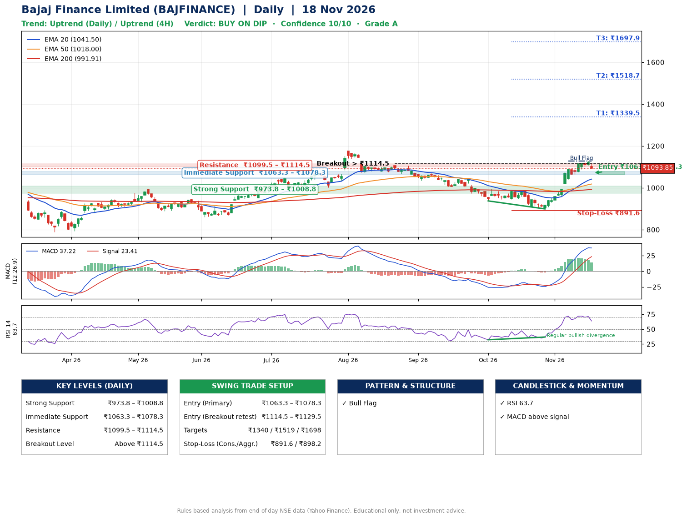

📌 **Bajaj Finance Limited (BAJFINANCE) – Multi-Timeframe Technical Analysis (Daily + 4H Combined)**
_Data up to 18 Nov 2026 · Close ₹1093.85_

**📍 Daily Timeframe Trend**
- Trend: **Uptrend** (price above rising EMAs)
- Recent swing highs: ₹1107.0, ₹1043.2, ₹986.5 · swing lows: ₹1034.8, ₹937.3, ₹899.2
- EMAs: EMA20 ₹1041.5, EMA50 ₹1018.0, EMA200 ₹991.9; bullish stack (EMA20 > EMA50 > EMA200); price above EMA20, EMA50, EMA200
- MACD 37.22 above signal 23.41 (above zero); histogram falling
- RSI(14) 63.7; Regular bullish divergence

**📍 4-Hour Timeframe Trend**
- Structure: **Uptrend** (price above rising EMAs)
- Pullback/support area: recent 4H swing lows ₹906.5, ₹900.0; EMA20 ₹1074.6
- EMA20/50: bullish stack (EMA20 > EMA50); price above EMA20, EMA50
- MACD 33.22 below signal 36.33 (above zero), fresh bearish crossover; histogram falling
- RSI(14) 61.3; Regular bullish divergence; Regular bearish divergence

**📍 Pattern Detection (Both Timeframes)**
- Daily: **Bull Flag** – 15% pole then a tight 8% flag; trigger above ₹1126.9
- 4H: **Bull Flag** – 15% pole then a tight 3% flag; trigger above ₹1126.8

**📍 Candlestick Patterns (last 3 daily candles)**
- No notable candlestick signal in the last 3 sessions.

**📍 Price Action Key Levels (Daily Structure)**

| Zone | Price Level (₹) | Context |
|------|-----------------|---------|
| Strong Support | ₹973.8 – ₹1008.8 | Cluster of earlier swing lows (demand) |
| Immediate Support | ₹1063.3 – ₹1078.3 | Nearest swing-low / wick area |
| Resistance | ₹1099.5 – ₹1114.5 | Nearest swing-high supply |
| Breakout Level | Above ₹1114.5 | Swing continuation trigger (52-week high ₹1176.4) |

**📍 Swing Trade Setup**

🟢 **Entry Zone**
- Primary: ₹1063.3 – ₹1078.3 (daily support / EMA20 area; enter on a bullish 4H candle)
- Alternate: ₹1114.5 – ₹1129.5 (breakout retest)

🎯 **Profit Targets**
- T1: ₹1339.5
- T2: ₹1518.7
- T3: ₹1697.9

🛑 **Stop-Loss**
- Conservative: below daily swing low (₹891.6)
- Aggressive: below 4H structure (₹898.2)
- Risk per share ≈ ₹179.2; reward:risk to T1 ≈ 1.5
- Time to T1: about 46 trading days (it rose this much within 60 trading days 19% of the time in the last 2 years)
- Time to T2: it never rose this much within 60 trading days in the price history

**📌 Strategy Notes**
- Higher timeframe: daily trend is uptrend; only take longs while price holds above ₹973.8.
- Entry timing: wait for a bullish 4H candle (engulfing/hammer) inside ₹1063.3 – ₹1078.3 rather than buying mid-range.
- EMA stacking: bullish stack (EMA20 > EMA50 > EMA200); price above EMA20, EMA50, EMA200.
- Breakout rule: a daily close above ₹1114.5 with volume above its 20-day average (≈10,076,859) opens T2/T3.
- Momentum: RSI 64 – room to run; Regular bullish divergence.
- Exit discipline: move the stop to entry once T1 is hit; book partial profits at each target.

**STEP 2 — Marked Up Chart**

**✅ Trade Validation Checklist**
- Trend + momentum aligned: Yes · Price at entry zone: No
- Stop defined (₹891.6) · Reward:risk ≥ 1.5 to T1: No

## 📌 Final Verdict

Recommendation: **🟡 BUY ON DIP**

Confidence: **10/10**

Trade Quality: **A**

Reason:
• Daily uptrend (price above rising EMAs)
• EMAs stacked bullishly

Next Action:
• Wait for a pullback to ₹1063.3–₹1078.3, or a breakout above ₹1114.5

_Rules-based analysis from end-of-day data. Educational only, not investment advice. Never place orders without your own confirmation._