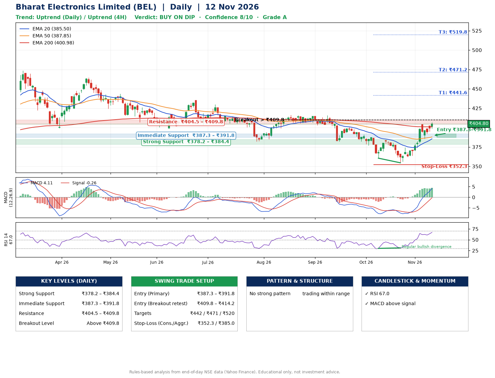

📌 **Bharat Electronics Limited (BEL) – Multi-Timeframe Technical Analysis (Daily + 4H Combined)**
_Data up to 12 Nov 2026 · Close ₹404.80_

**📍 Daily Timeframe Trend**
- Trend: **Uptrend** (price above rising EMAs)
- Recent swing highs: ₹429.9, ₹416.4, ₹416.0 · swing lows: ₹382.1, ₹360.5, ₹354.5
- EMAs: EMA20 ₹385.5, EMA50 ₹387.9, EMA200 ₹401.0; bearish stack (EMA20 < EMA50 < EMA200); price above EMA20, EMA50, EMA200
- MACD 4.11 above signal -0.26 (above zero); histogram rising
- RSI(14) 67.0; Regular bullish divergence

**📍 4-Hour Timeframe Trend**
- Structure: **Uptrend** (higher highs and higher lows)
- Pullback/support area: recent 4H swing lows ₹354.6, ₹385.5; EMA20 ₹390.2
- EMA20/50: bullish stack (EMA20 > EMA50); price above EMA20, EMA50
- MACD 7.57 above signal 5.94 (above zero); histogram falling
- RSI(14) 71.8; no divergence

**📍 Pattern Detection (Both Timeframes)**
- No strong pattern detected. Trading within range.

**📍 Candlestick Patterns (last 3 daily candles)**
- No notable candlestick signal in the last 3 sessions.

**📍 Price Action Key Levels (Daily Structure)**

| Zone | Price Level (₹) | Context |
|------|-----------------|---------|
| Strong Support | ₹378.2 – ₹384.4 | Cluster of earlier swing lows (demand) |
| Immediate Support | ₹387.3 – ₹391.8 | Nearest swing-low / wick area |
| Resistance | ₹404.5 – ₹409.8 | Nearest swing-high supply |
| Breakout Level | Above ₹409.8 | Swing continuation trigger (52-week high ₹473.5) |

**📍 Swing Trade Setup**

🟢 **Entry Zone**
- Primary: ₹387.3 – ₹391.8 (daily support / EMA20 area; enter on a bullish 4H candle)
- Alternate: ₹409.8 – ₹414.2 (breakout retest)

🎯 **Profit Targets**
- T1: ₹441.6
- T2: ₹471.2
- T3: ₹519.8

🛑 **Stop-Loss**
- Conservative: below daily swing low (₹352.3)
- Aggressive: below 4H structure (₹385.0)
- Risk per share ≈ ₹37.2; reward:risk to T1 ≈ 1.4
- Time to T1: about 26 trading days (it rose this much within 60 trading days 33% of the time in the last 2 years)
- Time to T2: about 31 trading days (it rose this much within 60 trading days 17% of the time in the last 2 years)

**📌 Strategy Notes**
- Higher timeframe: daily trend is uptrend; only take longs while price holds above ₹378.2.
- Entry timing: wait for a bullish 4H candle (engulfing/hammer) inside ₹387.3 – ₹391.8 rather than buying mid-range.
- EMA stacking: bearish stack (EMA20 < EMA50 < EMA200); price above EMA20, EMA50, EMA200.
- Breakout rule: a daily close above ₹409.8 with volume above its 20-day average (≈11,041,236) opens T2/T3.
- Momentum: RSI 67 – elevated, prefer dips; Regular bullish divergence.
- Exit discipline: move the stop to entry once T1 is hit; book partial profits at each target.

**STEP 2 — Marked Up Chart**

**✅ Trade Validation Checklist**
- Trend + momentum aligned: Yes · Price at entry zone: No
- Stop defined (₹352.3) · Reward:risk ≥ 1.5 to T1: No

## 📌 Final Verdict

Recommendation: **🟡 BUY ON DIP**

Confidence: **8/10**

Trade Quality: **A**

Reason:
• Daily uptrend (price above rising EMAs)

Next Action:
• Wait for a pullback to ₹387.3–₹391.8

_Rules-based analysis from end-of-day data. Educational only, not investment advice. Never place orders without your own confirmation._