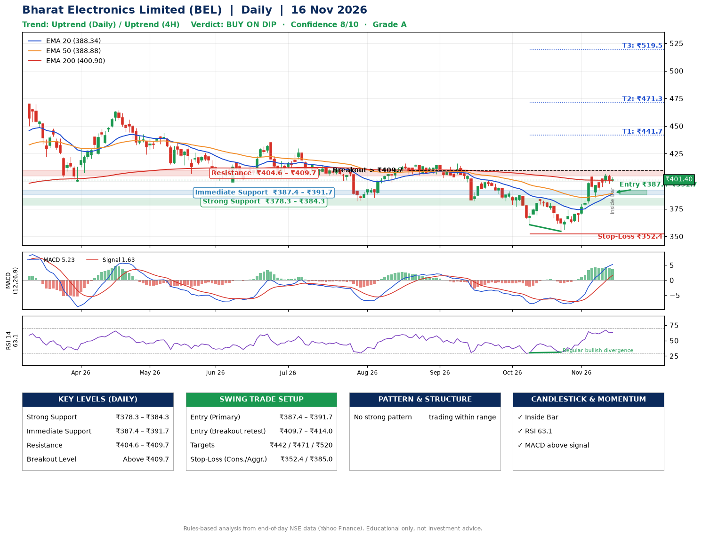

📌 **Bharat Electronics Limited (BEL) – Multi-Timeframe Technical Analysis (Daily + 4H Combined)**
_Data up to 16 Nov 2026 · Close ₹401.40_

**📍 Daily Timeframe Trend**
- Trend: **Uptrend** (price above rising EMAs)
- Recent swing highs: ₹429.9, ₹416.4, ₹416.0 · swing lows: ₹382.1, ₹360.5, ₹354.5
- EMAs: EMA20 ₹388.3, EMA50 ₹388.9, EMA200 ₹400.9; bearish stack (EMA20 < EMA50 < EMA200); price above EMA20, EMA50, EMA200
- MACD 5.23 above signal 1.63 (above zero); histogram falling
- RSI(14) 63.1; Regular bullish divergence

**📍 4-Hour Timeframe Trend**
- Structure: **Uptrend** (higher highs and higher lows)
- Pullback/support area: recent 4H swing lows ₹354.6, ₹385.5; EMA20 ₹394.5
- EMA20/50: bullish stack (EMA20 > EMA50); price above EMA20, EMA50
- MACD 5.93 below signal 6.40 (above zero), fresh bearish crossover; histogram falling
- RSI(14) 60.7; Regular bearish divergence

**📍 Pattern Detection (Both Timeframes)**
- No strong pattern detected. Trading within range.

**📍 Candlestick Patterns (last 3 daily candles)**
- **Inside Bar** – 16 Nov: compression inside the prior range ₹397.6–₹406.0

**📍 Price Action Key Levels (Daily Structure)**

| Zone | Price Level (₹) | Context |
|------|-----------------|---------|
| Strong Support | ₹378.3 – ₹384.3 | Cluster of earlier swing lows (demand) |
| Immediate Support | ₹387.4 – ₹391.7 | Nearest swing-low / wick area |
| Resistance | ₹404.6 – ₹409.7 | Nearest swing-high supply |
| Breakout Level | Above ₹409.7 | Swing continuation trigger (52-week high ₹473.5) |

**📍 Swing Trade Setup**

🟢 **Entry Zone**
- Primary: ₹387.4 – ₹391.7 (daily support / EMA20 area; enter on a bullish 4H candle)
- Alternate: ₹409.7 – ₹414.0 (breakout retest)

🎯 **Profit Targets**
- T1: ₹441.7
- T2: ₹471.3
- T3: ₹519.5

🛑 **Stop-Loss**
- Conservative: below daily swing low (₹352.4)
- Aggressive: below 4H structure (₹385.0)
- Risk per share ≈ ₹37.1; reward:risk to T1 ≈ 1.4
- Time to T1: about 26 trading days (it rose this much within 60 trading days 31% of the time in the last 2 years)
- Time to T2: about 31 trading days (it rose this much within 60 trading days 17% of the time in the last 2 years)

**📌 Strategy Notes**
- Higher timeframe: daily trend is uptrend; only take longs while price holds above ₹378.3.
- Entry timing: wait for a bullish 4H candle (engulfing/hammer) inside ₹387.4 – ₹391.7 rather than buying mid-range.
- EMA stacking: bearish stack (EMA20 < EMA50 < EMA200); price above EMA20, EMA50, EMA200.
- Breakout rule: a daily close above ₹409.7 with volume above its 20-day average (≈10,822,081) opens T2/T3.
- Momentum: RSI 63 – room to run; Regular bullish divergence.
- Exit discipline: move the stop to entry once T1 is hit; book partial profits at each target.

**STEP 2 — Marked Up Chart**

**✅ Trade Validation Checklist**
- Trend + momentum aligned: Yes · Price at entry zone: No
- Stop defined (₹352.4) · Reward:risk ≥ 1.5 to T1: No

## 📌 Final Verdict

Recommendation: **🟡 BUY ON DIP**

Confidence: **8/10**

Trade Quality: **A**

Reason:
• Daily uptrend (price above rising EMAs)

Next Action:
• Wait for a pullback to ₹387.4–₹391.7, or a breakout above ₹409.7

_Rules-based analysis from end-of-day data. Educational only, not investment advice. Never place orders without your own confirmation._