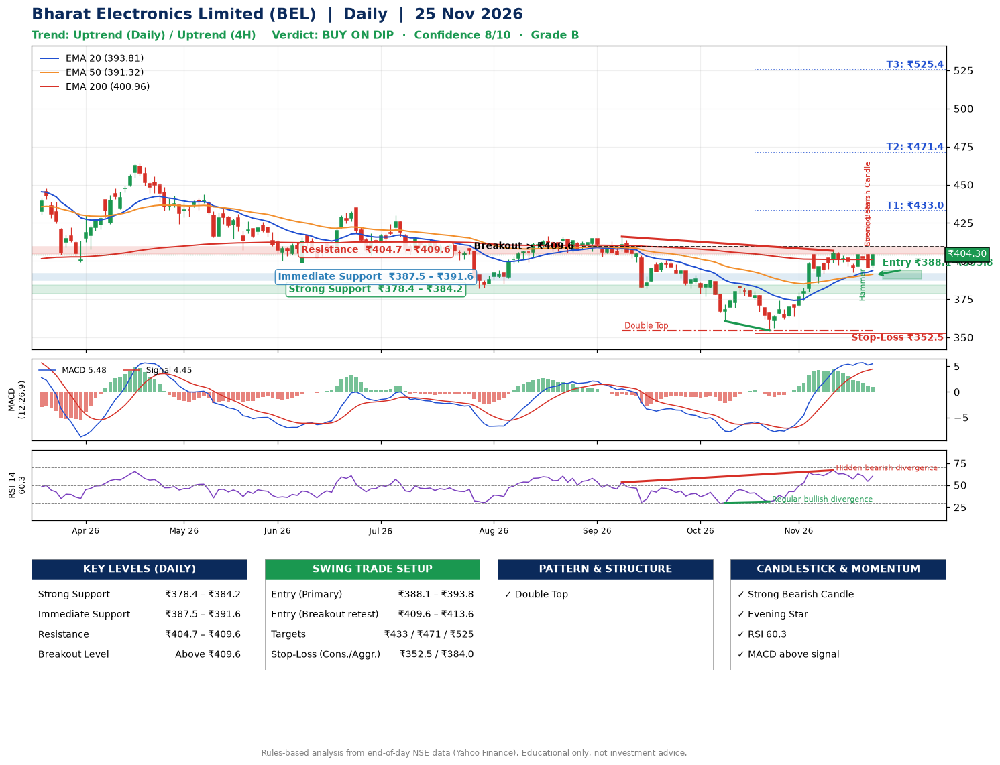

📌 **Bharat Electronics Limited (BEL) – Multi-Timeframe Technical Analysis (Daily + 4H Combined)**
_Data up to 25 Nov 2026 · Close ₹404.30_

**📍 Daily Timeframe Trend**
- Trend: **Uptrend** (price above rising EMAs)
- Recent swing highs: ₹416.4, ₹416.0, ₹406.7 · swing lows: ₹382.1, ₹360.5, ₹354.5
- EMAs: EMA20 ₹393.8, EMA50 ₹391.3, EMA200 ₹401.0; mixed / crossing; price above EMA20, EMA50, EMA200
- MACD 5.48 above signal 4.45 (above zero); histogram falling
- RSI(14) 60.3; Regular bullish divergence; Hidden bearish divergence

**📍 4-Hour Timeframe Trend**
- Structure: **Uptrend** (higher highs and higher lows)
- Pullback/support area: recent 4H swing lows ₹385.5, ₹392.7; EMA20 ₹398.0
- EMA20/50: bullish stack (EMA20 > EMA50); price above EMA20, EMA50
- MACD 3.54 below signal 4.17 (above zero); histogram rising
- RSI(14) 60.3; Hidden bullish divergence; Regular bearish divergence

**📍 Pattern Detection (Both Timeframes)**
- Daily: **Double Top** – tops near ₹416.0/₹406.7, neckline ₹354.5, forming
- 4H: **Double Bottom** – bottoms near ₹385.5/₹392.7, neckline ₹406.5, forming

**📍 Candlestick Patterns (last 3 daily candles)**
- **Hammer** – 20 Nov: long lower wick shows dip-buying near ₹400.0
- **Strong Bearish Candle** – 23 Nov: wide-range red candle, sellers in control
- **Evening Star** – 23 Nov: three-candle bearish reversal

**📍 Price Action Key Levels (Daily Structure)**

| Zone | Price Level (₹) | Context |
|------|-----------------|---------|
| Strong Support | ₹378.4 – ₹384.2 | Cluster of earlier swing lows (demand) |
| Immediate Support | ₹387.5 – ₹391.6 | Nearest swing-low / wick area |
| Resistance | ₹404.7 – ₹409.6 | Nearest swing-high supply |
| Breakout Level | Above ₹409.6 | Swing continuation trigger (52-week high ₹473.5) |

**📍 Swing Trade Setup**

🟢 **Entry Zone**
- Primary: ₹388.1 – ₹393.8 (daily support / EMA20 area; enter on a bullish 4H candle)
- Alternate: ₹409.6 – ₹413.6 (breakout retest)

🎯 **Profit Targets**
- T1: ₹433.0
- T2: ₹471.4
- T3: ₹525.4

🛑 **Stop-Loss**
- Conservative: below daily swing low (₹352.5)
- Aggressive: below 4H structure (₹384.0)
- Risk per share ≈ ₹38.4; reward:risk to T1 ≈ 1.1
- Time to T1: about 20 trading days (it rose this much within 60 trading days 41% of the time in the last 2 years)
- Time to T2: about 31 trading days (it rose this much within 60 trading days 17% of the time in the last 2 years)

**📌 Strategy Notes**
- Higher timeframe: daily trend is uptrend; only take longs while price holds above ₹378.4.
- Entry timing: wait for a bullish 4H candle (engulfing/hammer) inside ₹388.1 – ₹393.8 rather than buying mid-range.
- EMA stacking: mixed / crossing; price above EMA20, EMA50, EMA200.
- Breakout rule: a daily close above ₹409.6 with volume above its 20-day average (≈10,512,097) opens T2/T3.
- Momentum: RSI 60 – room to run; Regular bullish divergence; Hidden bearish divergence.
- Exit discipline: move the stop to entry once T1 is hit; book partial profits at each target.

**STEP 2 — Marked Up Chart**

**✅ Trade Validation Checklist**
- Trend + momentum aligned: Yes · Price at entry zone: No
- Stop defined (₹352.5) · Reward:risk ≥ 1.5 to T1: No

## 📌 Final Verdict

Recommendation: **🟡 BUY ON DIP**

Confidence: **8/10**

Trade Quality: **B**

Reason:
• Daily uptrend (price above rising EMAs)
• Double Top: tops near ₹416.0/₹406.7, neckline ₹354.5, forming

Next Action:
• Wait for a pullback to ₹388.1–₹393.8, or a breakout above ₹409.6

_Rules-based analysis from end-of-day data. Educational only, not investment advice. Never place orders without your own confirmation._