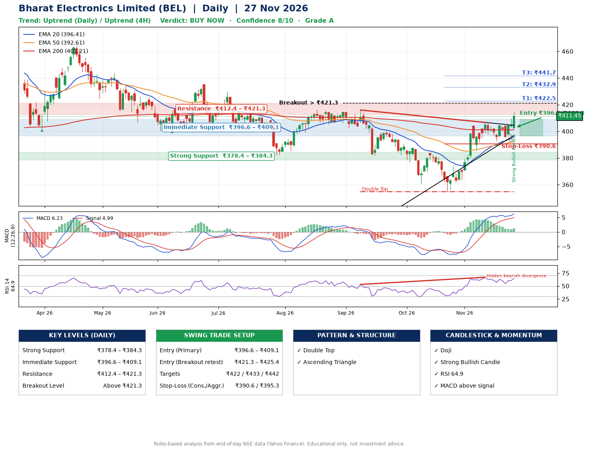

📌 **Bharat Electronics Limited (BEL) – Multi-Timeframe Technical Analysis (Daily + 4H Combined)**
_Data up to 27 Nov 2026 · Close ₹411.45_

**📍 Daily Timeframe Trend**
- Trend: **Uptrend** (price above rising EMAs)
- Recent swing highs: ₹416.4, ₹416.0, ₹406.7 · swing lows: ₹360.5, ₹354.5, ₹392.6
- EMAs: EMA20 ₹396.4, EMA50 ₹392.6, EMA200 ₹401.2; mixed / crossing; price above EMA20, EMA50, EMA200
- MACD 6.23 above signal 4.99 (above zero); histogram rising
- RSI(14) 64.9; Hidden bearish divergence

**📍 4-Hour Timeframe Trend**
- Structure: **Uptrend** (price above rising EMAs)
- Pullback/support area: recent 4H swing lows ₹395.8, ₹395.8; EMA20 ₹401.4
- EMA20/50: bullish stack (EMA20 > EMA50); price above EMA20, EMA50
- MACD 4.64 above signal 4.16 (above zero), fresh bullish crossover; histogram rising
- RSI(14) 66.5; Regular bearish divergence

**📍 Pattern Detection (Both Timeframes)**
- Daily: **Double Top** – tops near ₹416.0/₹406.7, neckline ₹354.5, forming
- Daily: **Ascending Triangle** – converging swing highs and lows over the last ~60 sessions

**📍 Candlestick Patterns (last 3 daily candles)**
- **Doji** – 26 Nov: indecision; wait for the next candle to confirm direction
- **Strong Bullish Candle** – 27 Nov: wide-range green candle, buyers in control

**📍 Price Action Key Levels (Daily Structure)**

| Zone | Price Level (₹) | Context |
|------|-----------------|---------|
| Strong Support | ₹378.4 – ₹384.3 | Cluster of earlier swing lows (demand) |
| Immediate Support | ₹396.6 – ₹409.1 | Nearest swing-low / wick area |
| Resistance | ₹412.4 – ₹421.3 | Nearest swing-high supply |
| Breakout Level | Above ₹421.3 | Swing continuation trigger (52-week high ₹473.5) |

**📍 Swing Trade Setup**

🟢 **Entry Zone**
- Primary: ₹396.6 – ₹409.1 (daily support / EMA20 area; enter on a bullish 4H candle)
- Alternate: ₹421.3 – ₹425.4 (breakout retest)

🎯 **Profit Targets**
- T1: ₹422.5
- T2: ₹432.9
- T3: ₹441.7

🛑 **Stop-Loss**
- Conservative: below daily swing low (₹390.6)
- Aggressive: below 4H structure (₹395.3)
- Risk per share ≈ ₹12.3; reward:risk to T1 ≈ 1.6
- Time to T1: about 10 trading days (it rose this much within 60 trading days 69% of the time in the last 2 years)
- Time to T2: about 13 trading days (it rose this much within 60 trading days 54% of the time in the last 2 years)

**📌 Strategy Notes**
- Higher timeframe: daily trend is uptrend; only take longs while price holds above ₹378.4.
- Entry timing: wait for a bullish 4H candle (engulfing/hammer) inside ₹396.6 – ₹409.1 rather than buying mid-range.
- EMA stacking: mixed / crossing; price above EMA20, EMA50, EMA200.
- Breakout rule: a daily close above ₹421.3 with volume above its 20-day average (≈10,678,439) opens T2/T3.
- Momentum: RSI 65 – room to run; Hidden bearish divergence.
- Exit discipline: move the stop to entry once T1 is hit; book partial profits at each target.

**STEP 2 — Marked Up Chart**

**✅ Trade Validation Checklist**
- Trend + momentum aligned: Yes · Price at entry zone: No
- Stop defined (₹390.6) · Reward:risk ≥ 1.5 to T1: Yes

## 📌 Final Verdict

Recommendation: **🟢 BUY NOW**

Confidence: **8/10**

Trade Quality: **A**

Reason:
• Daily uptrend (price above rising EMAs)
• Double Top: tops near ₹416.0/₹406.7, neckline ₹354.5, forming

Next Action:
• Buy now within the entry zone, with the stop-loss in place

_Rules-based analysis from end-of-day data. Educational only, not investment advice. Never place orders without your own confirmation._