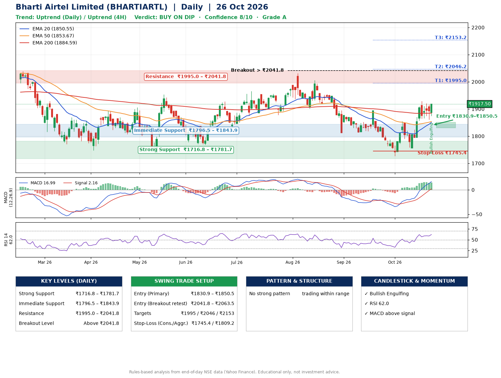

📌 **Bharti Airtel Limited (BHARTIARTL) – Multi-Timeframe Technical Analysis (Daily + 4H Combined)**
_Data up to 26 Oct 2026 · Close ₹1917.50_

**📍 Daily Timeframe Trend**
- Trend: **Uptrend** (price above rising EMAs)
- Recent swing highs: ₹2005.8, ₹1893.3, ₹1854.7 · swing lows: ₹1813.0, ₹1726.3, ₹1756.2
- EMAs: EMA20 ₹1850.5, EMA50 ₹1853.7, EMA200 ₹1884.6; bearish stack (EMA20 < EMA50 < EMA200); price above EMA20, EMA50, EMA200
- MACD 16.99 above signal 2.16 (above zero); histogram rising
- RSI(14) 62.0; no divergence on the last two swings

**📍 4-Hour Timeframe Trend**
- Structure: **Uptrend** (price above rising EMAs)
- Pullback/support area: recent 4H swing lows ₹1758.6, ₹1861.1; EMA20 ₹1868.3
- EMA20/50: bullish stack (EMA20 > EMA50); price above EMA20, EMA50
- MACD 25.05 above signal 21.75 (above zero); histogram rising
- RSI(14) 63.8; Hidden bearish divergence

**📍 Pattern Detection (Both Timeframes)**
- No strong pattern detected. Trading within range.

**📍 Candlestick Patterns (last 3 daily candles)**
- **Bullish Engulfing** – 26 Oct: buyers fully reversed the prior red candle

**📍 Price Action Key Levels (Daily Structure)**

| Zone | Price Level (₹) | Context |
|------|-----------------|---------|
| Strong Support | ₹1716.8 – ₹1781.7 | Cluster of earlier swing lows (demand) |
| Immediate Support | ₹1796.5 – ₹1843.9 | Nearest swing-low / wick area |
| Resistance | ₹1995.0 – ₹2041.8 | Nearest swing-high supply |
| Breakout Level | Above ₹2041.8 | Swing continuation trigger (52-week high ₹2174.5) |

**📍 Swing Trade Setup**

🟢 **Entry Zone**
- Primary: ₹1830.9 – ₹1850.5 (daily support / EMA20 area; enter on a bullish 4H candle)
- Alternate: ₹2041.8 – ₹2063.5 (breakout retest)

🎯 **Profit Targets**
- T1: ₹1995.0
- T2: ₹2046.2
- T3: ₹2153.2

🛑 **Stop-Loss**
- Conservative: below daily swing low (₹1745.4)
- Aggressive: below 4H structure (₹1809.2)
- Risk per share ≈ ₹95.3; reward:risk to T1 ≈ 1.6

**📌 Strategy Notes**
- Higher timeframe: daily trend is uptrend; only take longs while price holds above ₹1716.8.
- Entry timing: wait for a bullish 4H candle (engulfing/hammer) inside ₹1830.9 – ₹1850.5 rather than buying mid-range.
- EMA stacking: bearish stack (EMA20 < EMA50 < EMA200); price above EMA20, EMA50, EMA200.
- Breakout rule: a daily close above ₹2041.8 with volume above its 20-day average (≈8,255,100) opens T2/T3.
- Momentum: RSI 62 – room to run; no divergence on the last two swings.
- Exit discipline: move the stop to entry once T1 is hit; book partial profits at each target.

**STEP 2 — Marked Up Chart**

**✅ Trade Validation Checklist**
- Trend + momentum aligned: Yes · Price at entry zone: No
- Stop defined (₹1745.4) · Reward:risk ≥ 1.5 to T1: Yes

## 📌 Final Verdict

Recommendation: **🟡 BUY ON DIP**

Confidence: **8/10**

Trade Quality: **A**

Reason:
• Daily uptrend (price above rising EMAs)

Next Action:
• Wait for a pullback to ₹1830.9–₹1850.5

_Rules-based analysis from end-of-day data. Educational only, not investment advice. Never place orders without your own confirmation._