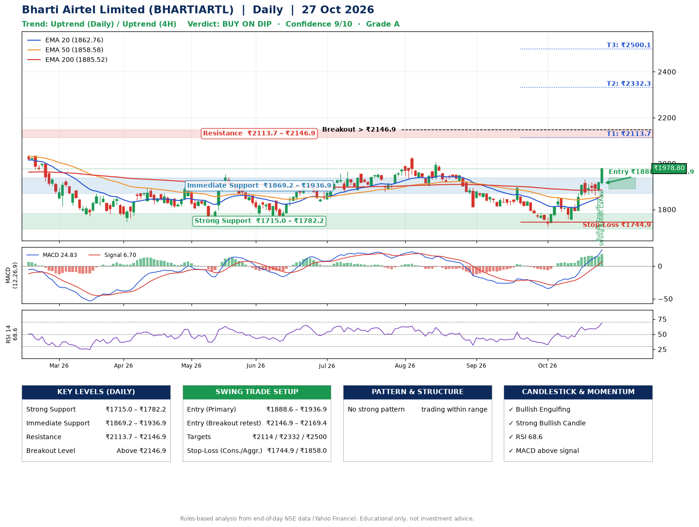

📌 **Bharti Airtel Limited (BHARTIARTL) – Multi-Timeframe Technical Analysis (Daily + 4H Combined)**
_Data up to 27 Oct 2026 · Close ₹1978.80_

**📍 Daily Timeframe Trend**
- Trend: **Uptrend** (price above rising EMAs)
- Recent swing highs: ₹2005.8, ₹1893.3, ₹1854.7 · swing lows: ₹1813.0, ₹1726.3, ₹1756.2
- EMAs: EMA20 ₹1862.8, EMA50 ₹1858.6, EMA200 ₹1885.5; mixed / crossing; price above EMA20, EMA50, EMA200
- MACD 24.83 above signal 6.70 (above zero); histogram rising
- RSI(14) 68.6; no divergence on the last two swings

**📍 4-Hour Timeframe Trend**
- Structure: **Uptrend** (price above rising EMAs)
- Pullback/support area: recent 4H swing lows ₹1758.6, ₹1861.1; EMA20 ₹1887.3
- EMA20/50: bullish stack (EMA20 > EMA50); price above EMA20, EMA50
- MACD 34.01 above signal 25.47 (above zero); histogram rising
- RSI(14) 71.9; Hidden bearish divergence

**📍 Pattern Detection (Both Timeframes)**
- No strong pattern detected. Trading within range.

**📍 Candlestick Patterns (last 3 daily candles)**
- **Bullish Engulfing** – 26 Oct: buyers fully reversed the prior red candle
- **Strong Bullish Candle** – 27 Oct: wide-range green candle, buyers in control

**📍 Price Action Key Levels (Daily Structure)**

| Zone | Price Level (₹) | Context |
|------|-----------------|---------|
| Strong Support | ₹1715.0 – ₹1782.2 | Cluster of earlier swing lows (demand) |
| Immediate Support | ₹1869.2 – ₹1936.9 | Nearest swing-low / wick area |
| Resistance | ₹2113.7 – ₹2146.9 | Nearest swing-high supply |
| Breakout Level | Above ₹2146.9 | Swing continuation trigger (52-week high ₹2174.5) |

**📍 Swing Trade Setup**

🟢 **Entry Zone**
- Primary: ₹1888.6 – ₹1936.9 (daily support / EMA20 area; enter on a bullish 4H candle)
- Alternate: ₹2146.9 – ₹2169.4 (breakout retest)

🎯 **Profit Targets**
- T1: ₹2113.7
- T2: ₹2332.3
- T3: ₹2500.1

🛑 **Stop-Loss**
- Conservative: below daily swing low (₹1744.9)
- Aggressive: below 4H structure (₹1858.0)
- Risk per share ≈ ₹167.8; reward:risk to T1 ≈ 1.2

**📌 Strategy Notes**
- Higher timeframe: daily trend is uptrend; only take longs while price holds above ₹1715.0.
- Entry timing: wait for a bullish 4H candle (engulfing/hammer) inside ₹1888.6 – ₹1936.9 rather than buying mid-range.
- EMA stacking: mixed / crossing; price above EMA20, EMA50, EMA200.
- Breakout rule: a daily close above ₹2146.9 with volume above its 20-day average (≈8,669,457) opens T2/T3.
- Momentum: RSI 69 – elevated, prefer dips; no divergence on the last two swings.
- Exit discipline: move the stop to entry once T1 is hit; book partial profits at each target.

**STEP 2 — Marked Up Chart**

**✅ Trade Validation Checklist**
- Trend + momentum aligned: Yes · Price at entry zone: No
- Stop defined (₹1744.9) · Reward:risk ≥ 1.5 to T1: No

## 📌 Final Verdict

Recommendation: **🟡 BUY ON DIP**

Confidence: **9/10**

Trade Quality: **A**

Reason:
• Daily uptrend (price above rising EMAs)

Next Action:
• Wait for a pullback to ₹1888.6–₹1936.9, or a breakout above ₹2146.9

_Rules-based analysis from end-of-day data. Educational only, not investment advice. Never place orders without your own confirmation._