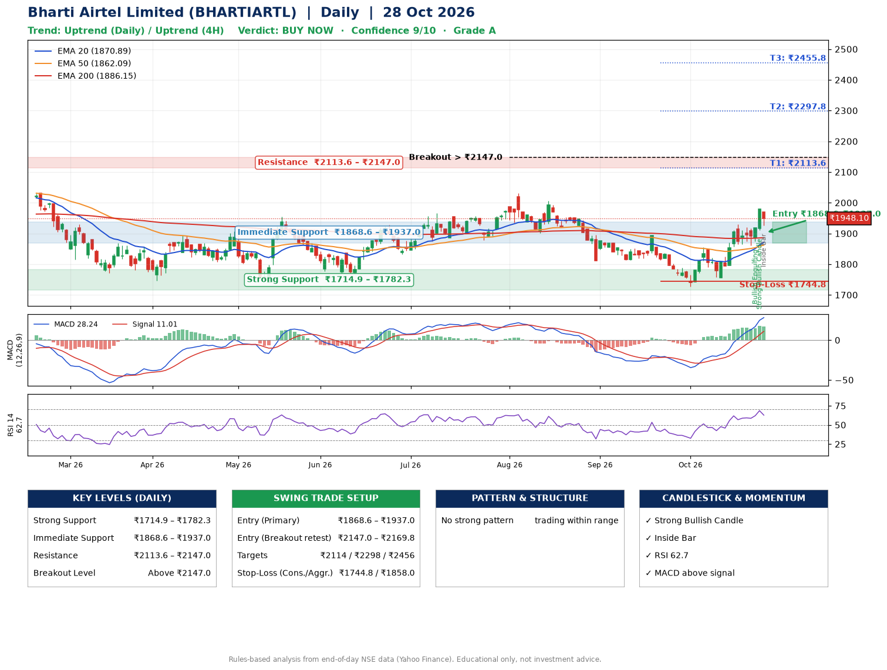

📌 **Bharti Airtel Limited (BHARTIARTL) – Multi-Timeframe Technical Analysis (Daily + 4H Combined)**
_Data up to 28 Oct 2026 · Close ₹1948.10_

**📍 Daily Timeframe Trend**
- Trend: **Uptrend** (price above rising EMAs)
- Recent swing highs: ₹2005.8, ₹1893.3, ₹1854.7 · swing lows: ₹1813.0, ₹1726.3, ₹1756.2
- EMAs: EMA20 ₹1870.9, EMA50 ₹1862.1, EMA200 ₹1886.1; mixed / crossing; price above EMA20, EMA50, EMA200
- MACD 28.24 above signal 11.01 (above zero); histogram falling
- RSI(14) 62.7; no divergence on the last two swings

**📍 4-Hour Timeframe Trend**
- Structure: **Uptrend** (price above rising EMAs)
- Pullback/support area: recent 4H swing lows ₹1758.6, ₹1861.1; EMA20 ₹1898.8
- EMA20/50: bullish stack (EMA20 > EMA50); price above EMA20, EMA50
- MACD 34.97 above signal 28.91 (above zero); histogram falling
- RSI(14) 63.6; Hidden bearish divergence

**📍 Pattern Detection (Both Timeframes)**
- No strong pattern detected. Trading within range.

**📍 Candlestick Patterns (last 3 daily candles)**
- **Bullish Engulfing** – 26 Oct: buyers fully reversed the prior red candle
- **Strong Bullish Candle** – 27 Oct: wide-range green candle, buyers in control
- **Inside Bar** – 28 Oct: compression inside the prior range ₹1910.6–₹1978.8

**📍 Price Action Key Levels (Daily Structure)**

| Zone | Price Level (₹) | Context |
|------|-----------------|---------|
| Strong Support | ₹1714.9 – ₹1782.3 | Cluster of earlier swing lows (demand) |
| Immediate Support | ₹1868.6 – ₹1937.0 | Nearest swing-low / wick area |
| Resistance | ₹2113.6 – ₹2147.0 | Nearest swing-high supply |
| Breakout Level | Above ₹2147.0 | Swing continuation trigger (52-week high ₹2174.5) |

**📍 Swing Trade Setup**

🟢 **Entry Zone**
- Primary: ₹1868.6 – ₹1937.0 (daily support / EMA20 area; enter on a bullish 4H candle)
- Alternate: ₹2147.0 – ₹2169.8 (breakout retest)

🎯 **Profit Targets**
- T1: ₹2113.6
- T2: ₹2297.8
- T3: ₹2455.8

🛑 **Stop-Loss**
- Conservative: below daily swing low (₹1744.8)
- Aggressive: below 4H structure (₹1858.0)
- Risk per share ≈ ₹158.0; reward:risk to T1 ≈ 1.3

**📌 Strategy Notes**
- Higher timeframe: daily trend is uptrend; only take longs while price holds above ₹1714.9.
- Entry timing: wait for a bullish 4H candle (engulfing/hammer) inside ₹1868.6 – ₹1937.0 rather than buying mid-range.
- EMA stacking: mixed / crossing; price above EMA20, EMA50, EMA200.
- Breakout rule: a daily close above ₹2147.0 with volume above its 20-day average (≈9,160,412) opens T2/T3.
- Momentum: RSI 63 – room to run; no divergence on the last two swings.
- Exit discipline: move the stop to entry once T1 is hit; book partial profits at each target.

**STEP 2 — Marked Up Chart**

**✅ Trade Validation Checklist**
- Trend + momentum aligned: Yes · Price at entry zone: No
- Stop defined (₹1744.8) · Reward:risk ≥ 1.5 to T1: No

## 📌 Final Verdict

Recommendation: **🟢 BUY NOW**

Confidence: **9/10**

Trade Quality: **A**

Reason:
• Daily uptrend (price above rising EMAs)

Next Action:
• Buy now within the entry zone, with the stop-loss in place

_Rules-based analysis from end-of-day data. Educational only, not investment advice. Never place orders without your own confirmation._