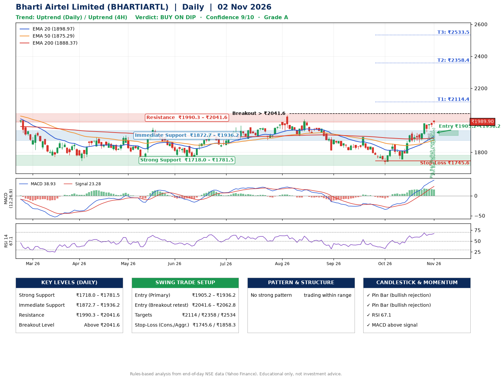

📌 **Bharti Airtel Limited (BHARTIARTL) – Multi-Timeframe Technical Analysis (Daily + 4H Combined)**
_Data up to 02 Nov 2026 · Close ₹1989.90_

**📍 Daily Timeframe Trend**
- Trend: **Uptrend** (price above rising EMAs)
- Recent swing highs: ₹2005.8, ₹1893.3, ₹1854.7 · swing lows: ₹1813.0, ₹1726.3, ₹1756.2
- EMAs: EMA20 ₹1899.0, EMA50 ₹1875.3, EMA200 ₹1888.4; mixed / crossing; price above EMA20, EMA50, EMA200
- MACD 38.93 above signal 23.28 (above zero); histogram falling
- RSI(14) 67.1; no divergence on the last two swings

**📍 4-Hour Timeframe Trend**
- Structure: **Uptrend** (higher highs and higher lows)
- Pullback/support area: recent 4H swing lows ₹1758.6, ₹1861.1; EMA20 ₹1934.1
- EMA20/50: bullish stack (EMA20 > EMA50); price above EMA20, EMA50
- MACD 37.47 above signal 34.76 (above zero); histogram falling
- RSI(14) 69.9; no divergence

**📍 Pattern Detection (Both Timeframes)**
- No strong pattern detected. Trading within range.

**📍 Candlestick Patterns (last 3 daily candles)**
- **Doji** – 29 Oct: indecision; wait for the next candle to confirm direction
- **Pin Bar (bullish rejection)** – 30 Oct: long lower wick shows dip-buying near ₹1958.0
- **Pin Bar (bullish rejection)** – 02 Nov: long lower wick shows dip-buying near ₹1977.9

**📍 Price Action Key Levels (Daily Structure)**

| Zone | Price Level (₹) | Context |
|------|-----------------|---------|
| Strong Support | ₹1718.0 – ₹1781.5 | Cluster of earlier swing lows (demand) |
| Immediate Support | ₹1872.7 – ₹1936.2 | Nearest swing-low / wick area |
| Resistance | ₹1990.3 – ₹2041.6 | Nearest swing-high supply |
| Breakout Level | Above ₹2041.6 | Swing continuation trigger (52-week high ₹2174.5) |

**📍 Swing Trade Setup**

🟢 **Entry Zone**
- Primary: ₹1905.2 – ₹1936.2 (daily support / EMA20 area; enter on a bullish 4H candle)
- Alternate: ₹2041.6 – ₹2062.8 (breakout retest)

🎯 **Profit Targets**
- T1: ₹2114.4
- T2: ₹2358.4
- T3: ₹2533.5

🛑 **Stop-Loss**
- Conservative: below daily swing low (₹1745.6)
- Aggressive: below 4H structure (₹1858.3)
- Risk per share ≈ ₹175.1; reward:risk to T1 ≈ 1.1

**📌 Strategy Notes**
- Higher timeframe: daily trend is uptrend; only take longs while price holds above ₹1718.0.
- Entry timing: wait for a bullish 4H candle (engulfing/hammer) inside ₹1905.2 – ₹1936.2 rather than buying mid-range.
- EMA stacking: mixed / crossing; price above EMA20, EMA50, EMA200.
- Breakout rule: a daily close above ₹2041.6 with volume above its 20-day average (≈9,031,418) opens T2/T3.
- Momentum: RSI 67 – elevated, prefer dips; no divergence on the last two swings.
- Exit discipline: move the stop to entry once T1 is hit; book partial profits at each target.

**STEP 2 — Marked Up Chart**

**✅ Trade Validation Checklist**
- Trend + momentum aligned: Yes · Price at entry zone: No
- Stop defined (₹1745.6) · Reward:risk ≥ 1.5 to T1: No

## 📌 Final Verdict

Recommendation: **🟡 BUY ON DIP**

Confidence: **9/10**

Trade Quality: **A**

Reason:
• Daily uptrend (price above rising EMAs)

Next Action:
• Wait for a pullback to ₹1905.2–₹1936.2, or a breakout above ₹2041.6

_Rules-based analysis from end-of-day data. Educational only, not investment advice. Never place orders without your own confirmation._