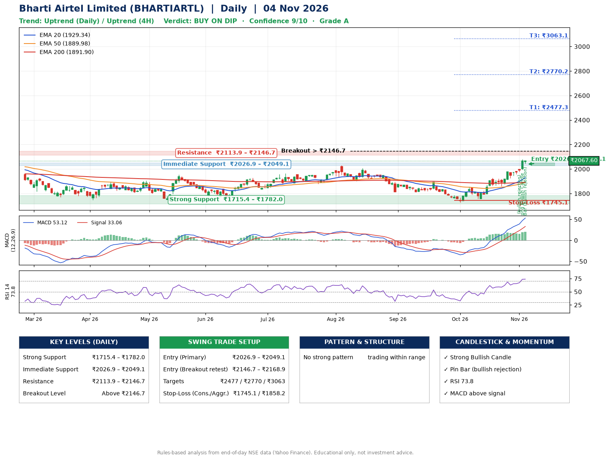

📌 **Bharti Airtel Limited (BHARTIARTL) – Multi-Timeframe Technical Analysis (Daily + 4H Combined)**
_Data up to 04 Nov 2026 · Close ₹2067.60_

**📍 Daily Timeframe Trend**
- Trend: **Uptrend** (price above rising EMAs)
- Recent swing highs: ₹2005.8, ₹1893.3, ₹1854.7 · swing lows: ₹1813.0, ₹1726.3, ₹1756.2
- EMAs: EMA20 ₹1929.3, EMA50 ₹1890.0, EMA200 ₹1891.9; mixed / crossing; price above EMA20, EMA50, EMA200
- MACD 53.12 above signal 33.06 (above zero); histogram rising
- RSI(14) 73.8; no divergence on the last two swings

**📍 4-Hour Timeframe Trend**
- Structure: **Uptrend** (higher highs and higher lows)
- Pullback/support area: recent 4H swing lows ₹1758.6, ₹1861.1; EMA20 ₹1976.9
- EMA20/50: bullish stack (EMA20 > EMA50); price above EMA20, EMA50
- MACD 51.26 above signal 42.92 (above zero); histogram falling
- RSI(14) 76.7; no divergence

**📍 Pattern Detection (Both Timeframes)**
- No strong pattern detected. Trading within range.

**📍 Candlestick Patterns (last 3 daily candles)**
- **Pin Bar (bullish rejection)** – 02 Nov: long lower wick shows dip-buying near ₹1977.9
- **Strong Bullish Candle** – 03 Nov: wide-range green candle, buyers in control
- **Pin Bar (bullish rejection)** – 04 Nov: long lower wick shows dip-buying near ₹2043.0

**📍 Price Action Key Levels (Daily Structure)**

| Zone | Price Level (₹) | Context |
|------|-----------------|---------|
| Strong Support | ₹1715.4 – ₹1782.0 | Cluster of earlier swing lows (demand) |
| Immediate Support | ₹2026.9 – ₹2049.1 | Nearest swing-low / wick area |
| Resistance | ₹2113.9 – ₹2146.7 | Nearest swing-high supply |
| Breakout Level | Above ₹2146.7 | Swing continuation trigger (52-week high ₹2174.5) |

**📍 Swing Trade Setup**

🟢 **Entry Zone**
- Primary: ₹2026.9 – ₹2049.1 (daily support / EMA20 area; enter on a bullish 4H candle)
- Alternate: ₹2146.7 – ₹2168.9 (breakout retest)

🎯 **Profit Targets**
- T1: ₹2477.3
- T2: ₹2770.2
- T3: ₹3063.1

🛑 **Stop-Loss**
- Conservative: below daily swing low (₹1745.1)
- Aggressive: below 4H structure (₹1858.2)
- Risk per share ≈ ₹292.9; reward:risk to T1 ≈ 1.5

**📌 Strategy Notes**
- Higher timeframe: daily trend is uptrend; only take longs while price holds above ₹1715.4.
- Entry timing: wait for a bullish 4H candle (engulfing/hammer) inside ₹2026.9 – ₹2049.1 rather than buying mid-range.
- EMA stacking: mixed / crossing; price above EMA20, EMA50, EMA200.
- Breakout rule: a daily close above ₹2146.7 with volume above its 20-day average (≈9,901,887) opens T2/T3.
- Momentum: RSI 74 – elevated, prefer dips; no divergence on the last two swings.
- Exit discipline: move the stop to entry once T1 is hit; book partial profits at each target.

**STEP 2 — Marked Up Chart**

**✅ Trade Validation Checklist**
- Trend + momentum aligned: Yes · Price at entry zone: No
- Stop defined (₹1745.1) · Reward:risk ≥ 1.5 to T1: No

## 📌 Final Verdict

Recommendation: **🟡 BUY ON DIP**

Confidence: **9/10**

Trade Quality: **A**

Reason:
• Daily uptrend (price above rising EMAs)

Next Action:
• Wait for a pullback to ₹2026.9–₹2049.1, or a breakout above ₹2146.7

_Rules-based analysis from end-of-day data. Educational only, not investment advice. Never place orders without your own confirmation._