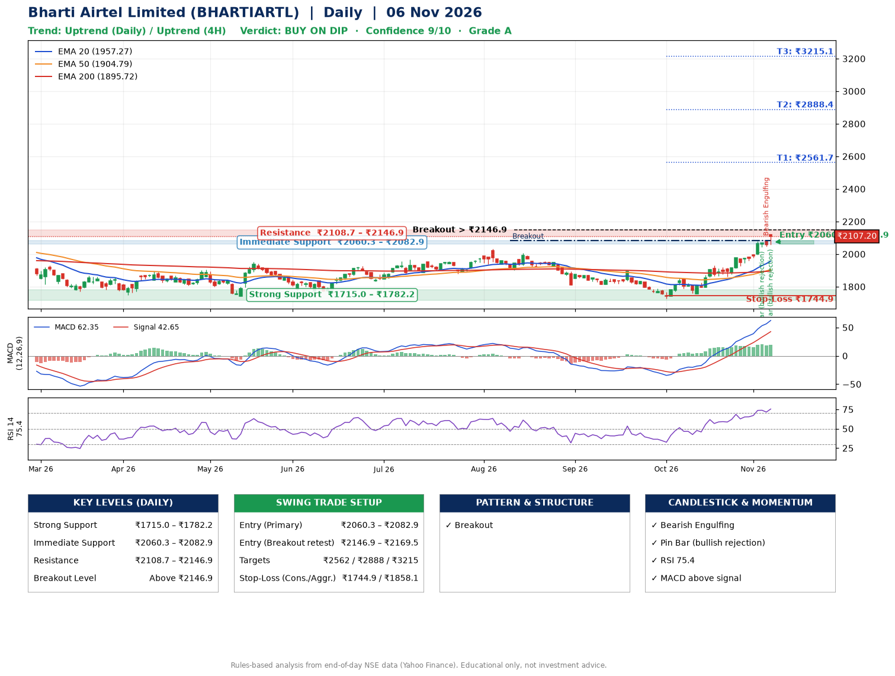

📌 **Bharti Airtel Limited (BHARTIARTL) – Multi-Timeframe Technical Analysis (Daily + 4H Combined)**
_Data up to 06 Nov 2026 · Close ₹2107.20_

**📍 Daily Timeframe Trend**
- Trend: **Uptrend** (price above rising EMAs)
- Recent swing highs: ₹2005.8, ₹1893.3, ₹1854.7 · swing lows: ₹1813.0, ₹1726.3, ₹1756.2
- EMAs: EMA20 ₹1957.3, EMA50 ₹1904.8, EMA200 ₹1895.7; bullish stack (EMA20 > EMA50 > EMA200); price above EMA20, EMA50, EMA200
- MACD 62.35 above signal 42.65 (above zero); histogram rising
- RSI(14) 75.4; no divergence on the last two swings

**📍 4-Hour Timeframe Trend**
- Structure: **Uptrend** (higher highs and higher lows)
- Pullback/support area: recent 4H swing lows ₹1758.6, ₹1861.1; EMA20 ₹2009.8
- EMA20/50: bullish stack (EMA20 > EMA50); price above EMA20, EMA50
- MACD 53.50 above signal 48.21 (above zero); histogram rising
- RSI(14) 78.8; no divergence

**📍 Pattern Detection (Both Timeframes)**
- Daily: **Breakout** – closed above the 60-session high ₹2084.0 on strong volume

**📍 Candlestick Patterns (last 3 daily candles)**
- **Pin Bar (bullish rejection)** – 04 Nov: long lower wick shows dip-buying near ₹2043.0
- **Bearish Engulfing** – 05 Nov: sellers fully reversed the prior green candle
- **Pin Bar (bullish rejection)** – 06 Nov: long lower wick shows dip-buying near ₹2056.2

**📍 Price Action Key Levels (Daily Structure)**

| Zone | Price Level (₹) | Context |
|------|-----------------|---------|
| Strong Support | ₹1715.0 – ₹1782.2 | Cluster of earlier swing lows (demand) |
| Immediate Support | ₹2060.3 – ₹2082.9 | Nearest swing-low / wick area |
| Resistance | ₹2108.7 – ₹2146.9 | Nearest swing-high supply |
| Breakout Level | Above ₹2146.9 | Swing continuation trigger (52-week high ₹2174.5) |

**📍 Swing Trade Setup**

🟢 **Entry Zone**
- Primary: ₹2060.3 – ₹2082.9 (daily support / EMA20 area; enter on a bullish 4H candle)
- Alternate: ₹2146.9 – ₹2169.5 (breakout retest)

🎯 **Profit Targets**
- T1: ₹2561.7
- T2: ₹2888.4
- T3: ₹3215.1

🛑 **Stop-Loss**
- Conservative: below daily swing low (₹1744.9)
- Aggressive: below 4H structure (₹1858.1)
- Risk per share ≈ ₹326.7; reward:risk to T1 ≈ 1.5

**📌 Strategy Notes**
- Higher timeframe: daily trend is uptrend; only take longs while price holds above ₹1715.0.
- Entry timing: wait for a bullish 4H candle (engulfing/hammer) inside ₹2060.3 – ₹2082.9 rather than buying mid-range.
- EMA stacking: bullish stack (EMA20 > EMA50 > EMA200); price above EMA20, EMA50, EMA200.
- Breakout rule: a daily close above ₹2146.9 with volume above its 20-day average (≈10,220,210) opens T2/T3.
- Momentum: RSI 75 – elevated, prefer dips; no divergence on the last two swings.
- Exit discipline: move the stop to entry once T1 is hit; book partial profits at each target.

**STEP 2 — Marked Up Chart**

**✅ Trade Validation Checklist**
- Trend + momentum aligned: Yes · Price at entry zone: No
- Stop defined (₹1744.9) · Reward:risk ≥ 1.5 to T1: Yes

## 📌 Final Verdict

Recommendation: **🟡 BUY ON DIP**

Confidence: **9/10**

Trade Quality: **A**

Reason:
• Daily uptrend (price above rising EMAs)
• EMAs stacked bullishly

Next Action:
• Wait for a pullback to ₹2060.3–₹2082.9, or a breakout above ₹2146.9

_Rules-based analysis from end-of-day data. Educational only, not investment advice. Never place orders without your own confirmation._