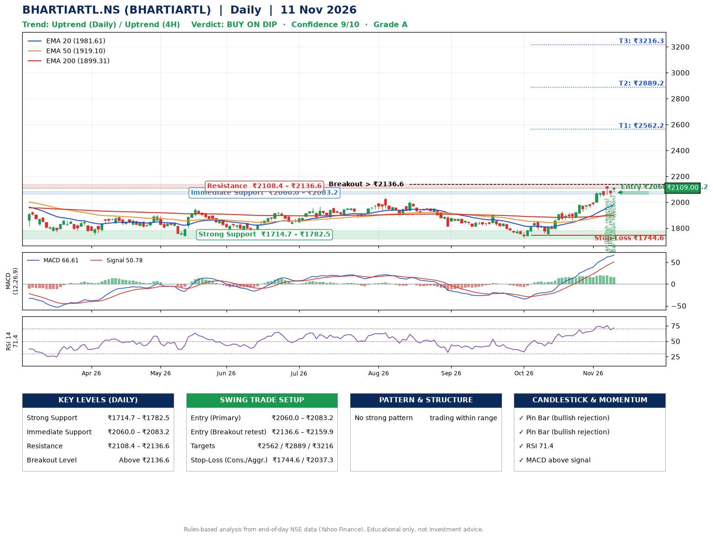

📌 **BHARTIARTL.NS (BHARTIARTL) – Multi-Timeframe Technical Analysis (Daily + 4H Combined)**
_Data up to 11 Nov 2026 · Close ₹2109.00_

**📍 Daily Timeframe Trend**
- Trend: **Uptrend** (price above rising EMAs)
- Recent swing highs: ₹2005.8, ₹1893.3, ₹1854.7 · swing lows: ₹1813.0, ₹1726.3, ₹1756.2
- EMAs: EMA20 ₹1981.6, EMA50 ₹1919.1, EMA200 ₹1899.3; bullish stack (EMA20 > EMA50 > EMA200); price above EMA20, EMA50, EMA200
- MACD 66.61 above signal 50.78 (above zero); histogram falling
- RSI(14) 71.4; no divergence on the last two swings

**📍 4-Hour Timeframe Trend**
- Structure: **Uptrend** (higher highs and higher lows)
- Pullback/support area: recent 4H swing lows ₹1861.1, ₹2040.6; EMA20 ₹2033.5
- EMA20/50: bullish stack (EMA20 > EMA50); price above EMA20, EMA50
- MACD 49.03 above signal 48.49 (above zero), fresh bullish crossover; histogram rising
- RSI(14) 68.8; no divergence

**📍 Pattern Detection (Both Timeframes)**
- No strong pattern detected. Trading within range.

**📍 Candlestick Patterns (last 3 daily candles)**
- **Pin Bar (bullish rejection)** – 06 Nov: long lower wick shows dip-buying near ₹2056.2
- **Pin Bar (bullish rejection)** – 09 Nov: long lower wick shows dip-buying near ₹2040.4
- **Pin Bar (bullish rejection)** – 11 Nov: long lower wick shows dip-buying near ₹2079.2

**📍 Price Action Key Levels (Daily Structure)**

| Zone | Price Level (₹) | Context |
|------|-----------------|---------|
| Strong Support | ₹1714.7 – ₹1782.5 | Cluster of earlier swing lows (demand) |
| Immediate Support | ₹2060.0 – ₹2083.2 | Nearest swing-low / wick area |
| Resistance | ₹2108.4 – ₹2136.6 | Nearest swing-high supply |
| Breakout Level | Above ₹2136.6 | Swing continuation trigger (52-week high ₹2174.5) |

**📍 Swing Trade Setup**

🟢 **Entry Zone**
- Primary: ₹2060.0 – ₹2083.2 (daily support / EMA20 area; enter on a bullish 4H candle)
- Alternate: ₹2136.6 – ₹2159.9 (breakout retest)

🎯 **Profit Targets**
- T1: ₹2562.2
- T2: ₹2889.2
- T3: ₹3216.3

🛑 **Stop-Loss**
- Conservative: below daily swing low (₹1744.6)
- Aggressive: below 4H structure (₹2037.3)
- Risk per share ≈ ₹327.0; reward:risk to T1 ≈ 1.5

**📌 Strategy Notes**
- Higher timeframe: daily trend is uptrend; only take longs while price holds above ₹1714.7.
- Entry timing: wait for a bullish 4H candle (engulfing/hammer) inside ₹2060.0 – ₹2083.2 rather than buying mid-range.
- EMA stacking: bullish stack (EMA20 > EMA50 > EMA200); price above EMA20, EMA50, EMA200.
- Breakout rule: a daily close above ₹2136.6 with volume above its 20-day average (≈10,561,916) opens T2/T3.
- Momentum: RSI 71 – elevated, prefer dips; no divergence on the last two swings.
- Exit discipline: move the stop to entry once T1 is hit; book partial profits at each target.

**STEP 2 — Marked Up Chart**

**✅ Trade Validation Checklist**
- Trend + momentum aligned: Yes · Price at entry zone: No
- Stop defined (₹1744.6) · Reward:risk ≥ 1.5 to T1: Yes

## 📌 Final Verdict

Recommendation: **🟡 BUY ON DIP**

Confidence: **9/10**

Trade Quality: **A**

Reason:
• Daily uptrend (price above rising EMAs)
• EMAs stacked bullishly

Next Action:
• Wait for a pullback to ₹2060.0–₹2083.2, or a breakout above ₹2136.6

_Rules-based analysis from end-of-day data. Educational only, not investment advice. Never place orders without your own confirmation._