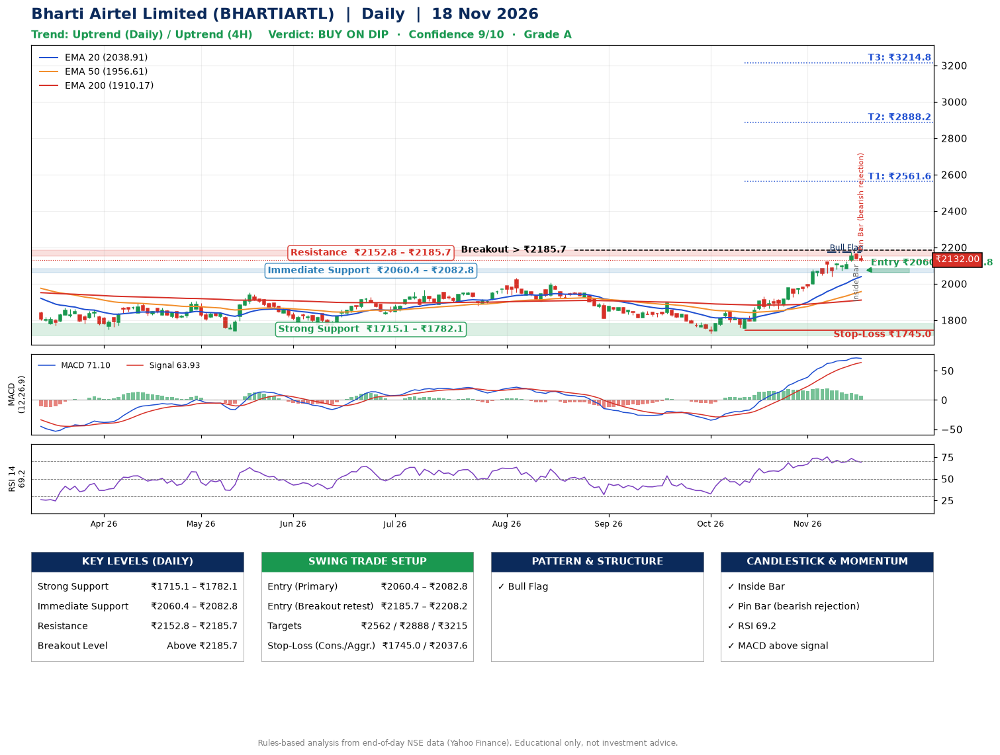

📌 **Bharti Airtel Limited (BHARTIARTL) – Multi-Timeframe Technical Analysis (Daily + 4H Combined)**
_Data up to 18 Nov 2026 · Close ₹2132.00_

**📍 Daily Timeframe Trend**
- Trend: **Uptrend** (price above rising EMAs)
- Recent swing highs: ₹2005.8, ₹1893.3, ₹1854.7 · swing lows: ₹1813.0, ₹1726.3, ₹1756.2
- EMAs: EMA20 ₹2038.9, EMA50 ₹1956.6, EMA200 ₹1910.2; bullish stack (EMA20 > EMA50 > EMA200); price above EMA20, EMA50, EMA200
- MACD 71.10 above signal 63.93 (above zero); histogram falling
- RSI(14) 69.2; no divergence on the last two swings

**📍 4-Hour Timeframe Trend**
- Structure: **Uptrend** (higher highs and higher lows)
- Pullback/support area: recent 4H swing lows ₹1861.1, ₹2040.6; EMA20 ₹2094.3
- EMA20/50: bullish stack (EMA20 > EMA50); price above EMA20, EMA50
- MACD 43.05 below signal 46.43 (above zero), fresh bearish crossover; histogram falling
- RSI(14) 63.4; no divergence

**📍 Pattern Detection (Both Timeframes)**
- Daily: **Bull Flag** – 16% pole then a tight 6% flag; trigger above ₹2172.3

**📍 Candlestick Patterns (last 3 daily candles)**
- **Inside Bar** – 17 Nov: compression inside the prior range ₹2123.0–₹2172.3
- **Pin Bar (bearish rejection)** – 18 Nov: long upper wick shows selling near ₹2155.0

**📍 Price Action Key Levels (Daily Structure)**

| Zone | Price Level (₹) | Context |
|------|-----------------|---------|
| Strong Support | ₹1715.1 – ₹1782.1 | Cluster of earlier swing lows (demand) |
| Immediate Support | ₹2060.4 – ₹2082.8 | Nearest swing-low / wick area |
| Resistance | ₹2152.8 – ₹2185.7 | Nearest swing-high supply |
| Breakout Level | Above ₹2185.7 | Swing continuation trigger (52-week high ₹2174.5) |

**📍 Swing Trade Setup**

🟢 **Entry Zone**
- Primary: ₹2060.4 – ₹2082.8 (daily support / EMA20 area; enter on a bullish 4H candle)
- Alternate: ₹2185.7 – ₹2208.2 (breakout retest)

🎯 **Profit Targets**
- T1: ₹2561.6
- T2: ₹2888.2
- T3: ₹3214.8

🛑 **Stop-Loss**
- Conservative: below daily swing low (₹1745.0)
- Aggressive: below 4H structure (₹2037.6)
- Risk per share ≈ ₹326.6; reward:risk to T1 ≈ 1.5
- Time to T1: it never rose this much within 60 trading days in the price history
- Time to T2: it never rose this much within 60 trading days in the price history

**📌 Strategy Notes**
- Higher timeframe: daily trend is uptrend; only take longs while price holds above ₹1715.1.
- Entry timing: wait for a bullish 4H candle (engulfing/hammer) inside ₹2060.4 – ₹2082.8 rather than buying mid-range.
- EMA stacking: bullish stack (EMA20 > EMA50 > EMA200); price above EMA20, EMA50, EMA200.
- Breakout rule: a daily close above ₹2185.7 with volume above its 20-day average (≈9,450,872) opens T2/T3.
- Momentum: RSI 69 – elevated, prefer dips; no divergence on the last two swings.
- Exit discipline: move the stop to entry once T1 is hit; book partial profits at each target.

**STEP 2 — Marked Up Chart**

**✅ Trade Validation Checklist**
- Trend + momentum aligned: Yes · Price at entry zone: No
- Stop defined (₹1745.0) · Reward:risk ≥ 1.5 to T1: Yes

## 📌 Final Verdict

Recommendation: **🟡 BUY ON DIP**

Confidence: **9/10**

Trade Quality: **A**

Reason:
• Daily uptrend (price above rising EMAs)
• EMAs stacked bullishly

Next Action:
• Wait for a pullback to ₹2060.4–₹2082.8, or a breakout above ₹2185.7

_Rules-based analysis from end-of-day data. Educational only, not investment advice. Never place orders without your own confirmation._