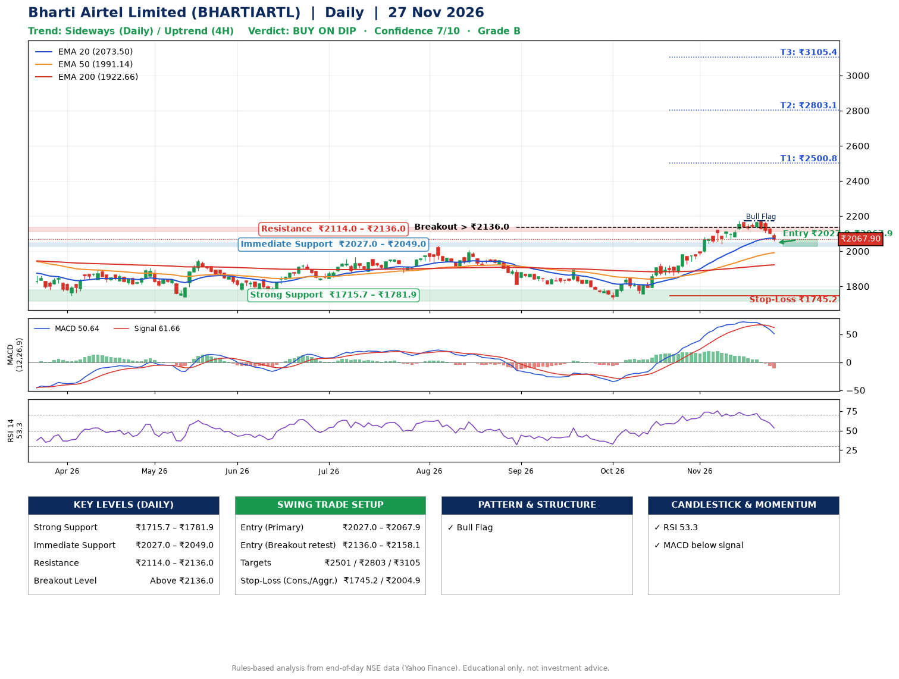

📌 **Bharti Airtel Limited (BHARTIARTL) – Multi-Timeframe Technical Analysis (Daily + 4H Combined)**
_Data up to 27 Nov 2026 · Close ₹2067.90_

**📍 Daily Timeframe Trend**
- Trend: **Sideways** (mixed swing structure)
- Recent swing highs: ₹2005.8, ₹1893.3, ₹1854.7 · swing lows: ₹1813.0, ₹1726.3, ₹1756.2
- EMAs: EMA20 ₹2073.5, EMA50 ₹1991.1, EMA200 ₹1922.7; bullish stack (EMA20 > EMA50 > EMA200); price above EMA50, EMA200
- MACD 50.64 below signal 61.66 (above zero), fresh bearish crossover; histogram falling
- RSI(14) 53.3; no divergence on the last two swings

**📍 4-Hour Timeframe Trend**
- Structure: **Uptrend** (higher highs and higher lows)
- Pullback/support area: recent 4H swing lows ₹2040.6, ₹2122.5; EMA20 ₹2106.3
- EMA20/50: bullish stack (EMA20 > EMA50); price above EMA50
- MACD 8.38 below signal 23.14 (above zero); histogram falling
- RSI(14) 42.3; Regular bearish divergence

**📍 Pattern Detection (Both Timeframes)**
- Daily: **Bull Flag** – 16% pole then a tight 5% flag; trigger above ₹2172.9
- 4H: **Double Top** – tops near ₹2172.2/₹2172.8, neckline ₹2122.5, confirmed (closed below neckline)

**📍 Candlestick Patterns (last 3 daily candles)**
- No notable candlestick signal in the last 3 sessions.

**📍 Price Action Key Levels (Daily Structure)**

| Zone | Price Level (₹) | Context |
|------|-----------------|---------|
| Strong Support | ₹1715.7 – ₹1781.9 | Cluster of earlier swing lows (demand) |
| Immediate Support | ₹2027.0 – ₹2049.0 | Nearest swing-low / wick area |
| Resistance | ₹2114.0 – ₹2136.0 | Nearest swing-high supply |
| Breakout Level | Above ₹2136.0 | Swing continuation trigger (52-week high ₹2172.9) |

**📍 Swing Trade Setup**

🟢 **Entry Zone**
- Primary: ₹2027.0 – ₹2067.9 (daily support / EMA20 area; enter on a bullish 4H candle)
- Alternate: ₹2136.0 – ₹2158.1 (breakout retest)

🎯 **Profit Targets**
- T1: ₹2500.8
- T2: ₹2803.1
- T3: ₹3105.4

🛑 **Stop-Loss**
- Conservative: below daily swing low (₹1745.2)
- Aggressive: below 4H structure (₹2004.9)
- Risk per share ≈ ₹302.3; reward:risk to T1 ≈ 1.5
- Time to T1: it never rose this much within 60 trading days in the price history
- Time to T2: it never rose this much within 60 trading days in the price history

**📌 Strategy Notes**
- Higher timeframe: daily trend is sideways; only take longs while price holds above ₹1715.7.
- Entry timing: wait for a bullish 4H candle (engulfing/hammer) inside ₹2027.0 – ₹2067.9 rather than buying mid-range.
- EMA stacking: bullish stack (EMA20 > EMA50 > EMA200); price above EMA50, EMA200.
- Breakout rule: a daily close above ₹2136.0 with volume above its 20-day average (≈7,926,664) opens T2/T3.
- Momentum: RSI 53 – room to run; no divergence on the last two swings.
- Exit discipline: move the stop to entry once T1 is hit; book partial profits at each target.

**STEP 2 — Marked Up Chart**

**✅ Trade Validation Checklist**
- Trend + momentum aligned: No · Price at entry zone: Yes
- Stop defined (₹1745.2) · Reward:risk ≥ 1.5 to T1: No

## 📌 Final Verdict

Recommendation: **🟡 BUY ON DIP**

Confidence: **7/10**

Trade Quality: **B**

Reason:
• EMAs stacked bullishly
• Bull Flag: 16% pole then a tight 5% flag; trigger above ₹2172.9

Next Action:
• Wait for a pullback to ₹2027.0–₹2067.9, or a breakout above ₹2136.0

_Rules-based analysis from end-of-day data. Educational only, not investment advice. Never place orders without your own confirmation._