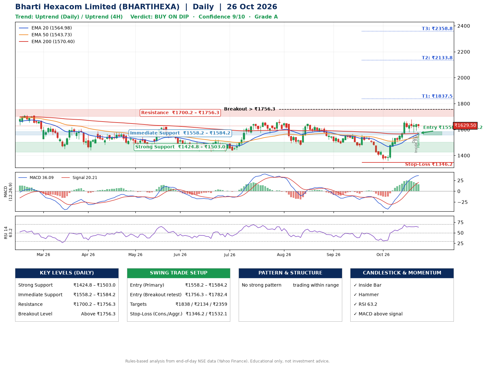

📌 **Bharti Hexacom Limited (BHARTIHEXA) – Multi-Timeframe Technical Analysis (Daily + 4H Combined)**
_Data up to 26 Oct 2026 · Close ₹1629.50_

**📍 Daily Timeframe Trend**
- Trend: **Uptrend** (price above rising EMAs)
- Recent swing highs: ₹1678.1, ₹1647.2, ₹1567.4 · swing lows: ₹1490.0, ₹1465.0, ₹1359.2
- EMAs: EMA20 ₹1565.0, EMA50 ₹1543.7, EMA200 ₹1570.4; mixed / crossing; price above EMA20, EMA50, EMA200
- MACD 36.09 above signal 20.21 (above zero); histogram falling
- RSI(14) 63.2; no divergence on the last two swings

**📍 4-Hour Timeframe Trend**
- Structure: **Uptrend** (price above rising EMAs)
- Pullback/support area: recent 4H swing lows ₹1593.4, ₹1578.2; EMA20 ₹1596.2
- EMA20/50: bullish stack (EMA20 > EMA50); price above EMA20, EMA50
- MACD 34.11 below signal 36.89 (above zero), fresh bearish crossover; histogram falling
- RSI(14) 63.1; Regular bearish divergence

**📍 Pattern Detection (Both Timeframes)**
- 4H: **Bull Flag** – 18% pole then a tight 6% flag; trigger above ₹1678.7

**📍 Candlestick Patterns (last 3 daily candles)**
- **Doji** – 22 Oct: indecision; wait for the next candle to confirm direction
- **Inside Bar** – 23 Oct: compression inside the prior range ₹1578.1–₹1649.8
- **Hammer** – 26 Oct: long lower wick shows dip-buying near ₹1612.0

**📍 Price Action Key Levels (Daily Structure)**

| Zone | Price Level (₹) | Context |
|------|-----------------|---------|
| Strong Support | ₹1424.8 – ₹1503.0 | Cluster of earlier swing lows (demand) |
| Immediate Support | ₹1558.2 – ₹1584.2 | Nearest swing-low / wick area |
| Resistance | ₹1700.2 – ₹1756.3 | Nearest swing-high supply |
| Breakout Level | Above ₹1756.3 | Swing continuation trigger (52-week high ₹1955.6) |

**📍 Swing Trade Setup**

🟢 **Entry Zone**
- Primary: ₹1558.2 – ₹1584.2 (daily support / EMA20 area; enter on a bullish 4H candle)
- Alternate: ₹1756.3 – ₹1782.4 (breakout retest)

🎯 **Profit Targets**
- T1: ₹1837.5
- T2: ₹2133.8
- T3: ₹2358.8

🛑 **Stop-Loss**
- Conservative: below daily swing low (₹1346.2)
- Aggressive: below 4H structure (₹1532.1)
- Risk per share ≈ ₹225.0; reward:risk to T1 ≈ 1.2

**📌 Strategy Notes**
- Higher timeframe: daily trend is uptrend; only take longs while price holds above ₹1424.8.
- Entry timing: wait for a bullish 4H candle (engulfing/hammer) inside ₹1558.2 – ₹1584.2 rather than buying mid-range.
- EMA stacking: mixed / crossing; price above EMA20, EMA50, EMA200.
- Breakout rule: a daily close above ₹1756.3 with volume above its 20-day average (≈256,332) opens T2/T3.
- Momentum: RSI 63 – room to run; no divergence on the last two swings.
- Exit discipline: move the stop to entry once T1 is hit; book partial profits at each target.

**STEP 2 — Marked Up Chart**

**✅ Trade Validation Checklist**
- Trend + momentum aligned: Yes · Price at entry zone: No
- Stop defined (₹1346.2) · Reward:risk ≥ 1.5 to T1: No

## 📌 Final Verdict

Recommendation: **🟡 BUY ON DIP**

Confidence: **9/10**

Trade Quality: **A**

Reason:
• Daily uptrend (price above rising EMAs)

Next Action:
• Wait for a pullback to ₹1558.2–₹1584.2, or a breakout above ₹1756.3

_Rules-based analysis from end-of-day data. Educational only, not investment advice. Never place orders without your own confirmation._