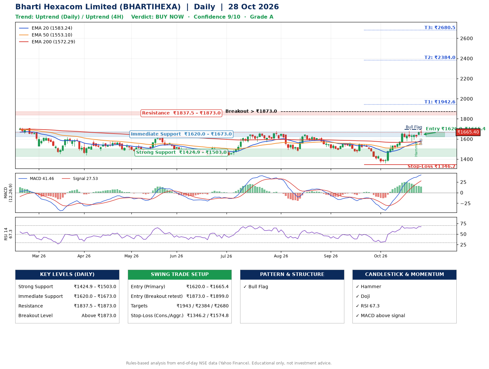

📌 **Bharti Hexacom Limited (BHARTIHEXA) – Multi-Timeframe Technical Analysis (Daily + 4H Combined)**
_Data up to 28 Oct 2026 · Close ₹1665.40_

**📍 Daily Timeframe Trend**
- Trend: **Uptrend** (price above rising EMAs)
- Recent swing highs: ₹1678.1, ₹1647.2, ₹1567.4 · swing lows: ₹1490.0, ₹1465.0, ₹1359.2
- EMAs: EMA20 ₹1583.2, EMA50 ₹1553.1, EMA200 ₹1572.3; mixed / crossing; price above EMA20, EMA50, EMA200
- MACD 41.46 above signal 27.53 (above zero); histogram falling
- RSI(14) 67.3; no divergence on the last two swings

**📍 4-Hour Timeframe Trend**
- Structure: **Uptrend** (price above rising EMAs)
- Pullback/support area: recent 4H swing lows ₹1593.4, ₹1578.2; EMA20 ₹1615.6
- EMA20/50: bullish stack (EMA20 > EMA50); price above EMA20, EMA50
- MACD 33.89 below signal 35.12 (above zero); histogram rising
- RSI(14) 66.2; Regular bearish divergence

**📍 Pattern Detection (Both Timeframes)**
- Daily: **Bull Flag** – 20% pole then a tight 7% flag; trigger above ₹1695.5
- 4H: **Bull Flag** – 18% pole then a tight 6% flag; trigger above ₹1692.6

**📍 Candlestick Patterns (last 3 daily candles)**
- **Hammer** – 26 Oct: long lower wick shows dip-buying near ₹1612.0
- **Doji** – 28 Oct: indecision; wait for the next candle to confirm direction

**📍 Price Action Key Levels (Daily Structure)**

| Zone | Price Level (₹) | Context |
|------|-----------------|---------|
| Strong Support | ₹1424.9 – ₹1503.0 | Cluster of earlier swing lows (demand) |
| Immediate Support | ₹1620.0 – ₹1673.0 | Nearest swing-low / wick area |
| Resistance | ₹1837.5 – ₹1873.0 | Nearest swing-high supply |
| Breakout Level | Above ₹1873.0 | Swing continuation trigger (52-week high ₹1955.6) |

**📍 Swing Trade Setup**

🟢 **Entry Zone**
- Primary: ₹1620.0 – ₹1665.4 (daily support / EMA20 area; enter on a bullish 4H candle)
- Alternate: ₹1873.0 – ₹1899.0 (breakout retest)

🎯 **Profit Targets**
- T1: ₹1942.6
- T2: ₹2384.0
- T3: ₹2680.5

🛑 **Stop-Loss**
- Conservative: below daily swing low (₹1346.2)
- Aggressive: below 4H structure (₹1574.8)
- Risk per share ≈ ₹296.5; reward:risk to T1 ≈ 1.0

**📌 Strategy Notes**
- Higher timeframe: daily trend is uptrend; only take longs while price holds above ₹1424.9.
- Entry timing: wait for a bullish 4H candle (engulfing/hammer) inside ₹1620.0 – ₹1665.4 rather than buying mid-range.
- EMA stacking: mixed / crossing; price above EMA20, EMA50, EMA200.
- Breakout rule: a daily close above ₹1873.0 with volume above its 20-day average (≈263,390) opens T2/T3.
- Momentum: RSI 67 – elevated, prefer dips; no divergence on the last two swings.
- Exit discipline: move the stop to entry once T1 is hit; book partial profits at each target.

**STEP 2 — Marked Up Chart**

**✅ Trade Validation Checklist**
- Trend + momentum aligned: Yes · Price at entry zone: Yes
- Stop defined (₹1346.2) · Reward:risk ≥ 1.5 to T1: No

## 📌 Final Verdict

Recommendation: **🟢 BUY NOW**

Confidence: **9/10**

Trade Quality: **A**

Reason:
• Daily uptrend (price above rising EMAs)
• Bull Flag: 20% pole then a tight 7% flag; trigger above ₹1695.5

Next Action:
• Buy now within the entry zone, with the stop-loss in place

_Rules-based analysis from end-of-day data. Educational only, not investment advice. Never place orders without your own confirmation._