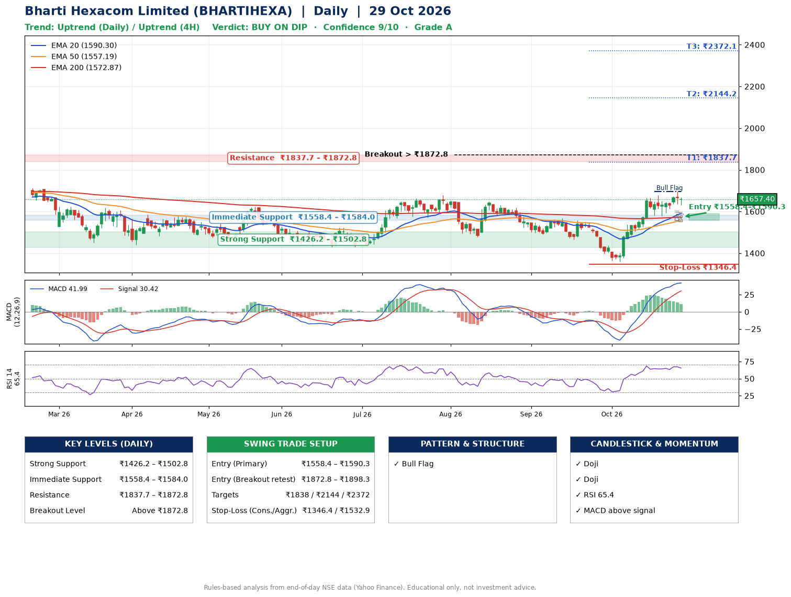

📌 **Bharti Hexacom Limited (BHARTIHEXA) – Multi-Timeframe Technical Analysis (Daily + 4H Combined)**
_Data up to 29 Oct 2026 · Close ₹1657.40_

**📍 Daily Timeframe Trend**
- Trend: **Uptrend** (price above rising EMAs)
- Recent swing highs: ₹1678.1, ₹1647.2, ₹1567.4 · swing lows: ₹1490.0, ₹1465.0, ₹1359.2
- EMAs: EMA20 ₹1590.3, EMA50 ₹1557.2, EMA200 ₹1572.9; mixed / crossing; price above EMA20, EMA50, EMA200
- MACD 41.99 above signal 30.42 (above zero); histogram falling
- RSI(14) 65.4; no divergence on the last two swings

**📍 4-Hour Timeframe Trend**
- Structure: **Uptrend** (price above rising EMAs)
- Pullback/support area: recent 4H swing lows ₹1593.4, ₹1578.2; EMA20 ₹1623.7
- EMA20/50: bullish stack (EMA20 > EMA50); price above EMA20, EMA50
- MACD 32.51 below signal 34.36 (above zero); histogram falling
- RSI(14) 63.5; Regular bearish divergence

**📍 Pattern Detection (Both Timeframes)**
- Daily: **Bull Flag** – 17% pole then a tight 7% flag; trigger above ₹1695.5
- 4H: **Double Top** – tops near ₹1678.7/₹1692.6, neckline ₹1578.2, forming
- 4H: **Bull Flag** – 18% pole then a tight 5% flag; trigger above ₹1692.6

**📍 Candlestick Patterns (last 3 daily candles)**
- **Doji** – 28 Oct: indecision; wait for the next candle to confirm direction
- **Doji** – 29 Oct: indecision; wait for the next candle to confirm direction

**📍 Price Action Key Levels (Daily Structure)**

| Zone | Price Level (₹) | Context |
|------|-----------------|---------|
| Strong Support | ₹1426.2 – ₹1502.8 | Cluster of earlier swing lows (demand) |
| Immediate Support | ₹1558.4 – ₹1584.0 | Nearest swing-low / wick area |
| Resistance | ₹1837.7 – ₹1872.8 | Nearest swing-high supply |
| Breakout Level | Above ₹1872.8 | Swing continuation trigger (52-week high ₹1955.6) |

**📍 Swing Trade Setup**

🟢 **Entry Zone**
- Primary: ₹1558.4 – ₹1590.3 (daily support / EMA20 area; enter on a bullish 4H candle)
- Alternate: ₹1872.8 – ₹1898.3 (breakout retest)

🎯 **Profit Targets**
- T1: ₹1837.7
- T2: ₹2144.2
- T3: ₹2372.1

🛑 **Stop-Loss**
- Conservative: below daily swing low (₹1346.4)
- Aggressive: below 4H structure (₹1532.9)
- Risk per share ≈ ₹227.9; reward:risk to T1 ≈ 1.2

**📌 Strategy Notes**
- Higher timeframe: daily trend is uptrend; only take longs while price holds above ₹1426.2.
- Entry timing: wait for a bullish 4H candle (engulfing/hammer) inside ₹1558.4 – ₹1590.3 rather than buying mid-range.
- EMA stacking: mixed / crossing; price above EMA20, EMA50, EMA200.
- Breakout rule: a daily close above ₹1872.8 with volume above its 20-day average (≈258,429) opens T2/T3.
- Momentum: RSI 65 – elevated, prefer dips; no divergence on the last two swings.
- Exit discipline: move the stop to entry once T1 is hit; book partial profits at each target.

**STEP 2 — Marked Up Chart**

**✅ Trade Validation Checklist**
- Trend + momentum aligned: Yes · Price at entry zone: No
- Stop defined (₹1346.4) · Reward:risk ≥ 1.5 to T1: No

## 📌 Final Verdict

Recommendation: **🟡 BUY ON DIP**

Confidence: **9/10**

Trade Quality: **A**

Reason:
• Daily uptrend (price above rising EMAs)
• Bull Flag: 17% pole then a tight 7% flag; trigger above ₹1695.5

Next Action:
• Wait for a pullback to ₹1558.4–₹1590.3

_Rules-based analysis from end-of-day data. Educational only, not investment advice. Never place orders without your own confirmation._