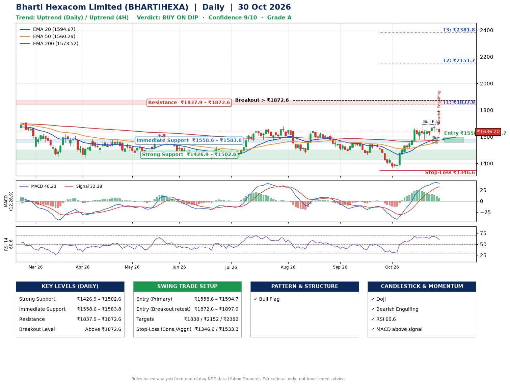

📌 **Bharti Hexacom Limited (BHARTIHEXA) – Multi-Timeframe Technical Analysis (Daily + 4H Combined)**
_Data up to 30 Oct 2026 · Close ₹1636.20_

**📍 Daily Timeframe Trend**
- Trend: **Uptrend** (price above rising EMAs)
- Recent swing highs: ₹1678.1, ₹1647.2, ₹1567.4 · swing lows: ₹1490.0, ₹1465.0, ₹1359.2
- EMAs: EMA20 ₹1594.7, EMA50 ₹1560.3, EMA200 ₹1573.5; mixed / crossing; price above EMA20, EMA50, EMA200
- MACD 40.23 above signal 32.38 (above zero); histogram falling
- RSI(14) 60.6; no divergence on the last two swings

**📍 4-Hour Timeframe Trend**
- Structure: **Uptrend** (higher highs and higher lows)
- Pullback/support area: recent 4H swing lows ₹1578.2, ₹1630.2; EMA20 ₹1626.6
- EMA20/50: bullish stack (EMA20 > EMA50); price above EMA20, EMA50
- MACD 27.40 below signal 32.27 (above zero); histogram falling
- RSI(14) 57.3; Hidden bullish divergence; Regular bearish divergence

**📍 Pattern Detection (Both Timeframes)**
- Daily: **Bull Flag** – 18% pole then a tight 7% flag; trigger above ₹1695.5
- 4H: **Double Top** – tops near ₹1678.7/₹1692.6, neckline ₹1578.2, forming

**📍 Candlestick Patterns (last 3 daily candles)**
- **Doji** – 28 Oct: indecision; wait for the next candle to confirm direction
- **Doji** – 29 Oct: indecision; wait for the next candle to confirm direction
- **Bearish Engulfing** – 30 Oct: sellers fully reversed the prior green candle

**📍 Price Action Key Levels (Daily Structure)**

| Zone | Price Level (₹) | Context |
|------|-----------------|---------|
| Strong Support | ₹1426.9 – ₹1502.6 | Cluster of earlier swing lows (demand) |
| Immediate Support | ₹1558.6 – ₹1583.8 | Nearest swing-low / wick area |
| Resistance | ₹1837.9 – ₹1872.6 | Nearest swing-high supply |
| Breakout Level | Above ₹1872.6 | Swing continuation trigger (52-week high ₹1955.6) |

**📍 Swing Trade Setup**

🟢 **Entry Zone**
- Primary: ₹1558.6 – ₹1594.7 (daily support / EMA20 area; enter on a bullish 4H candle)
- Alternate: ₹1872.6 – ₹1897.9 (breakout retest)

🎯 **Profit Targets**
- T1: ₹1837.9
- T2: ₹2151.7
- T3: ₹2381.8

🛑 **Stop-Loss**
- Conservative: below daily swing low (₹1346.6)
- Aggressive: below 4H structure (₹1533.3)
- Risk per share ≈ ₹230.0; reward:risk to T1 ≈ 1.1

**📌 Strategy Notes**
- Higher timeframe: daily trend is uptrend; only take longs while price holds above ₹1426.9.
- Entry timing: wait for a bullish 4H candle (engulfing/hammer) inside ₹1558.6 – ₹1594.7 rather than buying mid-range.
- EMA stacking: mixed / crossing; price above EMA20, EMA50, EMA200.
- Breakout rule: a daily close above ₹1872.6 with volume above its 20-day average (≈254,256) opens T2/T3.
- Momentum: RSI 61 – room to run; no divergence on the last two swings.
- Exit discipline: move the stop to entry once T1 is hit; book partial profits at each target.

**STEP 2 — Marked Up Chart**

**✅ Trade Validation Checklist**
- Trend + momentum aligned: Yes · Price at entry zone: No
- Stop defined (₹1346.6) · Reward:risk ≥ 1.5 to T1: No

## 📌 Final Verdict

Recommendation: **🟡 BUY ON DIP**

Confidence: **9/10**

Trade Quality: **A**

Reason:
• Daily uptrend (price above rising EMAs)
• Bull Flag: 18% pole then a tight 7% flag; trigger above ₹1695.5

Next Action:
• Wait for a pullback to ₹1558.6–₹1594.7, or a breakout above ₹1872.6

_Rules-based analysis from end-of-day data. Educational only, not investment advice. Never place orders without your own confirmation._