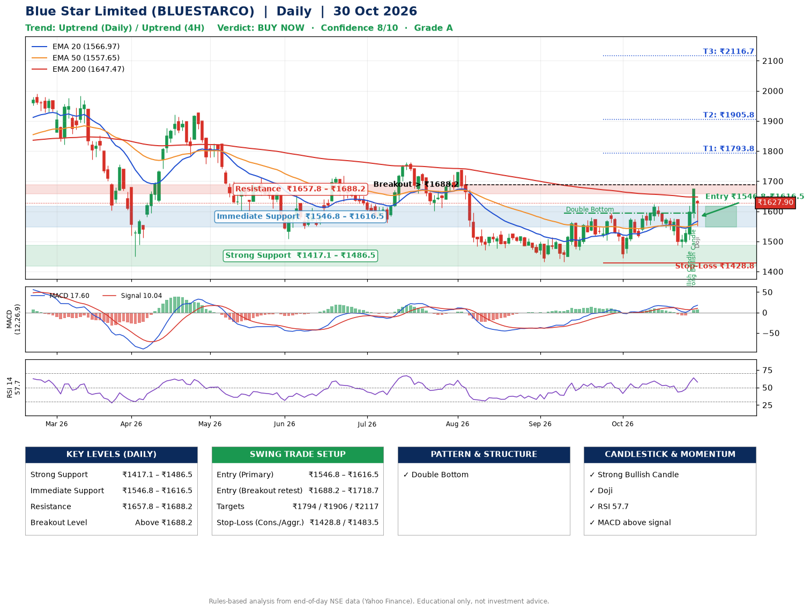

📌 **Blue Star Limited (BLUESTARCO) – Multi-Timeframe Technical Analysis (Daily + 4H Combined)**
_Data up to 30 Oct 2026 · Close ₹1627.90_

**📍 Daily Timeframe Trend**
- Trend: **Uptrend** (higher highs and higher lows)
- Recent swing highs: ₹1737.6, ₹1593.5, ₹1624.0 · swing lows: ₹1471.3, ₹1432.3, ₹1444.0
- EMAs: EMA20 ₹1567.0, EMA50 ₹1557.7, EMA200 ₹1647.5; mixed / crossing; price above EMA20, EMA50
- MACD 17.60 above signal 10.04 (above zero), fresh bullish crossover; histogram rising
- RSI(14) 57.7; no divergence on the last two swings

**📍 4-Hour Timeframe Trend**
- Structure: **Uptrend** (price above rising EMAs)
- Pullback/support area: recent 4H swing lows ₹1514.6, ₹1487.7; EMA20 ₹1580.1
- EMA20/50: bullish stack (EMA20 > EMA50); price above EMA20, EMA50
- MACD 19.40 above signal 8.41 (above zero); histogram falling
- RSI(14) 58.9; no divergence

**📍 Pattern Detection (Both Timeframes)**
- Daily: **Double Bottom** – bottoms near ₹1432.3/₹1444.0, neckline ₹1593.5, confirmed (closed above neckline)
- 4H: **Double Bottom** – bottoms near ₹1514.6/₹1487.7, neckline ₹1624.0, confirmed (closed above neckline)

**📍 Candlestick Patterns (last 3 daily candles)**
- **Strong Bullish Candle** – 28 Oct: wide-range green candle, buyers in control
- **Strong Bullish Candle** – 29 Oct: wide-range green candle, buyers in control
- **Doji** – 30 Oct: indecision; wait for the next candle to confirm direction

**📍 Price Action Key Levels (Daily Structure)**

| Zone | Price Level (₹) | Context |
|------|-----------------|---------|
| Strong Support | ₹1417.1 – ₹1486.5 | Cluster of earlier swing lows (demand) |
| Immediate Support | ₹1546.8 – ₹1616.5 | Nearest swing-low / wick area |
| Resistance | ₹1657.8 – ₹1688.2 | Nearest swing-high supply |
| Breakout Level | Above ₹1688.2 | Swing continuation trigger (52-week high ₹2029.6) |

**📍 Swing Trade Setup**

🟢 **Entry Zone**
- Primary: ₹1546.8 – ₹1616.5 (daily support / EMA20 area; enter on a bullish 4H candle)
- Alternate: ₹1688.2 – ₹1718.7 (breakout retest)

🎯 **Profit Targets**
- T1: ₹1793.8
- T2: ₹1905.8
- T3: ₹2116.7

🛑 **Stop-Loss**
- Conservative: below daily swing low (₹1428.8)
- Aggressive: below 4H structure (₹1483.5)
- Risk per share ≈ ₹152.9; reward:risk to T1 ≈ 1.4

**📌 Strategy Notes**
- Higher timeframe: daily trend is uptrend; only take longs while price holds above ₹1417.1.
- Entry timing: wait for a bullish 4H candle (engulfing/hammer) inside ₹1546.8 – ₹1616.5 rather than buying mid-range.
- EMA stacking: mixed / crossing; price above EMA20, EMA50.
- Breakout rule: a daily close above ₹1688.2 with volume above its 20-day average (≈464,760) opens T2/T3.
- Momentum: RSI 58 – room to run; no divergence on the last two swings.
- Exit discipline: move the stop to entry once T1 is hit; book partial profits at each target.

**STEP 2 — Marked Up Chart**

**✅ Trade Validation Checklist**
- Trend + momentum aligned: Yes · Price at entry zone: No
- Stop defined (₹1428.8) · Reward:risk ≥ 1.5 to T1: No

## 📌 Final Verdict

Recommendation: **🟢 BUY NOW**

Confidence: **8/10**

Trade Quality: **A**

Reason:
• Daily uptrend (higher highs and higher lows)
• Double Bottom: bottoms near ₹1432.3/₹1444.0, neckline ₹1593.5, confirmed (closed above neckline)

Next Action:
• Buy now within the entry zone, with the stop-loss in place

_Rules-based analysis from end-of-day data. Educational only, not investment advice. Never place orders without your own confirmation._