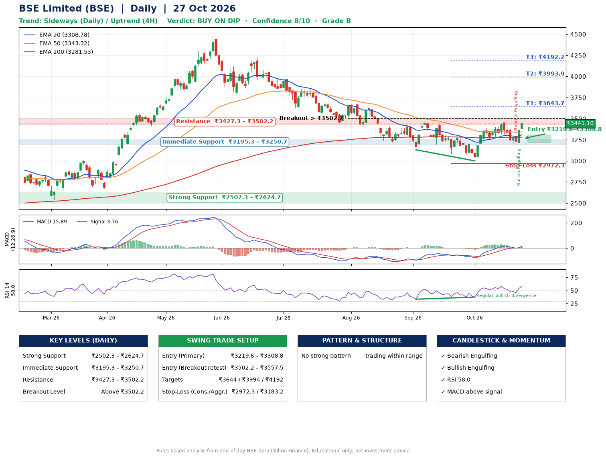

📌 **BSE Limited (BSE) – Multi-Timeframe Technical Analysis (Daily + 4H Combined)**
_Data up to 27 Oct 2026 · Close ₹3441.10_

**📍 Daily Timeframe Trend**
- Trend: **Sideways** (mixed swing structure)
- Recent swing highs: ₹3474.5, ₹3308.0, ₹3455.0 · swing lows: ₹3223.0, ₹3131.5, ₹3000.0
- EMAs: EMA20 ₹3308.8, EMA50 ₹3343.3, EMA200 ₹3281.5; mixed / crossing; price above EMA20, EMA50, EMA200
- MACD 15.89 above signal 3.76 (above zero); histogram rising
- RSI(14) 58.0; Regular bullish divergence

**📍 4-Hour Timeframe Trend**
- Structure: **Uptrend** (price above rising EMAs)
- Pullback/support area: recent 4H swing lows ₹3311.1, ₹3190.0; EMA20 ₹3325.2
- EMA20/50: bullish stack (EMA20 > EMA50); price above EMA20, EMA50
- MACD 24.69 above signal 13.31 (above zero), fresh bullish crossover; histogram rising
- RSI(14) 62.9; no divergence

**📍 Pattern Detection (Both Timeframes)**
- 4H: **Double Top** – tops near ₹3389.0/₹3445.0, neckline ₹3263.0, forming

**📍 Candlestick Patterns (last 3 daily candles)**
- **Bearish Engulfing** – 23 Oct: sellers fully reversed the prior green candle
- **Bullish Engulfing** – 26 Oct: buyers fully reversed the prior red candle

**📍 Price Action Key Levels (Daily Structure)**

| Zone | Price Level (₹) | Context |
|------|-----------------|---------|
| Strong Support | ₹2502.3 – ₹2624.7 | Cluster of earlier swing lows (demand) |
| Immediate Support | ₹3195.3 – ₹3250.7 | Nearest swing-low / wick area |
| Resistance | ₹3427.3 – ₹3502.2 | Nearest swing-high supply |
| Breakout Level | Above ₹3502.2 | Swing continuation trigger (52-week high ₹4446.8) |

**📍 Swing Trade Setup**

🟢 **Entry Zone**
- Primary: ₹3219.6 – ₹3308.8 (daily support / EMA20 area; enter on a bullish 4H candle)
- Alternate: ₹3502.2 – ₹3557.5 (breakout retest)

🎯 **Profit Targets**
- T1: ₹3643.7
- T2: ₹3993.9
- T3: ₹4192.2

🛑 **Stop-Loss**
- Conservative: below daily swing low (₹2972.3)
- Aggressive: below 4H structure (₹3183.2)
- Risk per share ≈ ₹291.9; reward:risk to T1 ≈ 1.3

**📌 Strategy Notes**
- Higher timeframe: daily trend is sideways; only take longs while price holds above ₹2502.3.
- Entry timing: wait for a bullish 4H candle (engulfing/hammer) inside ₹3219.6 – ₹3308.8 rather than buying mid-range.
- EMA stacking: mixed / crossing; price above EMA20, EMA50, EMA200.
- Breakout rule: a daily close above ₹3502.2 with volume above its 20-day average (≈5,569,919) opens T2/T3.
- Momentum: RSI 58 – room to run; Regular bullish divergence.
- Exit discipline: move the stop to entry once T1 is hit; book partial profits at each target.

**STEP 2 — Marked Up Chart**

**✅ Trade Validation Checklist**
- Trend + momentum aligned: No · Price at entry zone: No
- Stop defined (₹2972.3) · Reward:risk ≥ 1.5 to T1: No

## 📌 Final Verdict

Recommendation: **🟡 BUY ON DIP**

Confidence: **8/10**

Trade Quality: **B**

Reason:
• No strong edge from trend, momentum or patterns

Next Action:
• Wait for a pullback to ₹3219.6–₹3308.8

_Rules-based analysis from end-of-day data. Educational only, not investment advice. Never place orders without your own confirmation._