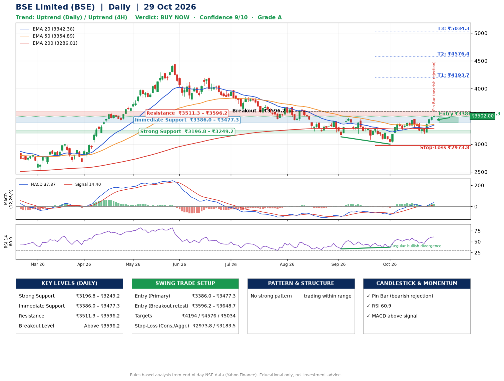

📌 **BSE Limited (BSE) – Multi-Timeframe Technical Analysis (Daily + 4H Combined)**
_Data up to 29 Oct 2026 · Close ₹3502.00_

**📍 Daily Timeframe Trend**
- Trend: **Uptrend** (price above rising EMAs)
- Recent swing highs: ₹3474.5, ₹3308.0, ₹3455.0 · swing lows: ₹3223.0, ₹3131.5, ₹3000.0
- EMAs: EMA20 ₹3342.4, EMA50 ₹3354.9, EMA200 ₹3286.0; mixed / crossing; price above EMA20, EMA50, EMA200
- MACD 37.87 above signal 14.40 (above zero); histogram rising
- RSI(14) 60.9; Regular bullish divergence

**📍 4-Hour Timeframe Trend**
- Structure: **Uptrend** (price above rising EMAs)
- Pullback/support area: recent 4H swing lows ₹3311.1, ₹3190.0; EMA20 ₹3381.5
- EMA20/50: bullish stack (EMA20 > EMA50); price above EMA20, EMA50
- MACD 52.52 above signal 32.86 (above zero); histogram falling
- RSI(14) 65.6; no divergence

**📍 Pattern Detection (Both Timeframes)**
- No strong pattern detected. Trading within range.

**📍 Candlestick Patterns (last 3 daily candles)**
- **Pin Bar (bearish rejection)** – 29 Oct: long upper wick shows selling near ₹3537.5

**📍 Price Action Key Levels (Daily Structure)**

| Zone | Price Level (₹) | Context |
|------|-----------------|---------|
| Strong Support | ₹3196.8 – ₹3249.2 | Cluster of earlier swing lows (demand) |
| Immediate Support | ₹3386.0 – ₹3477.3 | Nearest swing-low / wick area |
| Resistance | ₹3511.3 – ₹3596.2 | Nearest swing-high supply |
| Breakout Level | Above ₹3596.2 | Swing continuation trigger (52-week high ₹4446.8) |

**📍 Swing Trade Setup**

🟢 **Entry Zone**
- Primary: ₹3386.0 – ₹3477.3 (daily support / EMA20 area; enter on a bullish 4H candle)
- Alternate: ₹3596.2 – ₹3648.7 (breakout retest)

🎯 **Profit Targets**
- T1: ₹4193.7
- T2: ₹4576.4
- T3: ₹5034.3

🛑 **Stop-Loss**
- Conservative: below daily swing low (₹2973.8)
- Aggressive: below 4H structure (₹3183.5)
- Risk per share ≈ ₹457.9; reward:risk to T1 ≈ 1.7

**📌 Strategy Notes**
- Higher timeframe: daily trend is uptrend; only take longs while price holds above ₹3196.8.
- Entry timing: wait for a bullish 4H candle (engulfing/hammer) inside ₹3386.0 – ₹3477.3 rather than buying mid-range.
- EMA stacking: mixed / crossing; price above EMA20, EMA50, EMA200.
- Breakout rule: a daily close above ₹3596.2 with volume above its 20-day average (≈4,160,639) opens T2/T3.
- Momentum: RSI 61 – room to run; Regular bullish divergence.
- Exit discipline: move the stop to entry once T1 is hit; book partial profits at each target.

**STEP 2 — Marked Up Chart**

**✅ Trade Validation Checklist**
- Trend + momentum aligned: Yes · Price at entry zone: No
- Stop defined (₹2973.8) · Reward:risk ≥ 1.5 to T1: Yes

## 📌 Final Verdict

Recommendation: **🟢 BUY NOW**

Confidence: **9/10**

Trade Quality: **A**

Reason:
• Daily uptrend (price above rising EMAs)

Next Action:
• Buy now within the entry zone, with the stop-loss in place

_Rules-based analysis from end-of-day data. Educational only, not investment advice. Never place orders without your own confirmation._