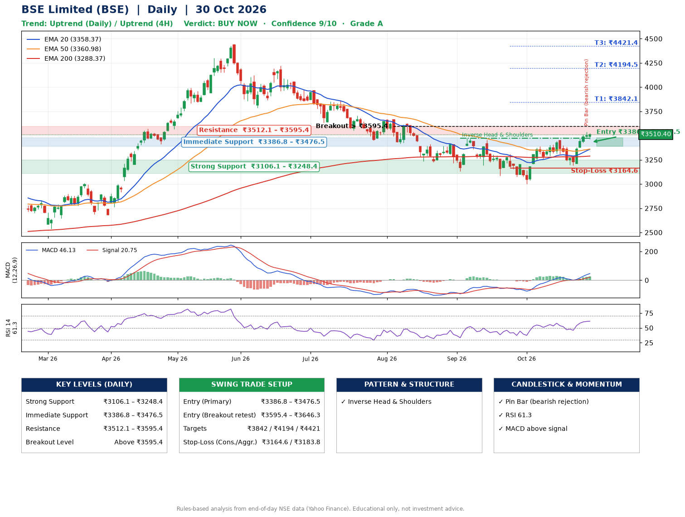

📌 **BSE Limited (BSE) – Multi-Timeframe Technical Analysis (Daily + 4H Combined)**
_Data up to 30 Oct 2026 · Close ₹3510.40_

**📍 Daily Timeframe Trend**
- Trend: **Uptrend** (higher highs and higher lows)
- Recent swing highs: ₹3474.5, ₹3308.0, ₹3455.0 · swing lows: ₹3131.5, ₹3000.0, ₹3190.0
- EMAs: EMA20 ₹3358.4, EMA50 ₹3361.0, EMA200 ₹3288.4; mixed / crossing; price above EMA20, EMA50, EMA200
- MACD 46.13 above signal 20.75 (above zero); histogram rising
- RSI(14) 61.3; no divergence on the last two swings

**📍 4-Hour Timeframe Trend**
- Structure: **Uptrend** (price above rising EMAs)
- Pullback/support area: recent 4H swing lows ₹3311.1, ₹3190.0; EMA20 ₹3404.8
- EMA20/50: bullish stack (EMA20 > EMA50); price above EMA20, EMA50
- MACD 58.24 above signal 41.65 (above zero); histogram falling
- RSI(14) 66.3; Regular bearish divergence

**📍 Pattern Detection (Both Timeframes)**
- Daily: **Inverse Head & Shoulders** – head ₹3000.0, neckline ₹3474.5
- 4H: **Double Top** – tops near ₹3445.0/₹3537.2, neckline ₹3190.0, forming

**📍 Candlestick Patterns (last 3 daily candles)**
- **Pin Bar (bearish rejection)** – 29 Oct: long upper wick shows selling near ₹3537.5

**📍 Price Action Key Levels (Daily Structure)**

| Zone | Price Level (₹) | Context |
|------|-----------------|---------|
| Strong Support | ₹3106.1 – ₹3248.4 | Cluster of earlier swing lows (demand) |
| Immediate Support | ₹3386.8 – ₹3476.5 | Nearest swing-low / wick area |
| Resistance | ₹3512.1 – ₹3595.4 | Nearest swing-high supply |
| Breakout Level | Above ₹3595.4 | Swing continuation trigger (52-week high ₹4446.8) |

**📍 Swing Trade Setup**

🟢 **Entry Zone**
- Primary: ₹3386.8 – ₹3476.5 (daily support / EMA20 area; enter on a bullish 4H candle)
- Alternate: ₹3595.4 – ₹3646.3 (breakout retest)

🎯 **Profit Targets**
- T1: ₹3842.1
- T2: ₹4194.5
- T3: ₹4421.4

🛑 **Stop-Loss**
- Conservative: below daily swing low (₹3164.6)
- Aggressive: below 4H structure (₹3183.8)
- Risk per share ≈ ₹267.1; reward:risk to T1 ≈ 1.5

**📌 Strategy Notes**
- Higher timeframe: daily trend is uptrend; only take longs while price holds above ₹3106.1.
- Entry timing: wait for a bullish 4H candle (engulfing/hammer) inside ₹3386.8 – ₹3476.5 rather than buying mid-range.
- EMA stacking: mixed / crossing; price above EMA20, EMA50, EMA200.
- Breakout rule: a daily close above ₹3595.4 with volume above its 20-day average (≈3,979,678) opens T2/T3.
- Momentum: RSI 61 – room to run; no divergence on the last two swings.
- Exit discipline: move the stop to entry once T1 is hit; book partial profits at each target.

**STEP 2 — Marked Up Chart**

**✅ Trade Validation Checklist**
- Trend + momentum aligned: Yes · Price at entry zone: No
- Stop defined (₹3164.6) · Reward:risk ≥ 1.5 to T1: Yes

## 📌 Final Verdict

Recommendation: **🟢 BUY NOW**

Confidence: **9/10**

Trade Quality: **A**

Reason:
• Daily uptrend (higher highs and higher lows)
• Inverse Head & Shoulders: head ₹3000.0, neckline ₹3474.5

Next Action:
• Buy now within the entry zone, with the stop-loss in place

_Rules-based analysis from end-of-day data. Educational only, not investment advice. Never place orders without your own confirmation._