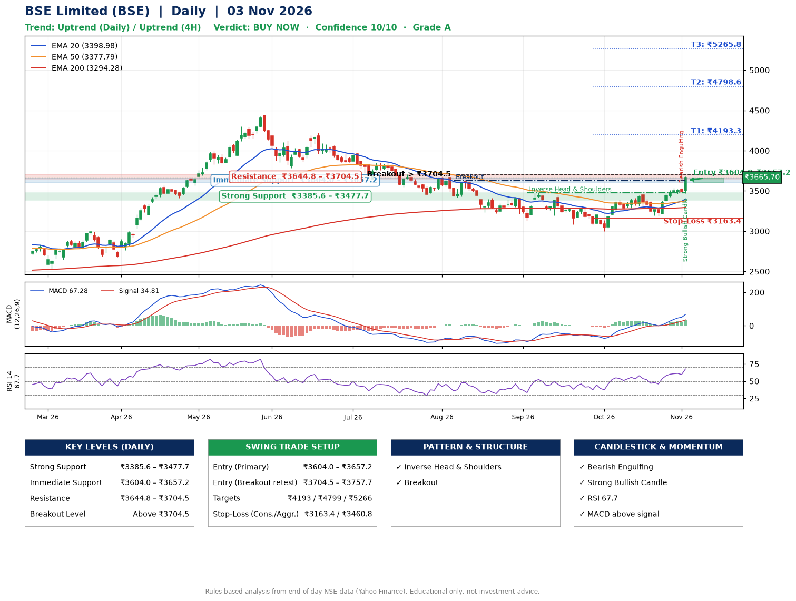

📌 **BSE Limited (BSE) – Multi-Timeframe Technical Analysis (Daily + 4H Combined)**
_Data up to 03 Nov 2026 · Close ₹3665.70_

**📍 Daily Timeframe Trend**
- Trend: **Uptrend** (higher highs and higher lows)
- Recent swing highs: ₹3474.5, ₹3308.0, ₹3455.0 · swing lows: ₹3131.5, ₹3000.0, ₹3190.0
- EMAs: EMA20 ₹3399.0, EMA50 ₹3377.8, EMA200 ₹3294.3; bullish stack (EMA20 > EMA50 > EMA200); price above EMA20, EMA50, EMA200
- MACD 67.28 above signal 34.81 (above zero); histogram rising
- RSI(14) 67.7; no divergence on the last two swings

**📍 4-Hour Timeframe Trend**
- Structure: **Uptrend** (higher highs and higher lows)
- Pullback/support area: recent 4H swing lows ₹3190.0, ₹3467.3; EMA20 ₹3464.0
- EMA20/50: bullish stack (EMA20 > EMA50); price above EMA20, EMA50
- MACD 77.63 above signal 56.59 (above zero); histogram rising
- RSI(14) 74.7; Regular bearish divergence

**📍 Pattern Detection (Both Timeframes)**
- Daily: **Inverse Head & Shoulders** – head ₹3000.0, neckline ₹3474.5
- Daily: **Breakout** – closed above the 60-session high ₹3628.0 on strong volume
- 4H: **Inverse Head & Shoulders** – head ₹3190.0, neckline ₹3537.2

**📍 Candlestick Patterns (last 3 daily candles)**
- **Bearish Engulfing** – 02 Nov: sellers fully reversed the prior green candle
- **Strong Bullish Candle** – 03 Nov: wide-range green candle, buyers in control

**📍 Price Action Key Levels (Daily Structure)**

| Zone | Price Level (₹) | Context |
|------|-----------------|---------|
| Strong Support | ₹3385.6 – ₹3477.7 | Cluster of earlier swing lows (demand) |
| Immediate Support | ₹3604.0 – ₹3657.2 | Nearest swing-low / wick area |
| Resistance | ₹3644.8 – ₹3704.5 | Nearest swing-high supply |
| Breakout Level | Above ₹3704.5 | Swing continuation trigger (52-week high ₹4446.8) |

**📍 Swing Trade Setup**

🟢 **Entry Zone**
- Primary: ₹3604.0 – ₹3657.2 (daily support / EMA20 area; enter on a bullish 4H candle)
- Alternate: ₹3704.5 – ₹3757.7 (breakout retest)

🎯 **Profit Targets**
- T1: ₹4193.3
- T2: ₹4798.6
- T3: ₹5265.8

🛑 **Stop-Loss**
- Conservative: below daily swing low (₹3163.4)
- Aggressive: below 4H structure (₹3460.8)
- Risk per share ≈ ₹467.2; reward:risk to T1 ≈ 1.2

**📌 Strategy Notes**
- Higher timeframe: daily trend is uptrend; only take longs while price holds above ₹3385.6.
- Entry timing: wait for a bullish 4H candle (engulfing/hammer) inside ₹3604.0 – ₹3657.2 rather than buying mid-range.
- EMA stacking: bullish stack (EMA20 > EMA50 > EMA200); price above EMA20, EMA50, EMA200.
- Breakout rule: a daily close above ₹3704.5 with volume above its 20-day average (≈3,731,257) opens T2/T3.
- Momentum: RSI 68 – elevated, prefer dips; no divergence on the last two swings.
- Exit discipline: move the stop to entry once T1 is hit; book partial profits at each target.

**STEP 2 — Marked Up Chart**

**✅ Trade Validation Checklist**
- Trend + momentum aligned: Yes · Price at entry zone: No
- Stop defined (₹3163.4) · Reward:risk ≥ 1.5 to T1: No

## 📌 Final Verdict

Recommendation: **🟢 BUY NOW**

Confidence: **10/10**

Trade Quality: **A**

Reason:
• Daily uptrend (higher highs and higher lows)
• EMAs stacked bullishly

Next Action:
• Buy now within the entry zone, with the stop-loss in place

_Rules-based analysis from end-of-day data. Educational only, not investment advice. Never place orders without your own confirmation._