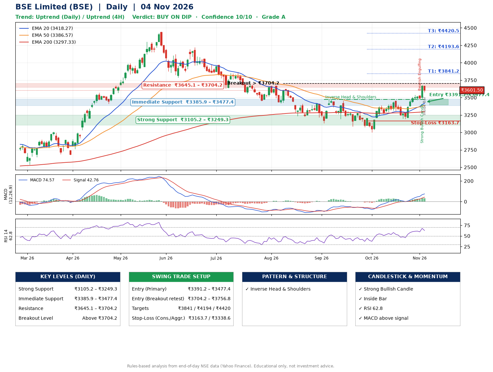

📌 **BSE Limited (BSE) – Multi-Timeframe Technical Analysis (Daily + 4H Combined)**
_Data up to 04 Nov 2026 · Close ₹3601.50_

**📍 Daily Timeframe Trend**
- Trend: **Uptrend** (higher highs and higher lows)
- Recent swing highs: ₹3474.5, ₹3308.0, ₹3455.0 · swing lows: ₹3131.5, ₹3000.0, ₹3190.0
- EMAs: EMA20 ₹3418.3, EMA50 ₹3386.6, EMA200 ₹3297.3; bullish stack (EMA20 > EMA50 > EMA200); price above EMA20, EMA50, EMA200
- MACD 74.57 above signal 42.76 (above zero); histogram falling
- RSI(14) 62.8; no divergence on the last two swings

**📍 4-Hour Timeframe Trend**
- Structure: **Uptrend** (higher highs and higher lows)
- Pullback/support area: recent 4H swing lows ₹3190.0, ₹3467.3; EMA20 ₹3488.2
- EMA20/50: bullish stack (EMA20 > EMA50); price above EMA20, EMA50
- MACD 78.30 above signal 64.36 (above zero); histogram falling
- RSI(14) 65.3; Regular bearish divergence

**📍 Pattern Detection (Both Timeframes)**
- Daily: **Inverse Head & Shoulders** – head ₹3000.0, neckline ₹3474.5
- 4H: **Inverse Head & Shoulders** – head ₹3190.0, neckline ₹3537.2

**📍 Candlestick Patterns (last 3 daily candles)**
- **Bearish Engulfing** – 02 Nov: sellers fully reversed the prior green candle
- **Strong Bullish Candle** – 03 Nov: wide-range green candle, buyers in control
- **Inside Bar** – 04 Nov: compression inside the prior range ₹3471.7–₹3677.9

**📍 Price Action Key Levels (Daily Structure)**

| Zone | Price Level (₹) | Context |
|------|-----------------|---------|
| Strong Support | ₹3105.2 – ₹3249.3 | Cluster of earlier swing lows (demand) |
| Immediate Support | ₹3385.9 – ₹3477.4 | Nearest swing-low / wick area |
| Resistance | ₹3645.1 – ₹3704.2 | Nearest swing-high supply |
| Breakout Level | Above ₹3704.2 | Swing continuation trigger (52-week high ₹4446.8) |

**📍 Swing Trade Setup**

🟢 **Entry Zone**
- Primary: ₹3391.2 – ₹3477.4 (daily support / EMA20 area; enter on a bullish 4H candle)
- Alternate: ₹3704.2 – ₹3756.8 (breakout retest)

🎯 **Profit Targets**
- T1: ₹3841.2
- T2: ₹4193.6
- T3: ₹4420.5

🛑 **Stop-Loss**
- Conservative: below daily swing low (₹3163.7)
- Aggressive: below 4H structure (₹3338.6)
- Risk per share ≈ ₹270.6; reward:risk to T1 ≈ 1.5

**📌 Strategy Notes**
- Higher timeframe: daily trend is uptrend; only take longs while price holds above ₹3105.2.
- Entry timing: wait for a bullish 4H candle (engulfing/hammer) inside ₹3391.2 – ₹3477.4 rather than buying mid-range.
- EMA stacking: bullish stack (EMA20 > EMA50 > EMA200); price above EMA20, EMA50, EMA200.
- Breakout rule: a daily close above ₹3704.2 with volume above its 20-day average (≈3,598,491) opens T2/T3.
- Momentum: RSI 63 – room to run; no divergence on the last two swings.
- Exit discipline: move the stop to entry once T1 is hit; book partial profits at each target.

**STEP 2 — Marked Up Chart**

**✅ Trade Validation Checklist**
- Trend + momentum aligned: Yes · Price at entry zone: No
- Stop defined (₹3163.7) · Reward:risk ≥ 1.5 to T1: Yes

## 📌 Final Verdict

Recommendation: **🟡 BUY ON DIP**

Confidence: **10/10**

Trade Quality: **A**

Reason:
• Daily uptrend (higher highs and higher lows)
• EMAs stacked bullishly

Next Action:
• Wait for a pullback to ₹3391.2–₹3477.4

_Rules-based analysis from end-of-day data. Educational only, not investment advice. Never place orders without your own confirmation._