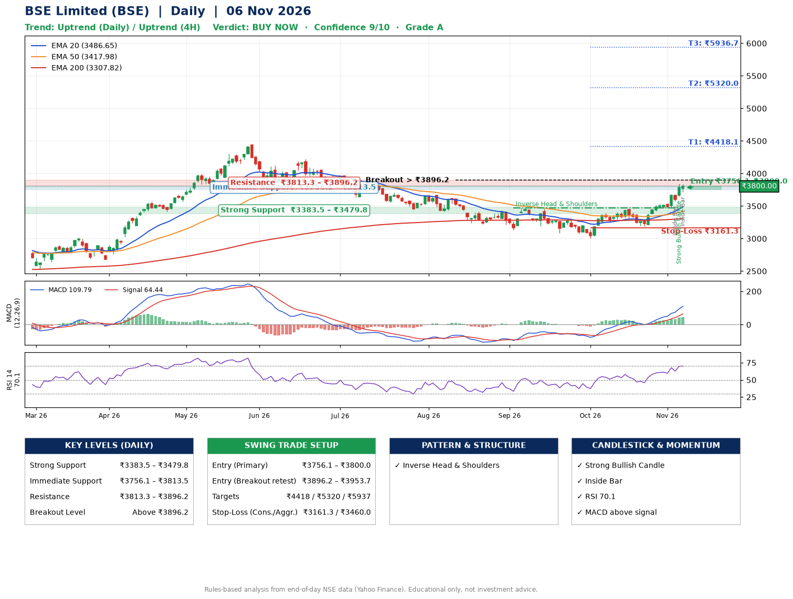

📌 **BSE Limited (BSE) – Multi-Timeframe Technical Analysis (Daily + 4H Combined)**
_Data up to 06 Nov 2026 · Close ₹3800.00_

**📍 Daily Timeframe Trend**
- Trend: **Uptrend** (higher highs and higher lows)
- Recent swing highs: ₹3474.5, ₹3308.0, ₹3455.0 · swing lows: ₹3131.5, ₹3000.0, ₹3190.0
- EMAs: EMA20 ₹3486.7, EMA50 ₹3418.0, EMA200 ₹3307.8; bullish stack (EMA20 > EMA50 > EMA200); price above EMA20, EMA50, EMA200
- MACD 109.79 above signal 64.44 (above zero); histogram rising
- RSI(14) 70.1; no divergence on the last two swings

**📍 4-Hour Timeframe Trend**
- Structure: **Uptrend** (higher highs and higher lows)
- Pullback/support area: recent 4H swing lows ₹3190.0, ₹3467.3; EMA20 ₹3588.2
- EMA20/50: bullish stack (EMA20 > EMA50); price above EMA20, EMA50
- MACD 113.51 above signal 89.52 (above zero); histogram falling
- RSI(14) 71.5; no divergence

**📍 Pattern Detection (Both Timeframes)**
- Daily: **Inverse Head & Shoulders** – head ₹3000.0, neckline ₹3474.5
- 4H: **Inverse Head & Shoulders** – head ₹3190.0, neckline ₹3537.2

**📍 Candlestick Patterns (last 3 daily candles)**
- **Inside Bar** – 04 Nov: compression inside the prior range ₹3471.7–₹3677.9
- **Strong Bullish Candle** – 05 Nov: wide-range green candle, buyers in control
- **Inside Bar** – 06 Nov: compression inside the prior range ₹3651.7–₹3842.0

**📍 Price Action Key Levels (Daily Structure)**

| Zone | Price Level (₹) | Context |
|------|-----------------|---------|
| Strong Support | ₹3383.5 – ₹3479.8 | Cluster of earlier swing lows (demand) |
| Immediate Support | ₹3756.1 – ₹3813.5 | Nearest swing-low / wick area |
| Resistance | ₹3813.3 – ₹3896.2 | Nearest swing-high supply |
| Breakout Level | Above ₹3896.2 | Swing continuation trigger (52-week high ₹4446.8) |

**📍 Swing Trade Setup**

🟢 **Entry Zone**
- Primary: ₹3756.1 – ₹3800.0 (daily support / EMA20 area; enter on a bullish 4H candle)
- Alternate: ₹3896.2 – ₹3953.7 (breakout retest)

🎯 **Profit Targets**
- T1: ₹4418.1
- T2: ₹5320.0
- T3: ₹5936.7

🛑 **Stop-Loss**
- Conservative: below daily swing low (₹3161.3)
- Aggressive: below 4H structure (₹3460.0)
- Risk per share ≈ ₹616.8; reward:risk to T1 ≈ 1.0

**📌 Strategy Notes**
- Higher timeframe: daily trend is uptrend; only take longs while price holds above ₹3383.5.
- Entry timing: wait for a bullish 4H candle (engulfing/hammer) inside ₹3756.1 – ₹3800.0 rather than buying mid-range.
- EMA stacking: bullish stack (EMA20 > EMA50 > EMA200); price above EMA20, EMA50, EMA200.
- Breakout rule: a daily close above ₹3896.2 with volume above its 20-day average (≈3,776,643) opens T2/T3.
- Momentum: RSI 70 – elevated, prefer dips; no divergence on the last two swings.
- Exit discipline: move the stop to entry once T1 is hit; book partial profits at each target.

**STEP 2 — Marked Up Chart**

**✅ Trade Validation Checklist**
- Trend + momentum aligned: Yes · Price at entry zone: Yes
- Stop defined (₹3161.3) · Reward:risk ≥ 1.5 to T1: No

## 📌 Final Verdict

Recommendation: **🟢 BUY NOW**

Confidence: **9/10**

Trade Quality: **A**

Reason:
• Daily uptrend (higher highs and higher lows)
• EMAs stacked bullishly

Next Action:
• Buy now within the entry zone, with the stop-loss in place

_Rules-based analysis from end-of-day data. Educational only, not investment advice. Never place orders without your own confirmation._