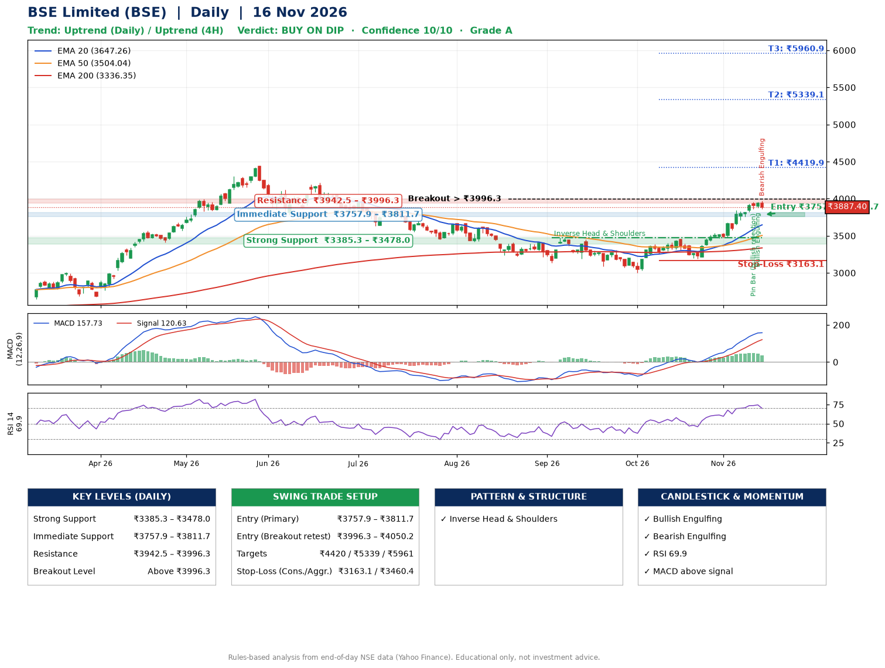

📌 **BSE Limited (BSE) – Multi-Timeframe Technical Analysis (Daily + 4H Combined)**
_Data up to 16 Nov 2026 · Close ₹3887.40_

**📍 Daily Timeframe Trend**
- Trend: **Uptrend** (higher highs and higher lows)
- Recent swing highs: ₹3474.5, ₹3308.0, ₹3455.0 · swing lows: ₹3131.5, ₹3000.0, ₹3190.0
- EMAs: EMA20 ₹3647.3, EMA50 ₹3504.0, EMA200 ₹3336.4; bullish stack (EMA20 > EMA50 > EMA200); price above EMA20, EMA50, EMA200
- MACD 157.73 above signal 120.63 (above zero); histogram falling
- RSI(14) 69.9; no divergence on the last two swings

**📍 4-Hour Timeframe Trend**
- Structure: **Uptrend** (higher highs and higher lows)
- Pullback/support area: recent 4H swing lows ₹3190.0, ₹3467.3; EMA20 ₹3799.6
- EMA20/50: bullish stack (EMA20 > EMA50); price above EMA20, EMA50
- MACD 106.79 below signal 118.34 (above zero), fresh bearish crossover; histogram falling
- RSI(14) 64.4; no divergence

**📍 Pattern Detection (Both Timeframes)**
- Daily: **Inverse Head & Shoulders** – head ₹3000.0, neckline ₹3474.5
- 4H: **Inverse Head & Shoulders** – head ₹3190.0, neckline ₹3537.2
- 4H: **Bull Flag** – 16% pole then a tight 4% flag; trigger above ₹4003.2

**📍 Candlestick Patterns (last 3 daily candles)**
- **Pin Bar (bullish rejection)** – 12 Nov: long lower wick shows dip-buying near ₹3862.7
- **Bullish Engulfing** – 13 Nov: buyers fully reversed the prior red candle
- **Bearish Engulfing** – 16 Nov: sellers fully reversed the prior green candle

**📍 Price Action Key Levels (Daily Structure)**

| Zone | Price Level (₹) | Context |
|------|-----------------|---------|
| Strong Support | ₹3385.3 – ₹3478.0 | Cluster of earlier swing lows (demand) |
| Immediate Support | ₹3757.9 – ₹3811.7 | Nearest swing-low / wick area |
| Resistance | ₹3942.5 – ₹3996.3 | Nearest swing-high supply |
| Breakout Level | Above ₹3996.3 | Swing continuation trigger (52-week high ₹4446.8) |

**📍 Swing Trade Setup**

🟢 **Entry Zone**
- Primary: ₹3757.9 – ₹3811.7 (daily support / EMA20 area; enter on a bullish 4H candle)
- Alternate: ₹3996.3 – ₹4050.2 (breakout retest)

🎯 **Profit Targets**
- T1: ₹4419.9
- T2: ₹5339.1
- T3: ₹5960.9

🛑 **Stop-Loss**
- Conservative: below daily swing low (₹3163.1)
- Aggressive: below 4H structure (₹3460.4)
- Risk per share ≈ ₹621.7; reward:risk to T1 ≈ 1.0
- Time to T1: about 18 trading days (it rose this much within 60 trading days 58% of the time in the last 2 years)
- Time to T2: about 33 trading days (it rose this much within 60 trading days 20% of the time in the last 2 years)

**📌 Strategy Notes**
- Higher timeframe: daily trend is uptrend; only take longs while price holds above ₹3385.3.
- Entry timing: wait for a bullish 4H candle (engulfing/hammer) inside ₹3757.9 – ₹3811.7 rather than buying mid-range.
- EMA stacking: bullish stack (EMA20 > EMA50 > EMA200); price above EMA20, EMA50, EMA200.
- Breakout rule: a daily close above ₹3996.3 with volume above its 20-day average (≈3,570,186) opens T2/T3.
- Momentum: RSI 70 – elevated, prefer dips; no divergence on the last two swings.
- Exit discipline: move the stop to entry once T1 is hit; book partial profits at each target.

**STEP 2 — Marked Up Chart**

**✅ Trade Validation Checklist**
- Trend + momentum aligned: Yes · Price at entry zone: No
- Stop defined (₹3163.1) · Reward:risk ≥ 1.5 to T1: No

## 📌 Final Verdict

Recommendation: **🟡 BUY ON DIP**

Confidence: **10/10**

Trade Quality: **A**

Reason:
• Daily uptrend (higher highs and higher lows)
• EMAs stacked bullishly

Next Action:
• Wait for a pullback to ₹3757.9–₹3811.7, or a breakout above ₹3996.3

_Rules-based analysis from end-of-day data. Educational only, not investment advice. Never place orders without your own confirmation._