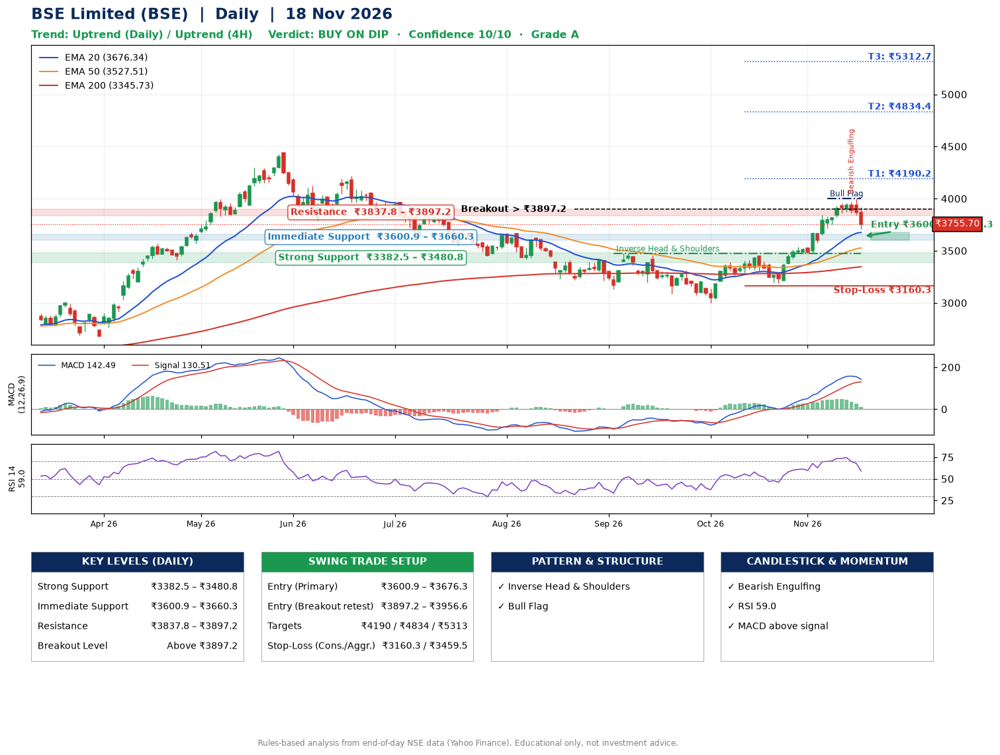

📌 **BSE Limited (BSE) – Multi-Timeframe Technical Analysis (Daily + 4H Combined)**
_Data up to 18 Nov 2026 · Close ₹3755.70_

**📍 Daily Timeframe Trend**
- Trend: **Uptrend** (higher highs and higher lows)
- Recent swing highs: ₹3474.5, ₹3308.0, ₹3455.0 · swing lows: ₹3131.5, ₹3000.0, ₹3190.0
- EMAs: EMA20 ₹3676.3, EMA50 ₹3527.5, EMA200 ₹3345.7; bullish stack (EMA20 > EMA50 > EMA200); price above EMA20, EMA50, EMA200
- MACD 142.49 above signal 130.51 (above zero); histogram falling
- RSI(14) 59.0; no divergence on the last two swings

**📍 4-Hour Timeframe Trend**
- Structure: **Uptrend** (higher highs and higher lows)
- Pullback/support area: recent 4H swing lows ₹3190.0, ₹3467.3; EMA20 ₹3794.2
- EMA20/50: bullish stack (EMA20 > EMA50); price above EMA50
- MACD 78.58 below signal 106.33 (above zero), fresh bearish crossover; histogram falling
- RSI(14) 50.6; Regular bearish divergence

**📍 Pattern Detection (Both Timeframes)**
- Daily: **Inverse Head & Shoulders** – head ₹3000.0, neckline ₹3474.5
- Daily: **Bull Flag** – 17% pole then a tight 8% flag; trigger above ₹4003.3
- 4H: **Inverse Head & Shoulders** – head ₹3190.0, neckline ₹3537.2
- 4H: **Bull Flag** – 16% pole then a tight 8% flag; trigger above ₹4003.2

**📍 Candlestick Patterns (last 3 daily candles)**
- **Bearish Engulfing** – 16 Nov: sellers fully reversed the prior green candle

**📍 Price Action Key Levels (Daily Structure)**

| Zone | Price Level (₹) | Context |
|------|-----------------|---------|
| Strong Support | ₹3382.5 – ₹3480.8 | Cluster of earlier swing lows (demand) |
| Immediate Support | ₹3600.9 – ₹3660.3 | Nearest swing-low / wick area |
| Resistance | ₹3837.8 – ₹3897.2 | Nearest swing-high supply |
| Breakout Level | Above ₹3897.2 | Swing continuation trigger (52-week high ₹4446.8) |

**📍 Swing Trade Setup**

🟢 **Entry Zone**
- Primary: ₹3600.9 – ₹3676.3 (daily support / EMA20 area; enter on a bullish 4H candle)
- Alternate: ₹3897.2 – ₹3956.6 (breakout retest)

🎯 **Profit Targets**
- T1: ₹4190.2
- T2: ₹4834.4
- T3: ₹5312.7

🛑 **Stop-Loss**
- Conservative: below daily swing low (₹3160.3)
- Aggressive: below 4H structure (₹3459.5)
- Risk per share ≈ ₹478.3; reward:risk to T1 ≈ 1.2
- Time to T1: about 16 trading days (it rose this much within 60 trading days 60% of the time in the last 2 years)
- Time to T2: about 31 trading days (it rose this much within 60 trading days 31% of the time in the last 2 years)

**📌 Strategy Notes**
- Higher timeframe: daily trend is uptrend; only take longs while price holds above ₹3382.5.
- Entry timing: wait for a bullish 4H candle (engulfing/hammer) inside ₹3600.9 – ₹3676.3 rather than buying mid-range.
- EMA stacking: bullish stack (EMA20 > EMA50 > EMA200); price above EMA20, EMA50, EMA200.
- Breakout rule: a daily close above ₹3897.2 with volume above its 20-day average (≈3,834,903) opens T2/T3.
- Momentum: RSI 59 – room to run; no divergence on the last two swings.
- Exit discipline: move the stop to entry once T1 is hit; book partial profits at each target.

**STEP 2 — Marked Up Chart**

**✅ Trade Validation Checklist**
- Trend + momentum aligned: Yes · Price at entry zone: No
- Stop defined (₹3160.3) · Reward:risk ≥ 1.5 to T1: No

## 📌 Final Verdict

Recommendation: **🟡 BUY ON DIP**

Confidence: **10/10**

Trade Quality: **A**

Reason:
• Daily uptrend (higher highs and higher lows)
• EMAs stacked bullishly

Next Action:
• Wait for a pullback to ₹3600.9–₹3676.3, or a breakout above ₹3897.2

_Rules-based analysis from end-of-day data. Educational only, not investment advice. Never place orders without your own confirmation._