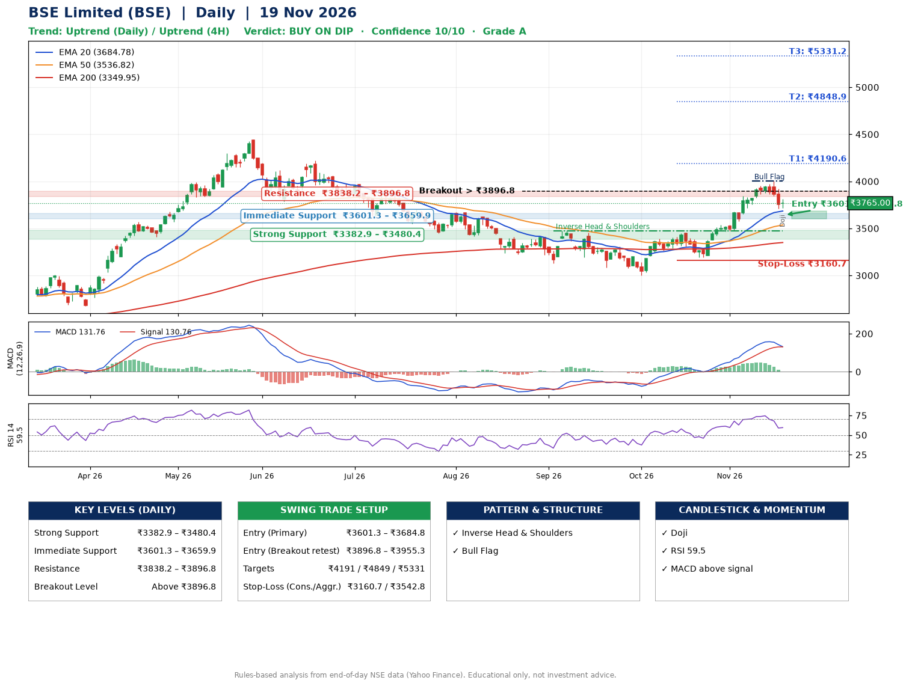

📌 **BSE Limited (BSE) – Multi-Timeframe Technical Analysis (Daily + 4H Combined)**
_Data up to 19 Nov 2026 · Close ₹3765.00_

**📍 Daily Timeframe Trend**
- Trend: **Uptrend** (higher highs and higher lows)
- Recent swing highs: ₹3474.5, ₹3308.0, ₹3455.0 · swing lows: ₹3131.5, ₹3000.0, ₹3190.0
- EMAs: EMA20 ₹3684.8, EMA50 ₹3536.8, EMA200 ₹3350.0; bullish stack (EMA20 > EMA50 > EMA200); price above EMA20, EMA50, EMA200
- MACD 131.76 above signal 130.76 (above zero); histogram falling
- RSI(14) 59.5; no divergence on the last two swings

**📍 4-Hour Timeframe Trend**
- Structure: **Uptrend** (higher highs and higher lows)
- Pullback/support area: recent 4H swing lows ₹3467.3, ₹3712.4; EMA20 ₹3786.9
- EMA20/50: bullish stack (EMA20 > EMA50); price above EMA50
- MACD 56.04 below signal 89.70 (above zero); histogram falling
- RSI(14) 51.7; Hidden bullish divergence; Regular bearish divergence

**📍 Pattern Detection (Both Timeframes)**
- Daily: **Inverse Head & Shoulders** – head ₹3000.0, neckline ₹3474.5
- Daily: **Bull Flag** – 18% pole then a tight 8% flag; trigger above ₹4003.3

**📍 Candlestick Patterns (last 3 daily candles)**
- **Doji** – 19 Nov: indecision; wait for the next candle to confirm direction

**📍 Price Action Key Levels (Daily Structure)**

| Zone | Price Level (₹) | Context |
|------|-----------------|---------|
| Strong Support | ₹3382.9 – ₹3480.4 | Cluster of earlier swing lows (demand) |
| Immediate Support | ₹3601.3 – ₹3659.9 | Nearest swing-low / wick area |
| Resistance | ₹3838.2 – ₹3896.8 | Nearest swing-high supply |
| Breakout Level | Above ₹3896.8 | Swing continuation trigger (52-week high ₹4446.8) |

**📍 Swing Trade Setup**

🟢 **Entry Zone**
- Primary: ₹3601.3 – ₹3684.8 (daily support / EMA20 area; enter on a bullish 4H candle)
- Alternate: ₹3896.8 – ₹3955.3 (breakout retest)

🎯 **Profit Targets**
- T1: ₹4190.6
- T2: ₹4848.9
- T3: ₹5331.2

🛑 **Stop-Loss**
- Conservative: below daily swing low (₹3160.7)
- Aggressive: below 4H structure (₹3542.8)
- Risk per share ≈ ₹482.3; reward:risk to T1 ≈ 1.1
- Time to T1: about 16 trading days (it rose this much within 60 trading days 60% of the time in the last 2 years)
- Time to T2: about 31 trading days (it rose this much within 60 trading days 30% of the time in the last 2 years)

**📌 Strategy Notes**
- Higher timeframe: daily trend is uptrend; only take longs while price holds above ₹3382.9.
- Entry timing: wait for a bullish 4H candle (engulfing/hammer) inside ₹3601.3 – ₹3684.8 rather than buying mid-range.
- EMA stacking: bullish stack (EMA20 > EMA50 > EMA200); price above EMA20, EMA50, EMA200.
- Breakout rule: a daily close above ₹3896.8 with volume above its 20-day average (≈3,840,750) opens T2/T3.
- Momentum: RSI 59 – room to run; no divergence on the last two swings.
- Exit discipline: move the stop to entry once T1 is hit; book partial profits at each target.

**STEP 2 — Marked Up Chart**

**✅ Trade Validation Checklist**
- Trend + momentum aligned: Yes · Price at entry zone: No
- Stop defined (₹3160.7) · Reward:risk ≥ 1.5 to T1: No

## 📌 Final Verdict

Recommendation: **🟡 BUY ON DIP**

Confidence: **10/10**

Trade Quality: **A**

Reason:
• Daily uptrend (higher highs and higher lows)
• EMAs stacked bullishly

Next Action:
• Wait for a pullback to ₹3601.3–₹3684.8, or a breakout above ₹3896.8

_Rules-based analysis from end-of-day data. Educational only, not investment advice. Never place orders without your own confirmation._