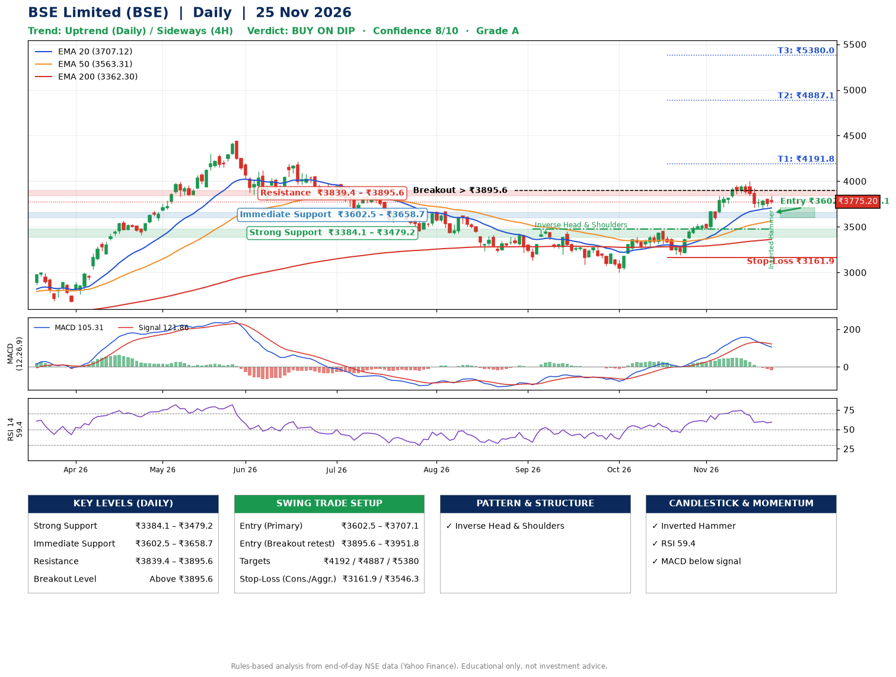

📌 **BSE Limited (BSE) – Multi-Timeframe Technical Analysis (Daily + 4H Combined)**
_Data up to 25 Nov 2026 · Close ₹3775.20_

**📍 Daily Timeframe Trend**
- Trend: **Uptrend** (higher highs and higher lows)
- Recent swing highs: ₹3308.0, ₹3455.0, ₹4003.3 · swing lows: ₹3131.5, ₹3000.0, ₹3190.0
- EMAs: EMA20 ₹3707.1, EMA50 ₹3563.3, EMA200 ₹3362.3; bullish stack (EMA20 > EMA50 > EMA200); price above EMA20, EMA50, EMA200
- MACD 105.31 below signal 121.86 (above zero), fresh bearish crossover; histogram falling
- RSI(14) 59.4; no divergence on the last two swings

**📍 4-Hour Timeframe Trend**
- Structure: **Sideways** (mixed swing structure)
- Pullback/support area: recent 4H swing lows ₹3712.4, ₹3694.9; EMA20 ₹3777.6
- EMA20/50: bullish stack (EMA20 > EMA50); price above EMA50
- MACD 23.23 below signal 46.59 (above zero); histogram rising
- RSI(14) 52.9; Regular bearish divergence

**📍 Pattern Detection (Both Timeframes)**
- Daily: **Inverse Head & Shoulders** – head ₹3000.0, neckline ₹3474.5

**📍 Candlestick Patterns (last 3 daily candles)**
- **Inverted Hammer** – 25 Nov: long upper wick shows selling near ₹3837.6

**📍 Price Action Key Levels (Daily Structure)**

| Zone | Price Level (₹) | Context |
|------|-----------------|---------|
| Strong Support | ₹3384.1 – ₹3479.2 | Cluster of earlier swing lows (demand) |
| Immediate Support | ₹3602.5 – ₹3658.7 | Nearest swing-low / wick area |
| Resistance | ₹3839.4 – ₹3895.6 | Nearest swing-high supply |
| Breakout Level | Above ₹3895.6 | Swing continuation trigger (52-week high ₹4446.8) |

**📍 Swing Trade Setup**

🟢 **Entry Zone**
- Primary: ₹3602.5 – ₹3707.1 (daily support / EMA20 area; enter on a bullish 4H candle)
- Alternate: ₹3895.6 – ₹3951.8 (breakout retest)

🎯 **Profit Targets**
- T1: ₹4191.8
- T2: ₹4887.1
- T3: ₹5380.0

🛑 **Stop-Loss**
- Conservative: below daily swing low (₹3161.9)
- Aggressive: below 4H structure (₹3546.3)
- Risk per share ≈ ₹492.9; reward:risk to T1 ≈ 1.1
- Time to T1: about 16 trading days (it rose this much within 60 trading days 61% of the time in the last 2 years)
- Time to T2: about 31 trading days (it rose this much within 60 trading days 29% of the time in the last 2 years)

**📌 Strategy Notes**
- Higher timeframe: daily trend is uptrend; only take longs while price holds above ₹3384.1.
- Entry timing: wait for a bullish 4H candle (engulfing/hammer) inside ₹3602.5 – ₹3707.1 rather than buying mid-range.
- EMA stacking: bullish stack (EMA20 > EMA50 > EMA200); price above EMA20, EMA50, EMA200.
- Breakout rule: a daily close above ₹3895.6 with volume above its 20-day average (≈3,861,541) opens T2/T3.
- Momentum: RSI 59 – room to run; no divergence on the last two swings.
- Exit discipline: move the stop to entry once T1 is hit; book partial profits at each target.

**STEP 2 — Marked Up Chart**

**✅ Trade Validation Checklist**
- Trend + momentum aligned: No · Price at entry zone: No
- Stop defined (₹3161.9) · Reward:risk ≥ 1.5 to T1: No

## 📌 Final Verdict

Recommendation: **🟡 BUY ON DIP**

Confidence: **8/10**

Trade Quality: **A**

Reason:
• Daily uptrend (higher highs and higher lows)
• EMAs stacked bullishly

Next Action:
• Wait for a pullback to ₹3602.5–₹3707.1, or a breakout above ₹3895.6

_Rules-based analysis from end-of-day data. Educational only, not investment advice. Never place orders without your own confirmation._