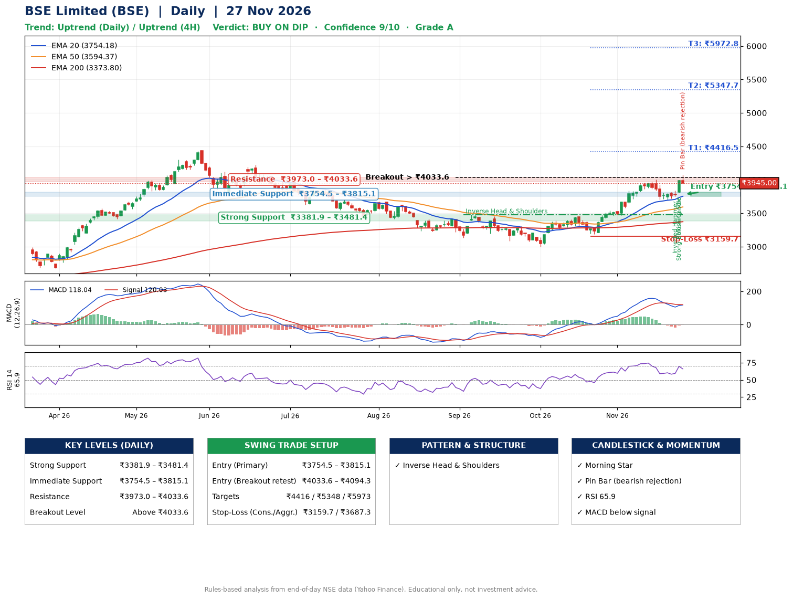

📌 **BSE Limited (BSE) – Multi-Timeframe Technical Analysis (Daily + 4H Combined)**
_Data up to 27 Nov 2026 · Close ₹3945.00_

**📍 Daily Timeframe Trend**
- Trend: **Uptrend** (higher highs and higher lows)
- Recent swing highs: ₹3308.0, ₹3455.0, ₹4003.3 · swing lows: ₹3131.5, ₹3000.0, ₹3190.0
- EMAs: EMA20 ₹3754.2, EMA50 ₹3594.4, EMA200 ₹3373.8; bullish stack (EMA20 > EMA50 > EMA200); price above EMA20, EMA50, EMA200
- MACD 118.04 below signal 120.03 (above zero), fresh bearish crossover; histogram rising
- RSI(14) 65.9; no divergence on the last two swings

**📍 4-Hour Timeframe Trend**
- Structure: **Uptrend** (price above rising EMAs)
- Pullback/support area: recent 4H swing lows ₹3712.4, ₹3694.9; EMA20 ₹3840.3
- EMA20/50: bullish stack (EMA20 > EMA50); price above EMA20, EMA50
- MACD 57.70 above signal 49.26 (above zero), fresh bullish crossover; histogram rising
- RSI(14) 65.2; Regular bearish divergence

**📍 Pattern Detection (Both Timeframes)**
- Daily: **Inverse Head & Shoulders** – head ₹3000.0, neckline ₹3474.5

**📍 Candlestick Patterns (last 3 daily candles)**
- **Inverted Hammer** – 25 Nov: long upper wick shows selling near ₹3837.6
- **Strong Bullish Candle** – 26 Nov: wide-range green candle, buyers in control
- **Morning Star** – 26 Nov: three-candle bullish reversal
- **Pin Bar (bearish rejection)** – 27 Nov: long upper wick shows selling near ₹4077.7

**📍 Price Action Key Levels (Daily Structure)**

| Zone | Price Level (₹) | Context |
|------|-----------------|---------|
| Strong Support | ₹3381.9 – ₹3481.4 | Cluster of earlier swing lows (demand) |
| Immediate Support | ₹3754.5 – ₹3815.1 | Nearest swing-low / wick area |
| Resistance | ₹3973.0 – ₹4033.6 | Nearest swing-high supply |
| Breakout Level | Above ₹4033.6 | Swing continuation trigger (52-week high ₹4446.8) |

**📍 Swing Trade Setup**

🟢 **Entry Zone**
- Primary: ₹3754.5 – ₹3815.1 (daily support / EMA20 area; enter on a bullish 4H candle)
- Alternate: ₹4033.6 – ₹4094.3 (breakout retest)

🎯 **Profit Targets**
- T1: ₹4416.5
- T2: ₹5347.7
- T3: ₹5972.8

🛑 **Stop-Loss**
- Conservative: below daily swing low (₹3159.7)
- Aggressive: below 4H structure (₹3687.3)
- Risk per share ≈ ₹625.1; reward:risk to T1 ≈ 1.0
- Time to T1: about 19 trading days (it rose this much within 60 trading days 58% of the time in the last 2 years)
- Time to T2: about 33 trading days (it rose this much within 60 trading days 19% of the time in the last 2 years)

**📌 Strategy Notes**
- Higher timeframe: daily trend is uptrend; only take longs while price holds above ₹3381.9.
- Entry timing: wait for a bullish 4H candle (engulfing/hammer) inside ₹3754.5 – ₹3815.1 rather than buying mid-range.
- EMA stacking: bullish stack (EMA20 > EMA50 > EMA200); price above EMA20, EMA50, EMA200.
- Breakout rule: a daily close above ₹4033.6 with volume above its 20-day average (≈3,923,770) opens T2/T3.
- Momentum: RSI 66 – elevated, prefer dips; no divergence on the last two swings.
- Exit discipline: move the stop to entry once T1 is hit; book partial profits at each target.

**STEP 2 — Marked Up Chart**

**✅ Trade Validation Checklist**
- Trend + momentum aligned: No · Price at entry zone: No
- Stop defined (₹3159.7) · Reward:risk ≥ 1.5 to T1: No

## 📌 Final Verdict

Recommendation: **🟡 BUY ON DIP**

Confidence: **9/10**

Trade Quality: **A**

Reason:
• Daily uptrend (higher highs and higher lows)
• EMAs stacked bullishly

Next Action:
• Wait for a pullback to ₹3754.5–₹3815.1

_Rules-based analysis from end-of-day data. Educational only, not investment advice. Never place orders without your own confirmation._