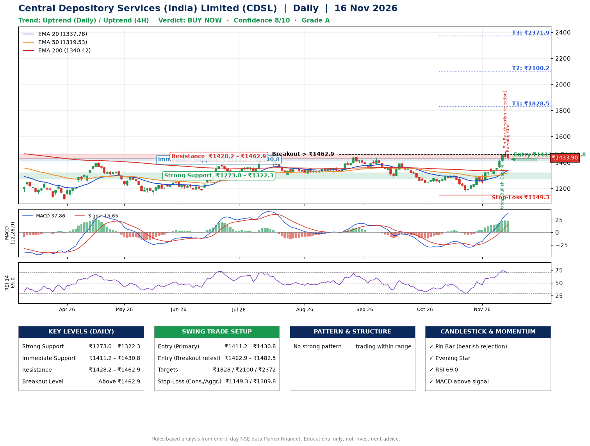

📌 **Central Depository Services (India) Limited (CDSL) – Multi-Timeframe Technical Analysis (Daily + 4H Combined)**
_Data up to 16 Nov 2026 · Close ₹1433.90_

**📍 Daily Timeframe Trend**
- Trend: **Uptrend** (price above rising EMAs)
- Recent swing highs: ₹1438.0, ₹1394.4, ₹1306.5 · swing lows: ₹1284.0, ₹1223.9, ₹1159.1
- EMAs: EMA20 ₹1337.8, EMA50 ₹1319.5, EMA200 ₹1340.4; mixed / crossing; price above EMA20, EMA50, EMA200
- MACD 37.86 above signal 15.65 (above zero); histogram falling
- RSI(14) 69.0; no divergence on the last two swings

**📍 4-Hour Timeframe Trend**
- Structure: **Uptrend** (higher highs and higher lows)
- Pullback/support area: recent 4H swing lows ₹1240.9, ₹1312.4; EMA20 ₹1376.7
- EMA20/50: bullish stack (EMA20 > EMA50); price above EMA20, EMA50
- MACD 46.91 above signal 40.27 (above zero); histogram falling
- RSI(14) 71.8; no divergence

**📍 Pattern Detection (Both Timeframes)**
- No strong pattern detected. Trading within range.

**📍 Candlestick Patterns (last 3 daily candles)**
- **Strong Bullish Candle** – 12 Nov: wide-range green candle, buyers in control
- **Pin Bar (bearish rejection)** – 13 Nov: long upper wick shows selling near ₹1484.8
- **Evening Star** – 16 Nov: three-candle bearish reversal

**📍 Price Action Key Levels (Daily Structure)**

| Zone | Price Level (₹) | Context |
|------|-----------------|---------|
| Strong Support | ₹1273.0 – ₹1322.3 | Cluster of earlier swing lows (demand) |
| Immediate Support | ₹1411.2 – ₹1430.8 | Nearest swing-low / wick area |
| Resistance | ₹1428.2 – ₹1462.9 | Nearest swing-high supply |
| Breakout Level | Above ₹1462.9 | Swing continuation trigger (52-week high ₹1673.7) |

**📍 Swing Trade Setup**

🟢 **Entry Zone**
- Primary: ₹1411.2 – ₹1430.8 (daily support / EMA20 area; enter on a bullish 4H candle)
- Alternate: ₹1462.9 – ₹1482.5 (breakout retest)

🎯 **Profit Targets**
- T1: ₹1828.5
- T2: ₹2100.2
- T3: ₹2371.9

🛑 **Stop-Loss**
- Conservative: below daily swing low (₹1149.3)
- Aggressive: below 4H structure (₹1309.8)
- Risk per share ≈ ₹271.7; reward:risk to T1 ≈ 1.5
- Time to T1: about 30 trading days (it rose this much within 60 trading days 13% of the time in the last 2 years)
- Time to T2: about 48 trading days (it rose this much within 60 trading days 7% of the time in the last 2 years)

**📌 Strategy Notes**
- Higher timeframe: daily trend is uptrend; only take longs while price holds above ₹1273.0.
- Entry timing: wait for a bullish 4H candle (engulfing/hammer) inside ₹1411.2 – ₹1430.8 rather than buying mid-range.
- EMA stacking: mixed / crossing; price above EMA20, EMA50, EMA200.
- Breakout rule: a daily close above ₹1462.9 with volume above its 20-day average (≈1,605,955) opens T2/T3.
- Momentum: RSI 69 – elevated, prefer dips; no divergence on the last two swings.
- Exit discipline: move the stop to entry once T1 is hit; book partial profits at each target.

**STEP 2 — Marked Up Chart**

**✅ Trade Validation Checklist**
- Trend + momentum aligned: Yes · Price at entry zone: No
- Stop defined (₹1149.3) · Reward:risk ≥ 1.5 to T1: No

## 📌 Final Verdict

Recommendation: **🟢 BUY NOW**

Confidence: **8/10**

Trade Quality: **A**

Reason:
• Daily uptrend (price above rising EMAs)

Next Action:
• Buy now within the entry zone, with the stop-loss in place

_Rules-based analysis from end-of-day data. Educational only, not investment advice. Never place orders without your own confirmation._