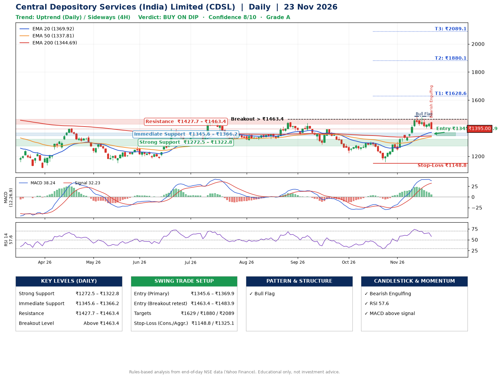

📌 **Central Depository Services (India) Limited (CDSL) – Multi-Timeframe Technical Analysis (Daily + 4H Combined)**
_Data up to 23 Nov 2026 · Close ₹1395.00_

**📍 Daily Timeframe Trend**
- Trend: **Uptrend** (price above rising EMAs)
- Recent swing highs: ₹1394.4, ₹1306.5, ₹1484.8 · swing lows: ₹1284.0, ₹1223.9, ₹1159.1
- EMAs: EMA20 ₹1369.9, EMA50 ₹1337.8, EMA200 ₹1344.7; mixed / crossing; price above EMA20, EMA50, EMA200
- MACD 38.24 above signal 32.23 (above zero); histogram falling
- RSI(14) 57.6; no divergence on the last two swings

**📍 4-Hour Timeframe Trend**
- Structure: **Sideways** (mixed swing structure)
- Pullback/support area: recent 4H swing lows ₹1419.0, ₹1401.3; EMA20 ₹1403.9
- EMA20/50: bullish stack (EMA20 > EMA50); price above EMA50
- MACD 23.16 below signal 32.36 (above zero); histogram falling
- RSI(14) 51.5; no divergence

**📍 Pattern Detection (Both Timeframes)**
- Daily: **Bull Flag** – 15% pole then a tight 6% flag; trigger above ₹1484.8
- 4H: **Bull Flag** – 15% pole then a tight 5% flag; trigger above ₹1467.4

**📍 Candlestick Patterns (last 3 daily candles)**
- **Bearish Engulfing** – 23 Nov: sellers fully reversed the prior green candle

**📍 Price Action Key Levels (Daily Structure)**

| Zone | Price Level (₹) | Context |
|------|-----------------|---------|
| Strong Support | ₹1272.5 – ₹1322.8 | Cluster of earlier swing lows (demand) |
| Immediate Support | ₹1345.6 – ₹1366.2 | Nearest swing-low / wick area |
| Resistance | ₹1427.7 – ₹1463.4 | Nearest swing-high supply |
| Breakout Level | Above ₹1463.4 | Swing continuation trigger (52-week high ₹1673.7) |

**📍 Swing Trade Setup**

🟢 **Entry Zone**
- Primary: ₹1345.6 – ₹1369.9 (daily support / EMA20 area; enter on a bullish 4H candle)
- Alternate: ₹1463.4 – ₹1483.9 (breakout retest)

🎯 **Profit Targets**
- T1: ₹1628.6
- T2: ₹1880.1
- T3: ₹2089.1

🛑 **Stop-Loss**
- Conservative: below daily swing low (₹1148.8)
- Aggressive: below 4H structure (₹1325.1)
- Risk per share ≈ ₹208.9; reward:risk to T1 ≈ 1.3
- Time to T1: about 24 trading days (it rose this much within 60 trading days 19% of the time in the last 2 years)
- Time to T2: about 39 trading days (it rose this much within 60 trading days 9% of the time in the last 2 years)

**📌 Strategy Notes**
- Higher timeframe: daily trend is uptrend; only take longs while price holds above ₹1272.5.
- Entry timing: wait for a bullish 4H candle (engulfing/hammer) inside ₹1345.6 – ₹1369.9 rather than buying mid-range.
- EMA stacking: mixed / crossing; price above EMA20, EMA50, EMA200.
- Breakout rule: a daily close above ₹1463.4 with volume above its 20-day average (≈1,825,133) opens T2/T3.
- Momentum: RSI 58 – room to run; no divergence on the last two swings.
- Exit discipline: move the stop to entry once T1 is hit; book partial profits at each target.

**STEP 2 — Marked Up Chart**

**✅ Trade Validation Checklist**
- Trend + momentum aligned: Yes · Price at entry zone: No
- Stop defined (₹1148.8) · Reward:risk ≥ 1.5 to T1: No

## 📌 Final Verdict

Recommendation: **🟡 BUY ON DIP**

Confidence: **8/10**

Trade Quality: **A**

Reason:
• Daily uptrend (price above rising EMAs)
• Bull Flag: 15% pole then a tight 6% flag; trigger above ₹1484.8

Next Action:
• Wait for a pullback to ₹1345.6–₹1369.9, or a breakout above ₹1463.4

_Rules-based analysis from end-of-day data. Educational only, not investment advice. Never place orders without your own confirmation._