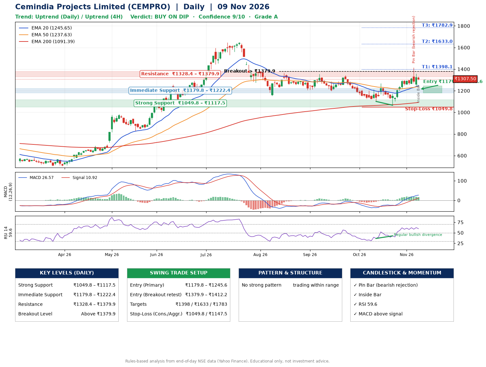

📌 **Cemindia Projects Limited (CEMPRO) – Multi-Timeframe Technical Analysis (Daily + 4H Combined)**
_Data up to 09 Nov 2026 · Close ₹1307.50_

**📍 Daily Timeframe Trend**
- Trend: **Uptrend** (price above rising EMAs)
- Recent swing highs: ₹1355.0, ₹1344.6, ₹1268.8 · swing lows: ₹1196.0, ₹1101.3, ₹1066.0
- EMAs: EMA20 ₹1245.6, EMA50 ₹1237.6, EMA200 ₹1091.4; bullish stack (EMA20 > EMA50 > EMA200); price above EMA20, EMA50, EMA200
- MACD 26.57 above signal 10.92 (above zero); histogram falling
- RSI(14) 59.6; Regular bullish divergence

**📍 4-Hour Timeframe Trend**
- Structure: **Uptrend** (higher highs and higher lows)
- Pullback/support area: recent 4H swing lows ₹1066.8, ₹1240.2; EMA20 ₹1274.9
- EMA20/50: bullish stack (EMA20 > EMA50); price above EMA20, EMA50
- MACD 33.26 above signal 32.39 (above zero); histogram falling
- RSI(14) 55.1; no divergence

**📍 Pattern Detection (Both Timeframes)**
- No strong pattern detected. Trading within range.

**📍 Candlestick Patterns (last 3 daily candles)**
- **Pin Bar (bearish rejection)** – 05 Nov: long upper wick shows selling near ₹1414.3
- **Inside Bar** – 09 Nov: compression inside the prior range ₹1239.6–₹1357.0

**📍 Price Action Key Levels (Daily Structure)**

| Zone | Price Level (₹) | Context |
|------|-----------------|---------|
| Strong Support | ₹1049.8 – ₹1117.5 | Cluster of earlier swing lows (demand) |
| Immediate Support | ₹1179.8 – ₹1222.4 | Nearest swing-low / wick area |
| Resistance | ₹1328.4 – ₹1379.9 | Nearest swing-high supply |
| Breakout Level | Above ₹1379.9 | Swing continuation trigger (52-week high ₹1649.2) |

**📍 Swing Trade Setup**

🟢 **Entry Zone**
- Primary: ₹1179.8 – ₹1245.6 (daily support / EMA20 area; enter on a bullish 4H candle)
- Alternate: ₹1379.9 – ₹1412.2 (breakout retest)

🎯 **Profit Targets**
- T1: ₹1398.1
- T2: ₹1633.0
- T3: ₹1782.9

🛑 **Stop-Loss**
- Conservative: below daily swing low (₹1049.8)
- Aggressive: below 4H structure (₹1147.5)
- Risk per share ≈ ₹162.9; reward:risk to T1 ≈ 1.1

**📌 Strategy Notes**
- Higher timeframe: daily trend is uptrend; only take longs while price holds above ₹1049.8.
- Entry timing: wait for a bullish 4H candle (engulfing/hammer) inside ₹1179.8 – ₹1245.6 rather than buying mid-range.
- EMA stacking: bullish stack (EMA20 > EMA50 > EMA200); price above EMA20, EMA50, EMA200.
- Breakout rule: a daily close above ₹1379.9 with volume above its 20-day average (≈615,289) opens T2/T3.
- Momentum: RSI 60 – room to run; Regular bullish divergence.
- Exit discipline: move the stop to entry once T1 is hit; book partial profits at each target.

**STEP 2 — Marked Up Chart**

**✅ Trade Validation Checklist**
- Trend + momentum aligned: Yes · Price at entry zone: No
- Stop defined (₹1049.8) · Reward:risk ≥ 1.5 to T1: No

## 📌 Final Verdict

Recommendation: **🟡 BUY ON DIP**

Confidence: **9/10**

Trade Quality: **A**

Reason:
• Daily uptrend (price above rising EMAs)
• EMAs stacked bullishly

Next Action:
• Wait for a pullback to ₹1179.8–₹1245.6

_Rules-based analysis from end-of-day data. Educational only, not investment advice. Never place orders without your own confirmation._