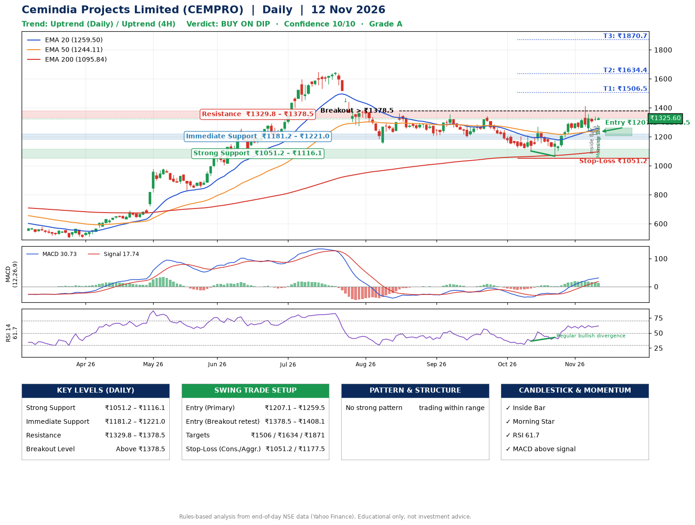

📌 **Cemindia Projects Limited (CEMPRO) – Multi-Timeframe Technical Analysis (Daily + 4H Combined)**
_Data up to 12 Nov 2026 · Close ₹1325.60_

**📍 Daily Timeframe Trend**
- Trend: **Uptrend** (price above rising EMAs)
- Recent swing highs: ₹1355.0, ₹1344.6, ₹1268.8 · swing lows: ₹1196.0, ₹1101.3, ₹1066.0
- EMAs: EMA20 ₹1259.5, EMA50 ₹1244.1, EMA200 ₹1095.8; bullish stack (EMA20 > EMA50 > EMA200); price above EMA20, EMA50, EMA200
- MACD 30.73 above signal 17.74 (above zero); histogram falling
- RSI(14) 61.7; Regular bullish divergence

**📍 4-Hour Timeframe Trend**
- Structure: **Uptrend** (higher highs and higher lows)
- Pullback/support area: recent 4H swing lows ₹1066.8, ₹1240.2; EMA20 ₹1291.5
- EMA20/50: bullish stack (EMA20 > EMA50); price above EMA20, EMA50
- MACD 31.04 below signal 32.08 (above zero), fresh bearish crossover; histogram falling
- RSI(14) 56.6; no divergence

**📍 Pattern Detection (Both Timeframes)**
- No strong pattern detected. Trading within range.

**📍 Candlestick Patterns (last 3 daily candles)**
- **Inside Bar** – 09 Nov: compression inside the prior range ₹1239.6–₹1357.0
- **Doji** – 11 Nov: indecision; wait for the next candle to confirm direction
- **Inside Bar** – 12 Nov: compression inside the prior range ₹1311.9–₹1338.9
- **Morning Star** – 12 Nov: three-candle bullish reversal

**📍 Price Action Key Levels (Daily Structure)**

| Zone | Price Level (₹) | Context |
|------|-----------------|---------|
| Strong Support | ₹1051.2 – ₹1116.1 | Cluster of earlier swing lows (demand) |
| Immediate Support | ₹1181.2 – ₹1221.0 | Nearest swing-low / wick area |
| Resistance | ₹1329.8 – ₹1378.5 | Nearest swing-high supply |
| Breakout Level | Above ₹1378.5 | Swing continuation trigger (52-week high ₹1649.2) |

**📍 Swing Trade Setup**

🟢 **Entry Zone**
- Primary: ₹1207.1 – ₹1259.5 (daily support / EMA20 area; enter on a bullish 4H candle)
- Alternate: ₹1378.5 – ₹1408.1 (breakout retest)

🎯 **Profit Targets**
- T1: ₹1506.5
- T2: ₹1634.4
- T3: ₹1870.7

🛑 **Stop-Loss**
- Conservative: below daily swing low (₹1051.2)
- Aggressive: below 4H structure (₹1177.5)
- Risk per share ≈ ₹182.1; reward:risk to T1 ≈ 1.5
- Time to T1: about 19 trading days (it rose this much within 60 trading days 43% of the time in the last 2 years)
- Time to T2: about 25 trading days (it rose this much within 60 trading days 36% of the time in the last 2 years)

**📌 Strategy Notes**
- Higher timeframe: daily trend is uptrend; only take longs while price holds above ₹1051.2.
- Entry timing: wait for a bullish 4H candle (engulfing/hammer) inside ₹1207.1 – ₹1259.5 rather than buying mid-range.
- EMA stacking: bullish stack (EMA20 > EMA50 > EMA200); price above EMA20, EMA50, EMA200.
- Breakout rule: a daily close above ₹1378.5 with volume above its 20-day average (≈559,833) opens T2/T3.
- Momentum: RSI 62 – room to run; Regular bullish divergence.
- Exit discipline: move the stop to entry once T1 is hit; book partial profits at each target.

**STEP 2 — Marked Up Chart**

**✅ Trade Validation Checklist**
- Trend + momentum aligned: Yes · Price at entry zone: No
- Stop defined (₹1051.2) · Reward:risk ≥ 1.5 to T1: Yes

## 📌 Final Verdict

Recommendation: **🟡 BUY ON DIP**

Confidence: **10/10**

Trade Quality: **A**

Reason:
• Daily uptrend (price above rising EMAs)
• EMAs stacked bullishly

Next Action:
• Wait for a pullback to ₹1207.1–₹1259.5

_Rules-based analysis from end-of-day data. Educational only, not investment advice. Never place orders without your own confirmation._