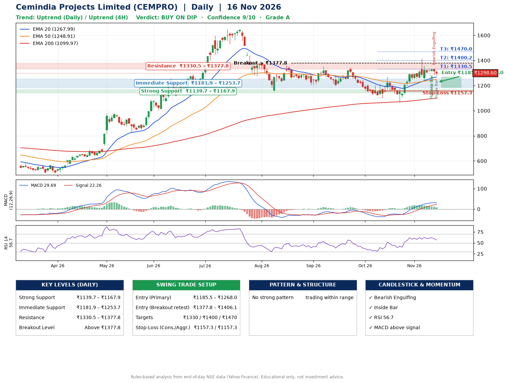

📌 **Cemindia Projects Limited (CEMPRO) – Multi-Timeframe Technical Analysis (Daily + 4H Combined)**
_Data up to 16 Nov 2026 · Close ₹1298.60_

**📍 Daily Timeframe Trend**
- Trend: **Uptrend** (higher highs and higher lows)
- Recent swing highs: ₹1344.6, ₹1268.8, ₹1414.3 · swing lows: ₹1101.3, ₹1066.0, ₹1239.6
- EMAs: EMA20 ₹1268.0, EMA50 ₹1248.9, EMA200 ₹1100.0; bullish stack (EMA20 > EMA50 > EMA200); price above EMA20, EMA50, EMA200
- MACD 29.69 above signal 22.26 (above zero); histogram falling
- RSI(14) 56.7; no divergence on the last two swings

**📍 4-Hour Timeframe Trend**
- Structure: **Uptrend** (higher highs and higher lows)
- Pullback/support area: recent 4H swing lows ₹1066.8, ₹1240.2; EMA20 ₹1294.5
- EMA20/50: bullish stack (EMA20 > EMA50); price above EMA20, EMA50
- MACD 20.64 below signal 27.11 (above zero); histogram falling
- RSI(14) 52.3; no divergence

**📍 Pattern Detection (Both Timeframes)**
- 4H: **Bull Flag** – 15% pole then a tight 4% flag; trigger above ₹1338.0

**📍 Candlestick Patterns (last 3 daily candles)**
- **Inside Bar** – 12 Nov: compression inside the prior range ₹1311.9–₹1338.9
- **Morning Star** – 12 Nov: three-candle bullish reversal
- **Bearish Engulfing** – 13 Nov: sellers fully reversed the prior green candle
- **Inside Bar** – 16 Nov: compression inside the prior range ₹1282.0–₹1330.0

**📍 Price Action Key Levels (Daily Structure)**

| Zone | Price Level (₹) | Context |
|------|-----------------|---------|
| Strong Support | ₹1139.7 – ₹1167.9 | Cluster of earlier swing lows (demand) |
| Immediate Support | ₹1181.9 – ₹1253.7 | Nearest swing-low / wick area |
| Resistance | ₹1330.5 – ₹1377.8 | Nearest swing-high supply |
| Breakout Level | Above ₹1377.8 | Swing continuation trigger (52-week high ₹1649.2) |

**📍 Swing Trade Setup**

🟢 **Entry Zone**
- Primary: ₹1185.5 – ₹1268.0 (daily support / EMA20 area; enter on a bullish 4H candle)
- Alternate: ₹1377.8 – ₹1406.1 (breakout retest)

🎯 **Profit Targets**
- T1: ₹1330.5
- T2: ₹1400.2
- T3: ₹1470.0

🛑 **Stop-Loss**
- Conservative: below daily swing low (₹1157.3)
- Aggressive: below 4H structure (₹1157.3)
- Risk per share ≈ ₹69.5; reward:risk to T1 ≈ 1.5
- Time to T1: about 11 trading days (it rose this much within 60 trading days 71% of the time in the last 2 years)
- Time to T2: about 14 trading days (it rose this much within 60 trading days 51% of the time in the last 2 years)

**📌 Strategy Notes**
- Higher timeframe: daily trend is uptrend; only take longs while price holds above ₹1139.7.
- Entry timing: wait for a bullish 4H candle (engulfing/hammer) inside ₹1185.5 – ₹1268.0 rather than buying mid-range.
- EMA stacking: bullish stack (EMA20 > EMA50 > EMA200); price above EMA20, EMA50, EMA200.
- Breakout rule: a daily close above ₹1377.8 with volume above its 20-day average (≈450,825) opens T2/T3.
- Momentum: RSI 57 – room to run; no divergence on the last two swings.
- Exit discipline: move the stop to entry once T1 is hit; book partial profits at each target.

**STEP 2 — Marked Up Chart**

**✅ Trade Validation Checklist**
- Trend + momentum aligned: Yes · Price at entry zone: No
- Stop defined (₹1157.3) · Reward:risk ≥ 1.5 to T1: No

## 📌 Final Verdict

Recommendation: **🟡 BUY ON DIP**

Confidence: **9/10**

Trade Quality: **A**

Reason:
• Daily uptrend (higher highs and higher lows)
• EMAs stacked bullishly

Next Action:
• Wait for a pullback to ₹1185.5–₹1268.0, or a breakout above ₹1377.8

_Rules-based analysis from end-of-day data. Educational only, not investment advice. Never place orders without your own confirmation._