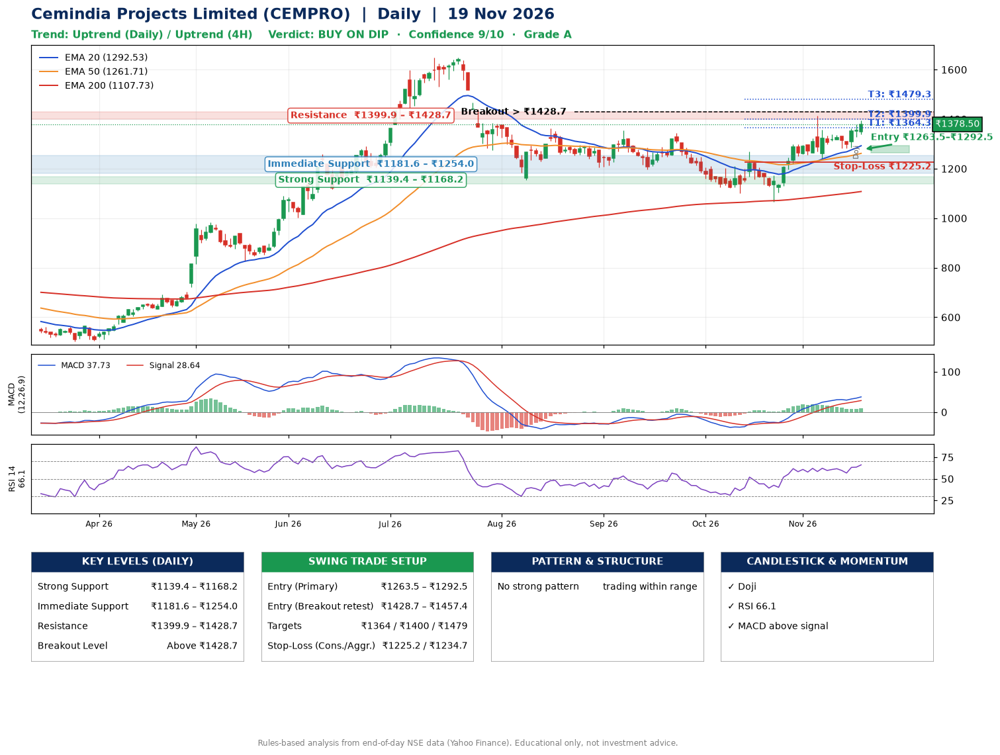

📌 **Cemindia Projects Limited (CEMPRO) – Multi-Timeframe Technical Analysis (Daily + 4H Combined)**
_Data up to 19 Nov 2026 · Close ₹1378.50_

**📍 Daily Timeframe Trend**
- Trend: **Uptrend** (higher highs and higher lows)
- Recent swing highs: ₹1344.6, ₹1268.8, ₹1414.3 · swing lows: ₹1101.3, ₹1066.0, ₹1239.6
- EMAs: EMA20 ₹1292.5, EMA50 ₹1261.7, EMA200 ₹1107.7; bullish stack (EMA20 > EMA50 > EMA200); price above EMA20, EMA50, EMA200
- MACD 37.73 above signal 28.64 (above zero); histogram rising
- RSI(14) 66.1; no divergence on the last two swings

**📍 4-Hour Timeframe Trend**
- Structure: **Uptrend** (higher highs and higher lows)
- Pullback/support area: recent 4H swing lows ₹1240.2, ₹1282.0; EMA20 ₹1323.6
- EMA20/50: bullish stack (EMA20 > EMA50); price above EMA20, EMA50
- MACD 27.89 above signal 26.11 (above zero), fresh bullish crossover; histogram rising
- RSI(14) 61.8; no divergence

**📍 Pattern Detection (Both Timeframes)**
- No strong pattern detected. Trading within range.

**📍 Candlestick Patterns (last 3 daily candles)**
- **Doji** – 18 Nov: indecision; wait for the next candle to confirm direction

**📍 Price Action Key Levels (Daily Structure)**

| Zone | Price Level (₹) | Context |
|------|-----------------|---------|
| Strong Support | ₹1139.4 – ₹1168.2 | Cluster of earlier swing lows (demand) |
| Immediate Support | ₹1181.6 – ₹1254.0 | Nearest swing-low / wick area |
| Resistance | ₹1399.9 – ₹1428.7 | Nearest swing-high supply |
| Breakout Level | Above ₹1428.7 | Swing continuation trigger (52-week high ₹1649.2) |

**📍 Swing Trade Setup**

🟢 **Entry Zone**
- Primary: ₹1263.5 – ₹1292.5 (daily support / EMA20 area; enter on a bullish 4H candle)
- Alternate: ₹1428.7 – ₹1457.4 (breakout retest)

🎯 **Profit Targets**
- T1: ₹1364.3
- T2: ₹1399.9
- T3: ₹1479.3

🛑 **Stop-Loss**
- Conservative: below daily swing low (₹1225.2)
- Aggressive: below 4H structure (₹1234.7)
- Risk per share ≈ ₹57.5; reward:risk to T1 ≈ 1.5
- Time to T1: about 9 trading days (it rose this much within 60 trading days 78% of the time in the last 2 years)
- Time to T2: about 12 trading days (it rose this much within 60 trading days 66% of the time in the last 2 years)

**📌 Strategy Notes**
- Higher timeframe: daily trend is uptrend; only take longs while price holds above ₹1139.4.
- Entry timing: wait for a bullish 4H candle (engulfing/hammer) inside ₹1263.5 – ₹1292.5 rather than buying mid-range.
- EMA stacking: bullish stack (EMA20 > EMA50 > EMA200); price above EMA20, EMA50, EMA200.
- Breakout rule: a daily close above ₹1428.7 with volume above its 20-day average (≈484,416) opens T2/T3.
- Momentum: RSI 66 – elevated, prefer dips; no divergence on the last two swings.
- Exit discipline: move the stop to entry once T1 is hit; book partial profits at each target.

**STEP 2 — Marked Up Chart**

**✅ Trade Validation Checklist**
- Trend + momentum aligned: Yes · Price at entry zone: No
- Stop defined (₹1225.2) · Reward:risk ≥ 1.5 to T1: Yes

## 📌 Final Verdict

Recommendation: **🟡 BUY ON DIP**

Confidence: **9/10**

Trade Quality: **A**

Reason:
• Daily uptrend (higher highs and higher lows)
• EMAs stacked bullishly

Next Action:
• Wait for a pullback to ₹1263.5–₹1292.5

_Rules-based analysis from end-of-day data. Educational only, not investment advice. Never place orders without your own confirmation._