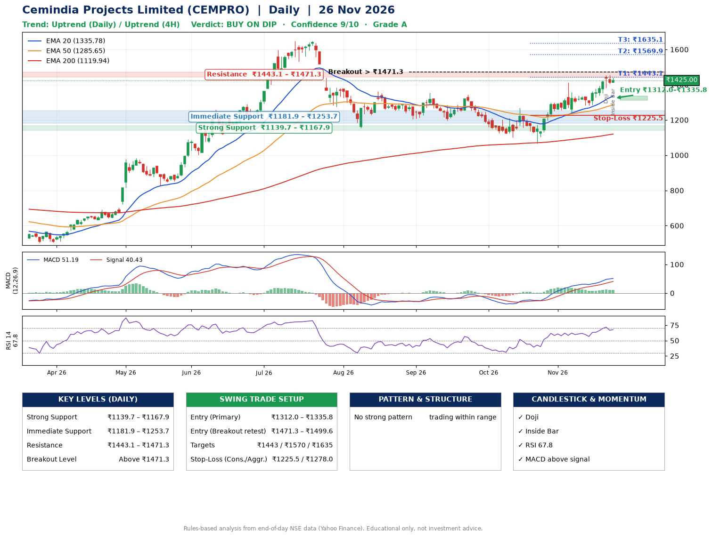

📌 **Cemindia Projects Limited (CEMPRO) – Multi-Timeframe Technical Analysis (Daily + 4H Combined)**
_Data up to 26 Nov 2026 · Close ₹1425.00_

**📍 Daily Timeframe Trend**
- Trend: **Uptrend** (higher highs and higher lows)
- Recent swing highs: ₹1344.6, ₹1268.8, ₹1414.3 · swing lows: ₹1101.3, ₹1066.0, ₹1239.6
- EMAs: EMA20 ₹1335.8, EMA50 ₹1285.6, EMA200 ₹1119.9; bullish stack (EMA20 > EMA50 > EMA200); price above EMA20, EMA50, EMA200
- MACD 51.19 above signal 40.43 (above zero); histogram falling
- RSI(14) 67.8; no divergence on the last two swings

**📍 4-Hour Timeframe Trend**
- Structure: **Uptrend** (higher highs and higher lows)
- Pullback/support area: recent 4H swing lows ₹1240.2, ₹1282.0; EMA20 ₹1376.9
- EMA20/50: bullish stack (EMA20 > EMA50); price above EMA20, EMA50
- MACD 39.08 above signal 35.53 (above zero); histogram falling
- RSI(14) 60.8; no divergence

**📍 Pattern Detection (Both Timeframes)**
- No strong pattern detected. Trading within range.

**📍 Candlestick Patterns (last 3 daily candles)**
- **Doji** – 23 Nov: indecision; wait for the next candle to confirm direction
- **Inside Bar** – 26 Nov: compression inside the prior range ₹1405.1–₹1457.2

**📍 Price Action Key Levels (Daily Structure)**

| Zone | Price Level (₹) | Context |
|------|-----------------|---------|
| Strong Support | ₹1139.7 – ₹1167.9 | Cluster of earlier swing lows (demand) |
| Immediate Support | ₹1181.9 – ₹1253.7 | Nearest swing-low / wick area |
| Resistance | ₹1443.1 – ₹1471.3 | Nearest swing-high supply |
| Breakout Level | Above ₹1471.3 | Swing continuation trigger (52-week high ₹1649.2) |

**📍 Swing Trade Setup**

🟢 **Entry Zone**
- Primary: ₹1312.0 – ₹1335.8 (daily support / EMA20 area; enter on a bullish 4H candle)
- Alternate: ₹1471.3 – ₹1499.6 (breakout retest)

🎯 **Profit Targets**
- T1: ₹1443.1
- T2: ₹1569.9
- T3: ₹1635.1

🛑 **Stop-Loss**
- Conservative: below daily swing low (₹1225.5)
- Aggressive: below 4H structure (₹1278.0)
- Risk per share ≈ ₹98.4; reward:risk to T1 ≈ 1.2
- Time to T1: about 11 trading days (it rose this much within 60 trading days 68% of the time in the last 2 years)
- Time to T2: about 17 trading days (it rose this much within 60 trading days 45% of the time in the last 2 years)

**📌 Strategy Notes**
- Higher timeframe: daily trend is uptrend; only take longs while price holds above ₹1139.7.
- Entry timing: wait for a bullish 4H candle (engulfing/hammer) inside ₹1312.0 – ₹1335.8 rather than buying mid-range.
- EMA stacking: bullish stack (EMA20 > EMA50 > EMA200); price above EMA20, EMA50, EMA200.
- Breakout rule: a daily close above ₹1471.3 with volume above its 20-day average (≈430,458) opens T2/T3.
- Momentum: RSI 68 – elevated, prefer dips; no divergence on the last two swings.
- Exit discipline: move the stop to entry once T1 is hit; book partial profits at each target.

**STEP 2 — Marked Up Chart**

**✅ Trade Validation Checklist**
- Trend + momentum aligned: Yes · Price at entry zone: No
- Stop defined (₹1225.5) · Reward:risk ≥ 1.5 to T1: No

## 📌 Final Verdict

Recommendation: **🟡 BUY ON DIP**

Confidence: **9/10**

Trade Quality: **A**

Reason:
• Daily uptrend (higher highs and higher lows)
• EMAs stacked bullishly

Next Action:
• Wait for a pullback to ₹1312.0–₹1335.8

_Rules-based analysis from end-of-day data. Educational only, not investment advice. Never place orders without your own confirmation._