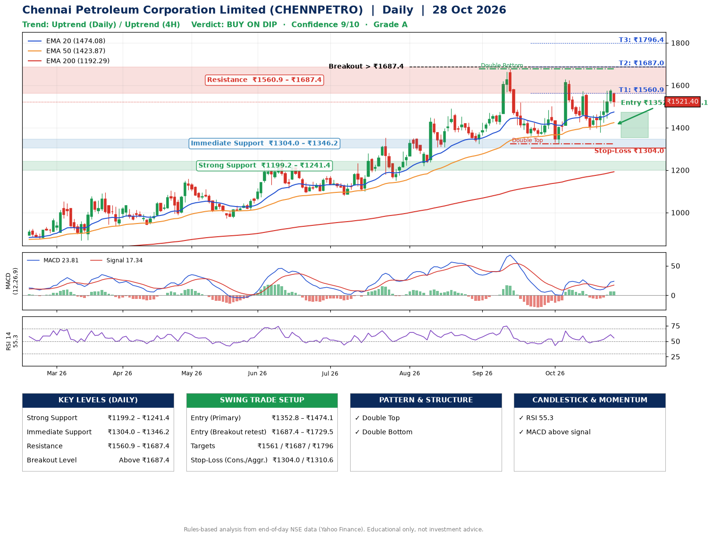

📌 **Chennai Petroleum Corporation Limited (CHENNPETRO) – Multi-Timeframe Technical Analysis (Daily + 4H Combined)**
_Data up to 28 Oct 2026 · Close ₹1521.40_

**📍 Daily Timeframe Trend**
- Trend: **Uptrend** (price above rising EMAs)
- Recent swing highs: ₹1489.7, ₹1677.5, ₹1628.7 · swing lows: ₹1220.3, ₹1325.1, ₹1325.1
- EMAs: EMA20 ₹1474.1, EMA50 ₹1423.9, EMA200 ₹1192.3; bullish stack (EMA20 > EMA50 > EMA200); price above EMA20, EMA50, EMA200
- MACD 23.81 above signal 17.34 (above zero), fresh bullish crossover; histogram falling
- RSI(14) 55.3; no divergence on the last two swings

**📍 4-Hour Timeframe Trend**
- Structure: **Uptrend** (price above rising EMAs)
- Pullback/support area: recent 4H swing lows ₹1392.3, ₹1377.7; EMA20 ₹1489.4
- EMA20/50: bullish stack (EMA20 > EMA50); price above EMA20, EMA50
- MACD 21.80 above signal 12.78 (above zero); histogram falling
- RSI(14) 55.1; Regular bullish divergence

**📍 Pattern Detection (Both Timeframes)**
- Daily: **Double Top** – tops near ₹1677.5/₹1628.7, neckline ₹1325.1, forming
- Daily: **Double Bottom** – bottoms near ₹1325.1/₹1325.1, neckline ₹1677.5, forming
- 4H: **Head & Shoulders** – head ₹1626.3, neckline ₹1327.3

**📍 Candlestick Patterns (last 3 daily candles)**
- No notable candlestick signal in the last 3 sessions.

**📍 Price Action Key Levels (Daily Structure)**

| Zone | Price Level (₹) | Context |
|------|-----------------|---------|
| Strong Support | ₹1199.2 – ₹1241.4 | Cluster of earlier swing lows (demand) |
| Immediate Support | ₹1304.0 – ₹1346.2 | Nearest swing-low / wick area |
| Resistance | ₹1560.9 – ₹1687.4 | Nearest swing-high supply |
| Breakout Level | Above ₹1687.4 | Swing continuation trigger (52-week high ₹1677.5) |

**📍 Swing Trade Setup**

🟢 **Entry Zone**
- Primary: ₹1352.8 – ₹1474.1 (daily support / EMA20 area; enter on a bullish 4H candle)
- Alternate: ₹1687.4 – ₹1729.5 (breakout retest)

🎯 **Profit Targets**
- T1: ₹1560.9
- T2: ₹1687.0
- T3: ₹1796.4

🛑 **Stop-Loss**
- Conservative: below daily swing low (₹1304.0)
- Aggressive: below 4H structure (₹1310.6)
- Risk per share ≈ ₹109.4; reward:risk to T1 ≈ 1.3

**📌 Strategy Notes**
- Higher timeframe: daily trend is uptrend; only take longs while price holds above ₹1199.2.
- Entry timing: wait for a bullish 4H candle (engulfing/hammer) inside ₹1352.8 – ₹1474.1 rather than buying mid-range.
- EMA stacking: bullish stack (EMA20 > EMA50 > EMA200); price above EMA20, EMA50, EMA200.
- Breakout rule: a daily close above ₹1687.4 with volume above its 20-day average (≈3,549,342) opens T2/T3.
- Momentum: RSI 55 – room to run; no divergence on the last two swings.
- Exit discipline: move the stop to entry once T1 is hit; book partial profits at each target.

**STEP 2 — Marked Up Chart**

**✅ Trade Validation Checklist**
- Trend + momentum aligned: Yes · Price at entry zone: No
- Stop defined (₹1304.0) · Reward:risk ≥ 1.5 to T1: No

## 📌 Final Verdict

Recommendation: **🟡 BUY ON DIP**

Confidence: **9/10**

Trade Quality: **A**

Reason:
• Daily uptrend (price above rising EMAs)
• EMAs stacked bullishly

Next Action:
• Wait for a pullback to ₹1352.8–₹1474.1

_Rules-based analysis from end-of-day data. Educational only, not investment advice. Never place orders without your own confirmation._