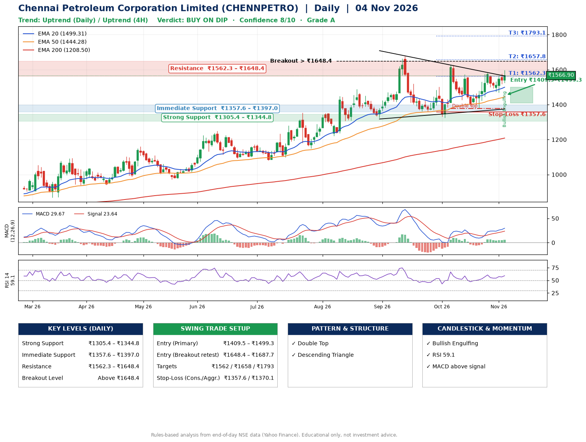

📌 **Chennai Petroleum Corporation Limited (CHENNPETRO) – Multi-Timeframe Technical Analysis (Daily + 4H Combined)**
_Data up to 04 Nov 2026 · Close ₹1566.90_

**📍 Daily Timeframe Trend**
- Trend: **Uptrend** (price above rising EMAs)
- Recent swing highs: ₹1677.5, ₹1628.7, ₹1582.0 · swing lows: ₹1325.1, ₹1325.1, ₹1377.3
- EMAs: EMA20 ₹1499.3, EMA50 ₹1444.3, EMA200 ₹1208.5; bullish stack (EMA20 > EMA50 > EMA200); price above EMA20, EMA50, EMA200
- MACD 29.67 above signal 23.64 (above zero); histogram rising
- RSI(14) 59.1; no divergence on the last two swings

**📍 4-Hour Timeframe Trend**
- Structure: **Uptrend** (higher highs and higher lows)
- Pullback/support area: recent 4H swing lows ₹1377.7, ₹1474.1; EMA20 ₹1521.0
- EMA20/50: bullish stack (EMA20 > EMA50); price above EMA20, EMA50
- MACD 23.51 above signal 20.14 (above zero); histogram falling
- RSI(14) 59.7; no divergence

**📍 Pattern Detection (Both Timeframes)**
- Daily: **Double Top** – tops near ₹1628.7/₹1582.0, neckline ₹1377.3, forming
- Daily: **Descending Triangle** – converging swing highs and lows over the last ~60 sessions
- 4H: **Double Top** – tops near ₹1572.8/₹1582.0, neckline ₹1377.7, forming
- 4H: **Ascending Triangle** – converging swing highs and lows over the last ~60 sessions

**📍 Candlestick Patterns (last 3 daily candles)**
- **Bullish Engulfing** – 04 Nov: buyers fully reversed the prior red candle

**📍 Price Action Key Levels (Daily Structure)**

| Zone | Price Level (₹) | Context |
|------|-----------------|---------|
| Strong Support | ₹1305.4 – ₹1344.8 | Cluster of earlier swing lows (demand) |
| Immediate Support | ₹1357.6 – ₹1397.0 | Nearest swing-low / wick area |
| Resistance | ₹1562.3 – ₹1648.4 | Nearest swing-high supply |
| Breakout Level | Above ₹1648.4 | Swing continuation trigger (52-week high ₹1677.5) |

**📍 Swing Trade Setup**

🟢 **Entry Zone**
- Primary: ₹1409.5 – ₹1499.3 (daily support / EMA20 area; enter on a bullish 4H candle)
- Alternate: ₹1648.4 – ₹1687.7 (breakout retest)

🎯 **Profit Targets**
- T1: ₹1562.3
- T2: ₹1657.8
- T3: ₹1793.1

🛑 **Stop-Loss**
- Conservative: below daily swing low (₹1357.6)
- Aggressive: below 4H structure (₹1370.1)
- Risk per share ≈ ₹96.8; reward:risk to T1 ≈ 1.1

**📌 Strategy Notes**
- Higher timeframe: daily trend is uptrend; only take longs while price holds above ₹1305.4.
- Entry timing: wait for a bullish 4H candle (engulfing/hammer) inside ₹1409.5 – ₹1499.3 rather than buying mid-range.
- EMA stacking: bullish stack (EMA20 > EMA50 > EMA200); price above EMA20, EMA50, EMA200.
- Breakout rule: a daily close above ₹1648.4 with volume above its 20-day average (≈3,434,409) opens T2/T3.
- Momentum: RSI 59 – room to run; no divergence on the last two swings.
- Exit discipline: move the stop to entry once T1 is hit; book partial profits at each target.

**STEP 2 — Marked Up Chart**

**✅ Trade Validation Checklist**
- Trend + momentum aligned: Yes · Price at entry zone: No
- Stop defined (₹1357.6) · Reward:risk ≥ 1.5 to T1: No

## 📌 Final Verdict

Recommendation: **🟡 BUY ON DIP**

Confidence: **8/10**

Trade Quality: **A**

Reason:
• Daily uptrend (price above rising EMAs)
• EMAs stacked bullishly

Next Action:
• Wait for a pullback to ₹1409.5–₹1499.3

_Rules-based analysis from end-of-day data. Educational only, not investment advice. Never place orders without your own confirmation._