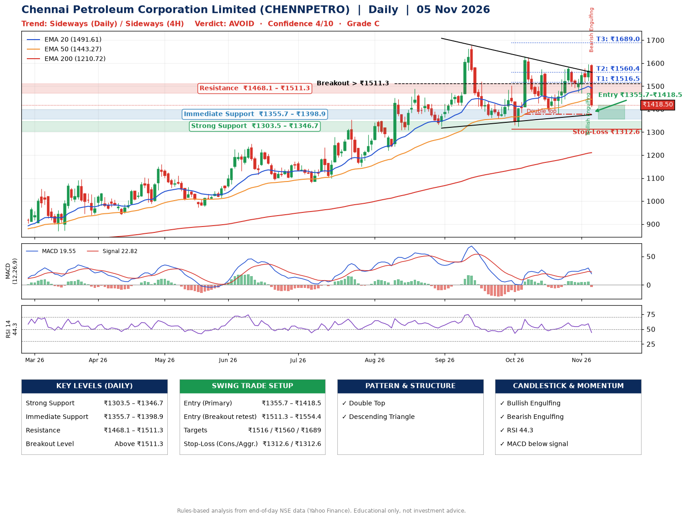

📌 **Chennai Petroleum Corporation Limited (CHENNPETRO) – Multi-Timeframe Technical Analysis (Daily + 4H Combined)**
_Data up to 05 Nov 2026 · Close ₹1418.50_

**📍 Daily Timeframe Trend**
- Trend: **Sideways** (mixed swing structure)
- Recent swing highs: ₹1677.5, ₹1628.7, ₹1582.0 · swing lows: ₹1325.1, ₹1325.1, ₹1377.3
- EMAs: EMA20 ₹1491.6, EMA50 ₹1443.3, EMA200 ₹1210.7; bullish stack (EMA20 > EMA50 > EMA200); price above EMA200
- MACD 19.55 below signal 22.82 (above zero), fresh bearish crossover; histogram falling
- RSI(14) 44.3; no divergence on the last two swings

**📍 4-Hour Timeframe Trend**
- Structure: **Sideways** (mixed swing structure)
- Pullback/support area: recent 4H swing lows ₹1377.7, ₹1474.1; EMA20 ₹1505.9
- EMA20/50: bullish stack (EMA20 > EMA50); price below all EMAs
- MACD 6.04 below signal 16.58 (above zero), fresh bearish crossover; histogram falling
- RSI(14) 38.3; Regular bearish divergence

**📍 Pattern Detection (Both Timeframes)**
- Daily: **Double Top** – tops near ₹1628.7/₹1582.0, neckline ₹1377.3, forming
- Daily: **Descending Triangle** – converging swing highs and lows over the last ~60 sessions
- 4H: **Double Top** – tops near ₹1582.0/₹1596.0, neckline ₹1474.1, confirmed (closed below neckline)
- 4H: **Ascending Triangle** – converging swing highs and lows over the last ~60 sessions

**📍 Candlestick Patterns (last 3 daily candles)**
- **Bullish Engulfing** – 04 Nov: buyers fully reversed the prior red candle
- **Bearish Engulfing** – 05 Nov: sellers fully reversed the prior green candle

**📍 Price Action Key Levels (Daily Structure)**

| Zone | Price Level (₹) | Context |
|------|-----------------|---------|
| Strong Support | ₹1303.5 – ₹1346.7 | Cluster of earlier swing lows (demand) |
| Immediate Support | ₹1355.7 – ₹1398.9 | Nearest swing-low / wick area |
| Resistance | ₹1468.1 – ₹1511.3 | Nearest swing-high supply |
| Breakout Level | Above ₹1511.3 | Swing continuation trigger (52-week high ₹1677.5) |

**📍 Swing Trade Setup**

🟢 **Entry Zone**
- Primary: ₹1355.7 – ₹1418.5 (daily support / EMA20 area; enter on a bullish 4H candle)
- Alternate: ₹1511.3 – ₹1554.4 (breakout retest)

🎯 **Profit Targets**
- T1: ₹1516.5
- T2: ₹1560.4
- T3: ₹1689.0

🛑 **Stop-Loss**
- Conservative: below daily swing low (₹1312.6)
- Aggressive: below 4H structure (₹1312.6)
- Risk per share ≈ ₹86.3; reward:risk to T1 ≈ 1.5

**📌 Strategy Notes**
- Higher timeframe: daily trend is sideways; only take longs while price holds above ₹1303.5.
- Entry timing: wait for a bullish 4H candle (engulfing/hammer) inside ₹1355.7 – ₹1418.5 rather than buying mid-range.
- EMA stacking: bullish stack (EMA20 > EMA50 > EMA200); price above EMA200.
- Breakout rule: a daily close above ₹1511.3 with volume above its 20-day average (≈2,602,427) opens T2/T3.
- Momentum: RSI 44 – room to run; no divergence on the last two swings.
- Exit discipline: move the stop to entry once T1 is hit; book partial profits at each target.

**STEP 2 — Marked Up Chart**

**✅ Trade Validation Checklist**
- Trend + momentum aligned: No · Price at entry zone: Yes
- Stop defined (₹1312.6) · Reward:risk ≥ 1.5 to T1: No

## 📌 Final Verdict

Recommendation: **🔴 AVOID**

Confidence: **4/10**

Trade Quality: **C**

Reason:
• Sharp pullback: 11% below the recent ₹1596.4 high
• EMAs stacked bullishly

Next Action:
• Avoid until the trend changes (reclaim EMA50 and a higher low)

_Rules-based analysis from end-of-day data. Educational only, not investment advice. Never place orders without your own confirmation._