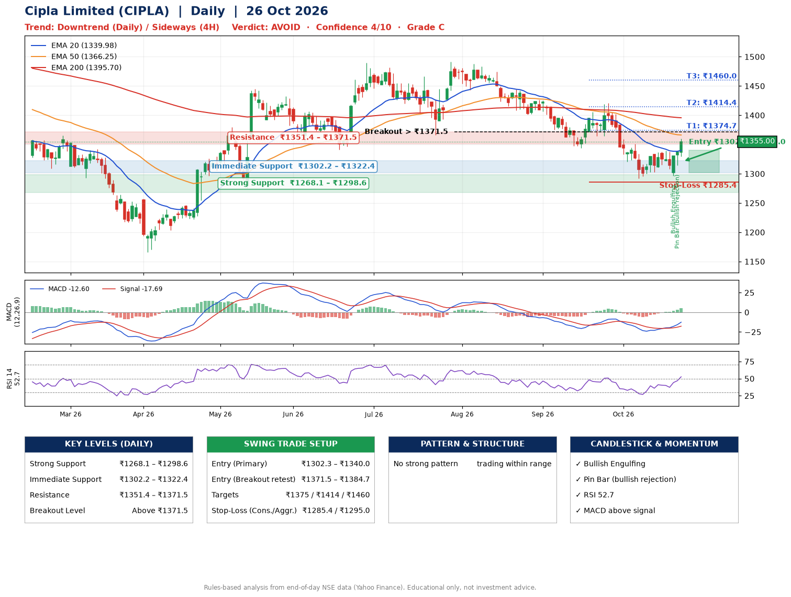

📌 **Cipla Limited (CIPLA) – Multi-Timeframe Technical Analysis (Daily + 4H Combined)**
_Data up to 26 Oct 2026 · Close ₹1355.00_

**📍 Daily Timeframe Trend**
- Trend: **Downtrend** (lower highs and lower lows)
- Recent swing highs: ₹1491.2, ₹1488.1, ₹1421.0 · swing lows: ₹1401.1, ₹1344.3, ₹1292.0
- EMAs: EMA20 ₹1340.0, EMA50 ₹1366.2, EMA200 ₹1395.7; bearish stack (EMA20 < EMA50 < EMA200); price above EMA20
- MACD -12.60 above signal -17.69 (below zero), fresh bullish crossover; histogram rising
- RSI(14) 52.7; no divergence on the last two swings

**📍 4-Hour Timeframe Trend**
- Structure: **Sideways** (mixed swing structure)
- Pullback/support area: recent 4H swing lows ₹1303.4, ₹1296.7; EMA20 ₹1330.0
- EMA20/50: bearish stack (EMA20 < EMA50); price above EMA20, EMA50
- MACD 0.07 above signal -5.17 (above zero); histogram rising
- RSI(14) 60.4; Regular bullish divergence; Regular bearish divergence

**📍 Pattern Detection (Both Timeframes)**
- 4H: **Descending Triangle** – converging swing highs and lows over the last ~60 sessions

**📍 Candlestick Patterns (last 3 daily candles)**
- **Bullish Engulfing** – 22 Oct: buyers fully reversed the prior red candle
- **Pin Bar (bullish rejection)** – 23 Oct: long lower wick shows dip-buying near ₹1314.1

**📍 Price Action Key Levels (Daily Structure)**

| Zone | Price Level (₹) | Context |
|------|-----------------|---------|
| Strong Support | ₹1268.1 – ₹1298.6 | Cluster of earlier swing lows (demand) |
| Immediate Support | ₹1302.2 – ₹1322.4 | Nearest swing-low / wick area |
| Resistance | ₹1351.4 – ₹1371.5 | Nearest swing-high supply |
| Breakout Level | Above ₹1371.5 | Swing continuation trigger (52-week high ₹1673.0) |

**📍 Swing Trade Setup**

🟢 **Entry Zone**
- Primary: ₹1302.3 – ₹1340.0 (daily support / EMA20 area; enter on a bullish 4H candle)
- Alternate: ₹1371.5 – ₹1384.7 (breakout retest)

🎯 **Profit Targets**
- T1: ₹1374.7
- T2: ₹1414.4
- T3: ₹1460.0

🛑 **Stop-Loss**
- Conservative: below daily swing low (₹1285.4)
- Aggressive: below 4H structure (₹1295.0)
- Risk per share ≈ ₹35.7; reward:risk to T1 ≈ 1.5

**📌 Strategy Notes**
- Higher timeframe: daily trend is downtrend; only take longs while price holds above ₹1268.1.
- Entry timing: wait for a bullish 4H candle (engulfing/hammer) inside ₹1302.3 – ₹1340.0 rather than buying mid-range.
- EMA stacking: bearish stack (EMA20 < EMA50 < EMA200); price above EMA20.
- Breakout rule: a daily close above ₹1371.5 with volume above its 20-day average (≈977,684) opens T2/T3.
- Momentum: RSI 53 – room to run; no divergence on the last two swings.
- Exit discipline: move the stop to entry once T1 is hit; book partial profits at each target.

**STEP 2 — Marked Up Chart**

**✅ Trade Validation Checklist**
- Trend + momentum aligned: No · Price at entry zone: No
- Stop defined (₹1285.4) · Reward:risk ≥ 1.5 to T1: Yes

## 📌 Final Verdict

Recommendation: **🔴 AVOID**

Confidence: **4/10**

Trade Quality: **C**

Reason:
• Daily downtrend (lower highs and lower lows)

Next Action:
• Avoid until the trend changes (reclaim EMA50 and a higher low)

_Rules-based analysis from end-of-day data. Educational only, not investment advice. Never place orders without your own confirmation._