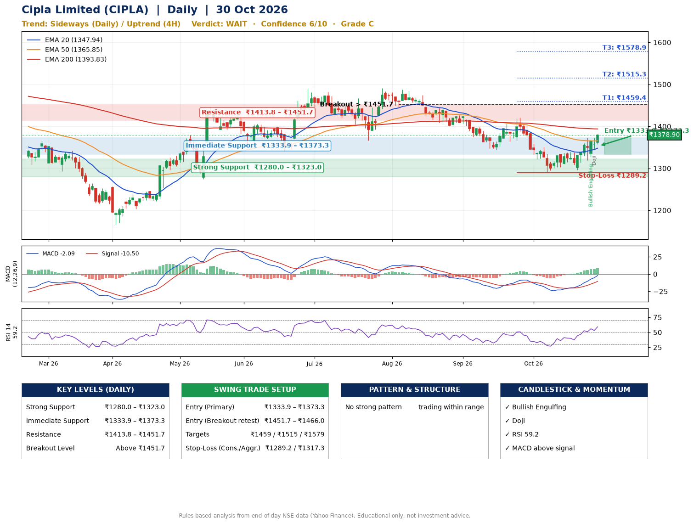

📌 **Cipla Limited (CIPLA) – Multi-Timeframe Technical Analysis (Daily + 4H Combined)**
_Data up to 30 Oct 2026 · Close ₹1378.90_

**📍 Daily Timeframe Trend**
- Trend: **Sideways** (mixed swing structure)
- Recent swing highs: ₹1491.2, ₹1488.1, ₹1421.0 · swing lows: ₹1344.3, ₹1292.0, ₹1296.4
- EMAs: EMA20 ₹1347.9, EMA50 ₹1365.8, EMA200 ₹1393.8; bearish stack (EMA20 < EMA50 < EMA200); price above EMA20, EMA50
- MACD -2.09 above signal -10.50 (below zero); histogram rising
- RSI(14) 59.2; no divergence on the last two swings

**📍 4-Hour Timeframe Trend**
- Structure: **Uptrend** (higher highs and higher lows)
- Pullback/support area: recent 4H swing lows ₹1296.7, ₹1319.3; EMA20 ₹1349.8
- EMA20/50: bullish stack (EMA20 > EMA50); price above EMA20, EMA50
- MACD 10.42 above signal 5.59 (above zero); histogram rising
- RSI(14) 64.2; no divergence

**📍 Pattern Detection (Both Timeframes)**
- No strong pattern detected. Trading within range.

**📍 Candlestick Patterns (last 3 daily candles)**
- **Bullish Engulfing** – 28 Oct: buyers fully reversed the prior red candle
- **Doji** – 29 Oct: indecision; wait for the next candle to confirm direction

**📍 Price Action Key Levels (Daily Structure)**

| Zone | Price Level (₹) | Context |
|------|-----------------|---------|
| Strong Support | ₹1280.0 – ₹1323.0 | Cluster of earlier swing lows (demand) |
| Immediate Support | ₹1333.9 – ₹1373.3 | Nearest swing-low / wick area |
| Resistance | ₹1413.8 – ₹1451.7 | Nearest swing-high supply |
| Breakout Level | Above ₹1451.7 | Swing continuation trigger (52-week high ₹1593.3) |

**📍 Swing Trade Setup**

🟢 **Entry Zone**
- Primary: ₹1333.9 – ₹1373.3 (daily support / EMA20 area; enter on a bullish 4H candle)
- Alternate: ₹1451.7 – ₹1466.0 (breakout retest)

🎯 **Profit Targets**
- T1: ₹1459.4
- T2: ₹1515.3
- T3: ₹1578.9

🛑 **Stop-Loss**
- Conservative: below daily swing low (₹1289.2)
- Aggressive: below 4H structure (₹1317.3)
- Risk per share ≈ ₹64.4; reward:risk to T1 ≈ 1.6

**📌 Strategy Notes**
- Higher timeframe: daily trend is sideways; only take longs while price holds above ₹1280.0.
- Entry timing: wait for a bullish 4H candle (engulfing/hammer) inside ₹1333.9 – ₹1373.3 rather than buying mid-range.
- EMA stacking: bearish stack (EMA20 < EMA50 < EMA200); price above EMA20, EMA50.
- Breakout rule: a daily close above ₹1451.7 with volume above its 20-day average (≈1,139,313) opens T2/T3.
- Momentum: RSI 59 – room to run; no divergence on the last two swings.
- Exit discipline: move the stop to entry once T1 is hit; book partial profits at each target.

**STEP 2 — Marked Up Chart**

**✅ Trade Validation Checklist**
- Trend + momentum aligned: No · Price at entry zone: No
- Stop defined (₹1289.2) · Reward:risk ≥ 1.5 to T1: Yes

## 📌 Final Verdict

Recommendation: **🟠 WAIT**

Confidence: **6/10**

Trade Quality: **C**

Reason:
• No strong edge from trend, momentum or patterns

Next Action:
• Wait for a breakout above ₹1451.7

_Rules-based analysis from end-of-day data. Educational only, not investment advice. Never place orders without your own confirmation._