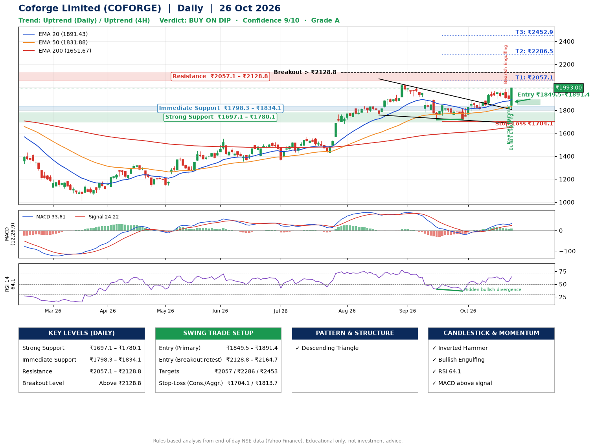

📌 **Coforge Limited (COFORGE) – Multi-Timeframe Technical Analysis (Daily + 4H Combined)**
_Data up to 26 Oct 2026 · Close ₹1993.00_

**📍 Daily Timeframe Trend**
- Trend: **Uptrend** (price above rising EMAs)
- Recent swing highs: ₹1569.0, ₹2021.2, ₹1888.0 · swing lows: ₹1762.2, ₹1717.0, ₹1722.0
- EMAs: EMA20 ₹1891.4, EMA50 ₹1831.9, EMA200 ₹1651.7; bullish stack (EMA20 > EMA50 > EMA200); price above EMA20, EMA50, EMA200
- MACD 33.61 above signal 24.22 (above zero); histogram rising
- RSI(14) 64.1; Hidden bullish divergence

**📍 4-Hour Timeframe Trend**
- Structure: **Uptrend** (higher highs and higher lows)
- Pullback/support area: recent 4H swing lows ₹1837.4, ₹1904.3; EMA20 ₹1918.2
- EMA20/50: bullish stack (EMA20 > EMA50); price above EMA20, EMA50
- MACD 26.11 above signal 25.19 (above zero), fresh bullish crossover; histogram rising
- RSI(14) 65.9; no divergence

**📍 Pattern Detection (Both Timeframes)**
- Daily: **Descending Triangle** – converging swing highs and lows over the last ~60 sessions

**📍 Candlestick Patterns (last 3 daily candles)**
- **Bearish Engulfing** – 22 Oct: sellers fully reversed the prior green candle
- **Inverted Hammer** – 23 Oct: long upper wick shows selling near ₹1992.4
- **Bullish Engulfing** – 26 Oct: buyers fully reversed the prior red candle

**📍 Price Action Key Levels (Daily Structure)**

| Zone | Price Level (₹) | Context |
|------|-----------------|---------|
| Strong Support | ₹1697.1 – ₹1780.1 | Cluster of earlier swing lows (demand) |
| Immediate Support | ₹1798.3 – ₹1834.1 | Nearest swing-low / wick area |
| Resistance | ₹2057.1 – ₹2128.8 | Nearest swing-high supply |
| Breakout Level | Above ₹2128.8 | Swing continuation trigger (52-week high ₹2021.2) |

**📍 Swing Trade Setup**

🟢 **Entry Zone**
- Primary: ₹1849.5 – ₹1891.4 (daily support / EMA20 area; enter on a bullish 4H candle)
- Alternate: ₹2128.8 – ₹2164.7 (breakout retest)

🎯 **Profit Targets**
- T1: ₹2057.1
- T2: ₹2286.5
- T3: ₹2452.9

🛑 **Stop-Loss**
- Conservative: below daily swing low (₹1704.1)
- Aggressive: below 4H structure (₹1813.7)
- Risk per share ≈ ₹166.4; reward:risk to T1 ≈ 1.1

**📌 Strategy Notes**
- Higher timeframe: daily trend is uptrend; only take longs while price holds above ₹1697.1.
- Entry timing: wait for a bullish 4H candle (engulfing/hammer) inside ₹1849.5 – ₹1891.4 rather than buying mid-range.
- EMA stacking: bullish stack (EMA20 > EMA50 > EMA200); price above EMA20, EMA50, EMA200.
- Breakout rule: a daily close above ₹2128.8 with volume above its 20-day average (≈2,444,947) opens T2/T3.
- Momentum: RSI 64 – room to run; Hidden bullish divergence.
- Exit discipline: move the stop to entry once T1 is hit; book partial profits at each target.

**STEP 2 — Marked Up Chart**

**✅ Trade Validation Checklist**
- Trend + momentum aligned: Yes · Price at entry zone: No
- Stop defined (₹1704.1) · Reward:risk ≥ 1.5 to T1: No

## 📌 Final Verdict

Recommendation: **🟡 BUY ON DIP**

Confidence: **9/10**

Trade Quality: **A**

Reason:
• Daily uptrend (price above rising EMAs)
• EMAs stacked bullishly

Next Action:
• Wait for a pullback to ₹1849.5–₹1891.4

_Rules-based analysis from end-of-day data. Educational only, not investment advice. Never place orders without your own confirmation._