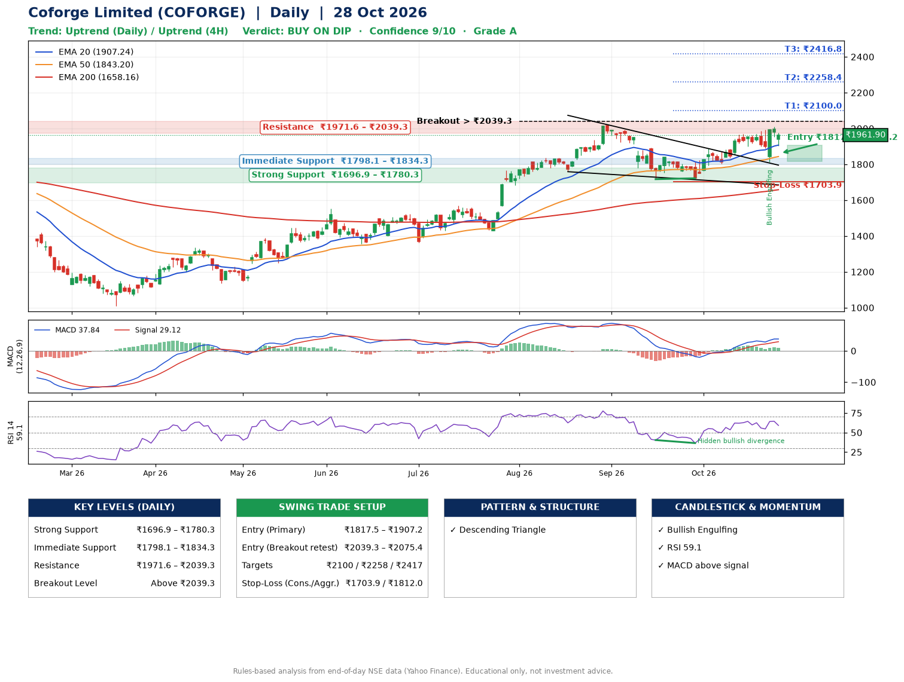

📌 **Coforge Limited (COFORGE) – Multi-Timeframe Technical Analysis (Daily + 4H Combined)**
_Data up to 28 Oct 2026 · Close ₹1961.90_

**📍 Daily Timeframe Trend**
- Trend: **Uptrend** (price above rising EMAs)
- Recent swing highs: ₹1569.0, ₹2021.2, ₹1888.0 · swing lows: ₹1762.2, ₹1717.0, ₹1722.0
- EMAs: EMA20 ₹1907.2, EMA50 ₹1843.2, EMA200 ₹1658.2; bullish stack (EMA20 > EMA50 > EMA200); price above EMA20, EMA50, EMA200
- MACD 37.84 above signal 29.12 (above zero); histogram falling
- RSI(14) 59.1; Hidden bullish divergence

**📍 4-Hour Timeframe Trend**
- Structure: **Uptrend** (price above rising EMAs)
- Pullback/support area: recent 4H swing lows ₹1904.3, ₹1816.9; EMA20 ₹1936.6
- EMA20/50: bullish stack (EMA20 > EMA50); price above EMA20, EMA50
- MACD 27.83 above signal 27.06 (above zero), fresh bullish crossover; histogram falling
- RSI(14) 56.9; Regular bullish divergence; Regular bearish divergence

**📍 Pattern Detection (Both Timeframes)**
- Daily: **Descending Triangle** – converging swing highs and lows over the last ~60 sessions
- 4H: **Double Top** – tops near ₹1970.0/₹2008.5, neckline ₹1816.9, forming

**📍 Candlestick Patterns (last 3 daily candles)**
- **Bullish Engulfing** – 26 Oct: buyers fully reversed the prior red candle

**📍 Price Action Key Levels (Daily Structure)**

| Zone | Price Level (₹) | Context |
|------|-----------------|---------|
| Strong Support | ₹1696.9 – ₹1780.3 | Cluster of earlier swing lows (demand) |
| Immediate Support | ₹1798.1 – ₹1834.3 | Nearest swing-low / wick area |
| Resistance | ₹1971.6 – ₹2039.3 | Nearest swing-high supply |
| Breakout Level | Above ₹2039.3 | Swing continuation trigger (52-week high ₹2021.2) |

**📍 Swing Trade Setup**

🟢 **Entry Zone**
- Primary: ₹1817.5 – ₹1907.2 (daily support / EMA20 area; enter on a bullish 4H candle)
- Alternate: ₹2039.3 – ₹2075.4 (breakout retest)

🎯 **Profit Targets**
- T1: ₹2100.0
- T2: ₹2258.4
- T3: ₹2416.8

🛑 **Stop-Loss**
- Conservative: below daily swing low (₹1703.9)
- Aggressive: below 4H structure (₹1812.0)
- Risk per share ≈ ₹158.4; reward:risk to T1 ≈ 1.5

**📌 Strategy Notes**
- Higher timeframe: daily trend is uptrend; only take longs while price holds above ₹1696.9.
- Entry timing: wait for a bullish 4H candle (engulfing/hammer) inside ₹1817.5 – ₹1907.2 rather than buying mid-range.
- EMA stacking: bullish stack (EMA20 > EMA50 > EMA200); price above EMA20, EMA50, EMA200.
- Breakout rule: a daily close above ₹2039.3 with volume above its 20-day average (≈2,649,546) opens T2/T3.
- Momentum: RSI 59 – room to run; Hidden bullish divergence.
- Exit discipline: move the stop to entry once T1 is hit; book partial profits at each target.

**STEP 2 — Marked Up Chart**

**✅ Trade Validation Checklist**
- Trend + momentum aligned: Yes · Price at entry zone: No
- Stop defined (₹1703.9) · Reward:risk ≥ 1.5 to T1: Yes

## 📌 Final Verdict

Recommendation: **🟡 BUY ON DIP**

Confidence: **9/10**

Trade Quality: **A**

Reason:
• Daily uptrend (price above rising EMAs)
• EMAs stacked bullishly

Next Action:
• Wait for a pullback to ₹1817.5–₹1907.2, or a breakout above ₹2039.3

_Rules-based analysis from end-of-day data. Educational only, not investment advice. Never place orders without your own confirmation._