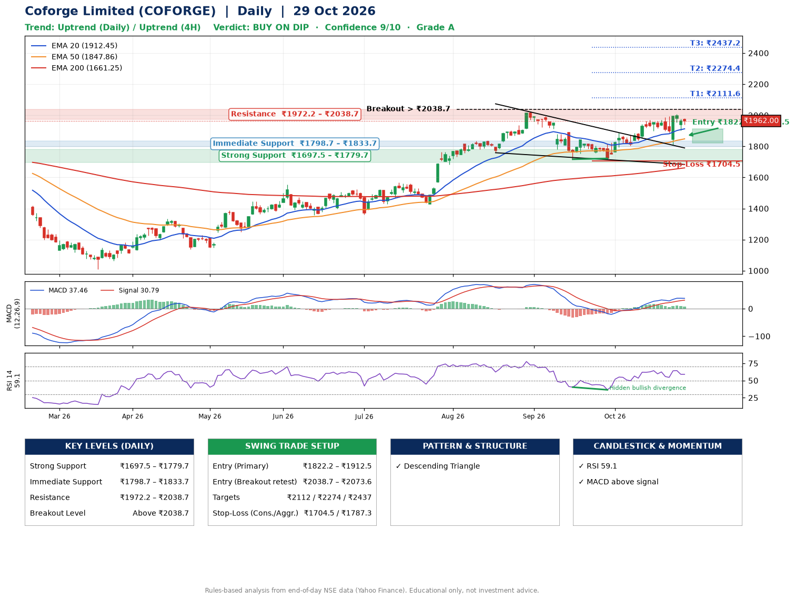

📌 **Coforge Limited (COFORGE) – Multi-Timeframe Technical Analysis (Daily + 4H Combined)**
_Data up to 29 Oct 2026 · Close ₹1962.00_

**📍 Daily Timeframe Trend**
- Trend: **Uptrend** (price above rising EMAs)
- Recent swing highs: ₹1569.0, ₹2021.2, ₹1888.0 · swing lows: ₹1762.2, ₹1717.0, ₹1722.0
- EMAs: EMA20 ₹1912.5, EMA50 ₹1847.9, EMA200 ₹1661.3; bullish stack (EMA20 > EMA50 > EMA200); price above EMA20, EMA50, EMA200
- MACD 37.46 above signal 30.79 (above zero); histogram falling
- RSI(14) 59.1; Hidden bullish divergence

**📍 4-Hour Timeframe Trend**
- Structure: **Uptrend** (higher highs and higher lows)
- Pullback/support area: recent 4H swing lows ₹1816.9, ₹1905.0; EMA20 ₹1940.1
- EMA20/50: bullish stack (EMA20 > EMA50); price above EMA20, EMA50
- MACD 24.33 below signal 26.26 (above zero), fresh bearish crossover; histogram falling
- RSI(14) 56.5; Hidden bullish divergence; Regular bearish divergence

**📍 Pattern Detection (Both Timeframes)**
- Daily: **Descending Triangle** – converging swing highs and lows over the last ~60 sessions
- 4H: **Double Top** – tops near ₹1970.0/₹2008.5, neckline ₹1816.9, forming
- 4H: **Inverse Head & Shoulders** – head ₹1816.9, neckline ₹2008.5

**📍 Candlestick Patterns (last 3 daily candles)**
- No notable candlestick signal in the last 3 sessions.

**📍 Price Action Key Levels (Daily Structure)**

| Zone | Price Level (₹) | Context |
|------|-----------------|---------|
| Strong Support | ₹1697.5 – ₹1779.7 | Cluster of earlier swing lows (demand) |
| Immediate Support | ₹1798.7 – ₹1833.7 | Nearest swing-low / wick area |
| Resistance | ₹1972.2 – ₹2038.7 | Nearest swing-high supply |
| Breakout Level | Above ₹2038.7 | Swing continuation trigger (52-week high ₹2021.2) |

**📍 Swing Trade Setup**

🟢 **Entry Zone**
- Primary: ₹1822.2 – ₹1912.5 (daily support / EMA20 area; enter on a bullish 4H candle)
- Alternate: ₹2038.7 – ₹2073.6 (breakout retest)

🎯 **Profit Targets**
- T1: ₹2111.6
- T2: ₹2274.4
- T3: ₹2437.2

🛑 **Stop-Loss**
- Conservative: below daily swing low (₹1704.5)
- Aggressive: below 4H structure (₹1787.3)
- Risk per share ≈ ₹162.8; reward:risk to T1 ≈ 1.5

**📌 Strategy Notes**
- Higher timeframe: daily trend is uptrend; only take longs while price holds above ₹1697.5.
- Entry timing: wait for a bullish 4H candle (engulfing/hammer) inside ₹1822.2 – ₹1912.5 rather than buying mid-range.
- EMA stacking: bullish stack (EMA20 > EMA50 > EMA200); price above EMA20, EMA50, EMA200.
- Breakout rule: a daily close above ₹2038.7 with volume above its 20-day average (≈2,631,169) opens T2/T3.
- Momentum: RSI 59 – room to run; Hidden bullish divergence.
- Exit discipline: move the stop to entry once T1 is hit; book partial profits at each target.

**STEP 2 — Marked Up Chart**

**✅ Trade Validation Checklist**
- Trend + momentum aligned: Yes · Price at entry zone: No
- Stop defined (₹1704.5) · Reward:risk ≥ 1.5 to T1: Yes

## 📌 Final Verdict

Recommendation: **🟡 BUY ON DIP**

Confidence: **9/10**

Trade Quality: **A**

Reason:
• Daily uptrend (price above rising EMAs)
• EMAs stacked bullishly

Next Action:
• Wait for a pullback to ₹1822.2–₹1912.5, or a breakout above ₹2038.7

_Rules-based analysis from end-of-day data. Educational only, not investment advice. Never place orders without your own confirmation._