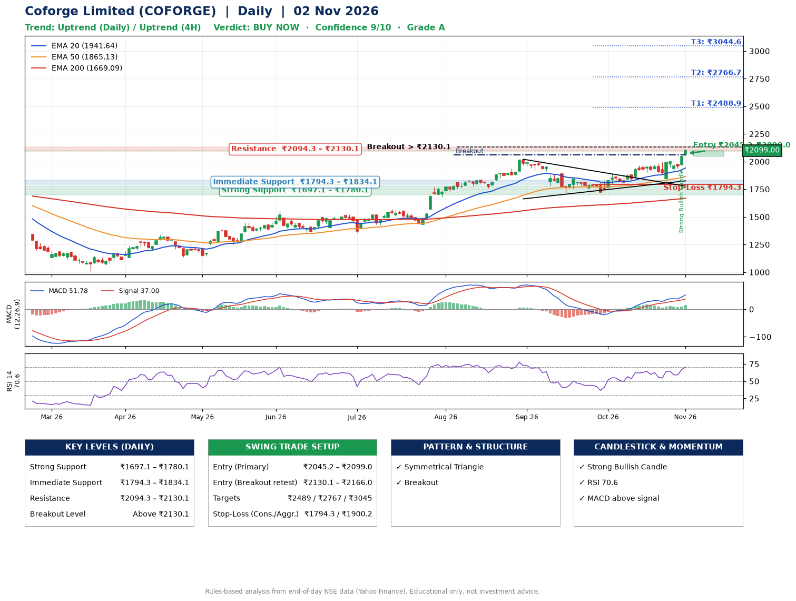

📌 **Coforge Limited (COFORGE) – Multi-Timeframe Technical Analysis (Daily + 4H Combined)**
_Data up to 02 Nov 2026 · Close ₹2099.00_

**📍 Daily Timeframe Trend**
- Trend: **Uptrend** (price above rising EMAs)
- Recent swing highs: ₹1569.0, ₹2021.2, ₹1888.0 · swing lows: ₹1717.0, ₹1722.0, ₹1812.2
- EMAs: EMA20 ₹1941.6, EMA50 ₹1865.1, EMA200 ₹1669.1; bullish stack (EMA20 > EMA50 > EMA200); price above EMA20, EMA50, EMA200
- MACD 51.78 above signal 37.00 (above zero); histogram rising
- RSI(14) 70.6; no divergence on the last two swings

**📍 4-Hour Timeframe Trend**
- Structure: **Uptrend** (higher highs and higher lows)
- Pullback/support area: recent 4H swing lows ₹1816.9, ₹1905.0; EMA20 ₹1982.2
- EMA20/50: bullish stack (EMA20 > EMA50); price above EMA20, EMA50
- MACD 44.33 above signal 33.02 (above zero), fresh bullish crossover; histogram rising
- RSI(14) 72.2; Hidden bullish divergence; Regular bearish divergence

**📍 Pattern Detection (Both Timeframes)**
- Daily: **Symmetrical Triangle** – converging swing highs and lows over the last ~60 sessions
- Daily: **Breakout** – closed above the 60-session high ₹2061.8 (volume not confirming yet)
- 4H: **Inverse Head & Shoulders** – head ₹1816.9, neckline ₹2008.5

**📍 Candlestick Patterns (last 3 daily candles)**
- **Strong Bullish Candle** – 30 Oct: wide-range green candle, buyers in control

**📍 Price Action Key Levels (Daily Structure)**

| Zone | Price Level (₹) | Context |
|------|-----------------|---------|
| Strong Support | ₹1697.1 – ₹1780.1 | Cluster of earlier swing lows (demand) |
| Immediate Support | ₹1794.3 – ₹1834.1 | Nearest swing-low / wick area |
| Resistance | ₹2094.3 – ₹2130.1 | Nearest swing-high supply |
| Breakout Level | Above ₹2130.1 | Swing continuation trigger (52-week high ₹2112.2) |

**📍 Swing Trade Setup**

🟢 **Entry Zone**
- Primary: ₹2045.2 – ₹2099.0 (daily support / EMA20 area; enter on a bullish 4H candle)
- Alternate: ₹2130.1 – ₹2166.0 (breakout retest)

🎯 **Profit Targets**
- T1: ₹2488.9
- T2: ₹2766.7
- T3: ₹3044.6

🛑 **Stop-Loss**
- Conservative: below daily swing low (₹1794.3)
- Aggressive: below 4H structure (₹1900.2)
- Risk per share ≈ ₹277.8; reward:risk to T1 ≈ 1.5

**📌 Strategy Notes**
- Higher timeframe: daily trend is uptrend; only take longs while price holds above ₹1697.1.
- Entry timing: wait for a bullish 4H candle (engulfing/hammer) inside ₹2045.2 – ₹2099.0 rather than buying mid-range.
- EMA stacking: bullish stack (EMA20 > EMA50 > EMA200); price above EMA20, EMA50, EMA200.
- Breakout rule: a daily close above ₹2130.1 with volume above its 20-day average (≈2,791,296) opens T2/T3.
- Momentum: RSI 71 – elevated, prefer dips; no divergence on the last two swings.
- Exit discipline: move the stop to entry once T1 is hit; book partial profits at each target.

**STEP 2 — Marked Up Chart**

**✅ Trade Validation Checklist**
- Trend + momentum aligned: Yes · Price at entry zone: Yes
- Stop defined (₹1794.3) · Reward:risk ≥ 1.5 to T1: Yes

## 📌 Final Verdict

Recommendation: **🟢 BUY NOW**

Confidence: **9/10**

Trade Quality: **A**

Reason:
• Daily uptrend (price above rising EMAs)
• EMAs stacked bullishly

Next Action:
• Buy now within the entry zone, with the stop-loss in place

_Rules-based analysis from end-of-day data. Educational only, not investment advice. Never place orders without your own confirmation._