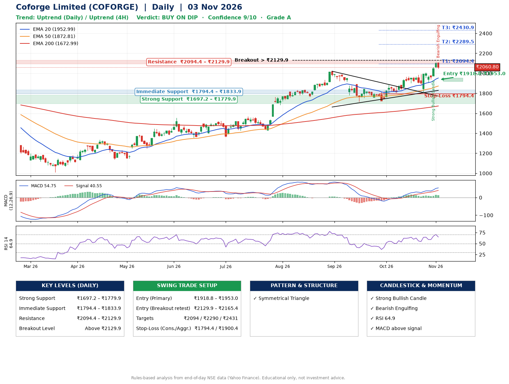

📌 **Coforge Limited (COFORGE) – Multi-Timeframe Technical Analysis (Daily + 4H Combined)**
_Data up to 03 Nov 2026 · Close ₹2060.80_

**📍 Daily Timeframe Trend**
- Trend: **Uptrend** (price above rising EMAs)
- Recent swing highs: ₹1569.0, ₹2021.2, ₹1888.0 · swing lows: ₹1717.0, ₹1722.0, ₹1812.2
- EMAs: EMA20 ₹1953.0, EMA50 ₹1872.8, EMA200 ₹1673.0; bullish stack (EMA20 > EMA50 > EMA200); price above EMA20, EMA50, EMA200
- MACD 54.75 above signal 40.55 (above zero); histogram falling
- RSI(14) 64.9; no divergence on the last two swings

**📍 4-Hour Timeframe Trend**
- Structure: **Uptrend** (higher highs and higher lows)
- Pullback/support area: recent 4H swing lows ₹1816.9, ₹1905.0; EMA20 ₹1996.1
- EMA20/50: bullish stack (EMA20 > EMA50); price above EMA20, EMA50
- MACD 44.88 above signal 37.26 (above zero); histogram falling
- RSI(14) 63.9; Hidden bullish divergence

**📍 Pattern Detection (Both Timeframes)**
- Daily: **Symmetrical Triangle** – converging swing highs and lows over the last ~60 sessions
- 4H: **Inverse Head & Shoulders** – head ₹1816.9, neckline ₹2008.5

**📍 Candlestick Patterns (last 3 daily candles)**
- **Strong Bullish Candle** – 30 Oct: wide-range green candle, buyers in control
- **Bearish Engulfing** – 03 Nov: sellers fully reversed the prior green candle

**📍 Price Action Key Levels (Daily Structure)**

| Zone | Price Level (₹) | Context |
|------|-----------------|---------|
| Strong Support | ₹1697.2 – ₹1779.9 | Cluster of earlier swing lows (demand) |
| Immediate Support | ₹1794.4 – ₹1833.9 | Nearest swing-low / wick area |
| Resistance | ₹2094.4 – ₹2129.9 | Nearest swing-high supply |
| Breakout Level | Above ₹2129.9 | Swing continuation trigger (52-week high ₹2112.2) |

**📍 Swing Trade Setup**

🟢 **Entry Zone**
- Primary: ₹1918.8 – ₹1953.0 (daily support / EMA20 area; enter on a bullish 4H candle)
- Alternate: ₹2129.9 – ₹2165.4 (breakout retest)

🎯 **Profit Targets**
- T1: ₹2094.4
- T2: ₹2289.5
- T3: ₹2430.9

🛑 **Stop-Loss**
- Conservative: below daily swing low (₹1794.4)
- Aggressive: below 4H structure (₹1900.4)
- Risk per share ≈ ₹141.4; reward:risk to T1 ≈ 1.1

**📌 Strategy Notes**
- Higher timeframe: daily trend is uptrend; only take longs while price holds above ₹1697.2.
- Entry timing: wait for a bullish 4H candle (engulfing/hammer) inside ₹1918.8 – ₹1953.0 rather than buying mid-range.
- EMA stacking: bullish stack (EMA20 > EMA50 > EMA200); price above EMA20, EMA50, EMA200.
- Breakout rule: a daily close above ₹2129.9 with volume above its 20-day average (≈2,681,214) opens T2/T3.
- Momentum: RSI 65 – room to run; no divergence on the last two swings.
- Exit discipline: move the stop to entry once T1 is hit; book partial profits at each target.

**STEP 2 — Marked Up Chart**

**✅ Trade Validation Checklist**
- Trend + momentum aligned: Yes · Price at entry zone: No
- Stop defined (₹1794.4) · Reward:risk ≥ 1.5 to T1: No

## 📌 Final Verdict

Recommendation: **🟡 BUY ON DIP**

Confidence: **9/10**

Trade Quality: **A**

Reason:
• Daily uptrend (price above rising EMAs)
• EMAs stacked bullishly

Next Action:
• Wait for a pullback to ₹1918.8–₹1953.0

_Rules-based analysis from end-of-day data. Educational only, not investment advice. Never place orders without your own confirmation._