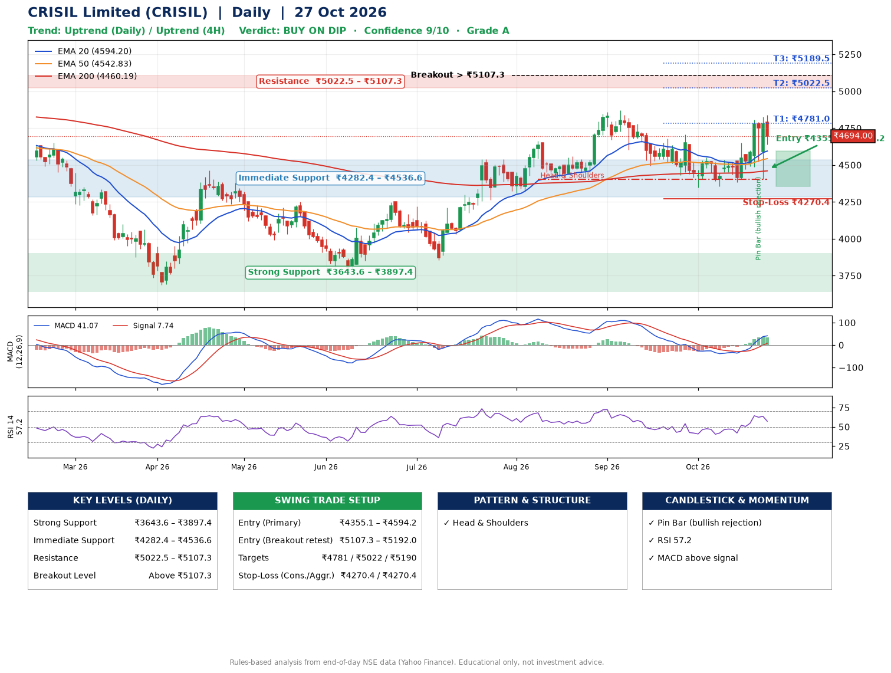

📌 **CRISIL Limited (CRISIL) – Multi-Timeframe Technical Analysis (Daily + 4H Combined)**
_Data up to 27 Oct 2026 · Close ₹4694.00_

**📍 Daily Timeframe Trend**
- Trend: **Uptrend** (price above rising EMAs)
- Recent swing highs: ₹4662.0, ₹4872.0, ₹4706.2 · swing lows: ₹4401.2, ₹4494.2, ₹4345.0
- EMAs: EMA20 ₹4594.2, EMA50 ₹4542.8, EMA200 ₹4460.2; bullish stack (EMA20 > EMA50 > EMA200); price above EMA20, EMA50, EMA200
- MACD 41.07 above signal 7.74 (above zero); histogram falling
- RSI(14) 57.2; no divergence on the last two swings

**📍 4-Hour Timeframe Trend**
- Structure: **Uptrend** (higher highs and higher lows)
- Pullback/support area: recent 4H swing lows ₹4381.9, ₹4402.6; EMA20 ₹4615.4
- EMA20/50: bullish stack (EMA20 > EMA50); price above EMA20, EMA50
- MACD 63.41 above signal 41.49 (above zero); histogram falling
- RSI(14) 54.7; no divergence

**📍 Pattern Detection (Both Timeframes)**
- Daily: **Head & Shoulders** – head ₹4872.0, neckline ₹4401.2
- 4H: **Double Bottom** – bottoms near ₹4381.9/₹4402.6, neckline ₹4805.0, forming

**📍 Candlestick Patterns (last 3 daily candles)**
- **Pin Bar (bullish rejection)** – 23 Oct: long lower wick shows dip-buying near ₹4521.1

**📍 Price Action Key Levels (Daily Structure)**

| Zone | Price Level (₹) | Context |
|------|-----------------|---------|
| Strong Support | ₹3643.6 – ₹3897.4 | Cluster of earlier swing lows (demand) |
| Immediate Support | ₹4282.4 – ₹4536.6 | Nearest swing-low / wick area |
| Resistance | ₹5022.5 – ₹5107.3 | Nearest swing-high supply |
| Breakout Level | Above ₹5107.3 | Swing continuation trigger (52-week high ₹5064.9) |

**📍 Swing Trade Setup**

🟢 **Entry Zone**
- Primary: ₹4355.1 – ₹4594.2 (daily support / EMA20 area; enter on a bullish 4H candle)
- Alternate: ₹5107.3 – ₹5192.0 (breakout retest)

🎯 **Profit Targets**
- T1: ₹4781.0
- T2: ₹5022.5
- T3: ₹5189.5

🛑 **Stop-Loss**
- Conservative: below daily swing low (₹4270.4)
- Aggressive: below 4H structure (₹4270.4)
- Risk per share ≈ ₹204.3; reward:risk to T1 ≈ 1.5

**📌 Strategy Notes**
- Higher timeframe: daily trend is uptrend; only take longs while price holds above ₹3643.6.
- Entry timing: wait for a bullish 4H candle (engulfing/hammer) inside ₹4355.1 – ₹4594.2 rather than buying mid-range.
- EMA stacking: bullish stack (EMA20 > EMA50 > EMA200); price above EMA20, EMA50, EMA200.
- Breakout rule: a daily close above ₹5107.3 with volume above its 20-day average (≈50,509) opens T2/T3.
- Momentum: RSI 57 – room to run; no divergence on the last two swings.
- Exit discipline: move the stop to entry once T1 is hit; book partial profits at each target.

**STEP 2 — Marked Up Chart**

**✅ Trade Validation Checklist**
- Trend + momentum aligned: Yes · Price at entry zone: No
- Stop defined (₹4270.4) · Reward:risk ≥ 1.5 to T1: No

## 📌 Final Verdict

Recommendation: **🟡 BUY ON DIP**

Confidence: **9/10**

Trade Quality: **A**

Reason:
• Daily uptrend (price above rising EMAs)
• EMAs stacked bullishly

Next Action:
• Wait for a pullback to ₹4355.1–₹4594.2, or a breakout above ₹5107.3

_Rules-based analysis from end-of-day data. Educational only, not investment advice. Never place orders without your own confirmation._