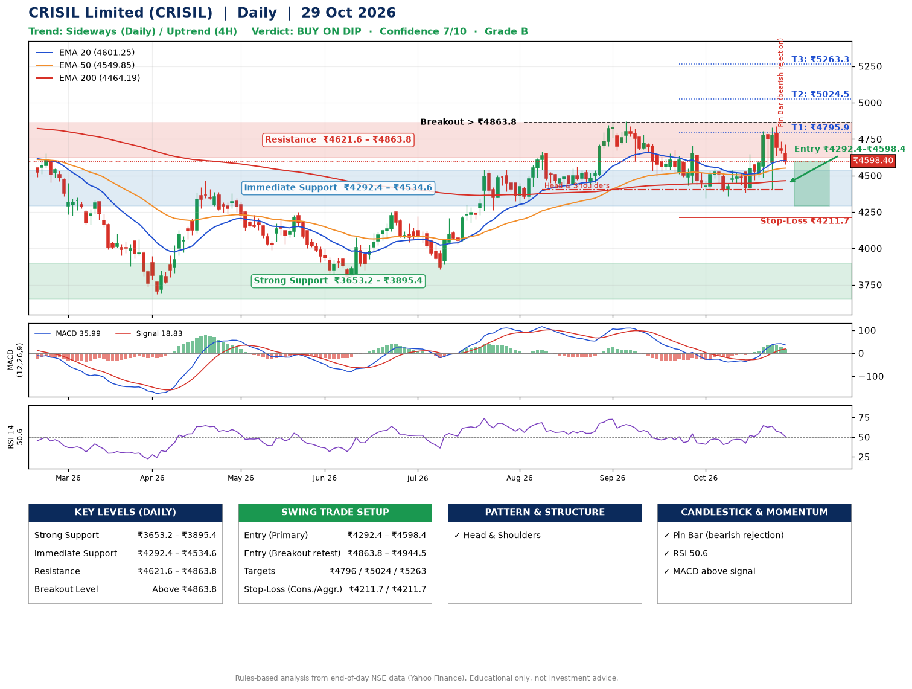

📌 **CRISIL Limited (CRISIL) – Multi-Timeframe Technical Analysis (Daily + 4H Combined)**
_Data up to 29 Oct 2026 · Close ₹4598.40_

**📍 Daily Timeframe Trend**
- Trend: **Sideways** (mixed swing structure)
- Recent swing highs: ₹4662.0, ₹4872.0, ₹4706.2 · swing lows: ₹4401.2, ₹4494.2, ₹4345.0
- EMAs: EMA20 ₹4601.2, EMA50 ₹4549.9, EMA200 ₹4464.2; bullish stack (EMA20 > EMA50 > EMA200); price above EMA50, EMA200
- MACD 35.99 above signal 18.83 (above zero); histogram falling
- RSI(14) 50.6; no divergence on the last two swings

**📍 4-Hour Timeframe Trend**
- Structure: **Uptrend** (higher highs and higher lows)
- Pullback/support area: recent 4H swing lows ₹4381.9, ₹4402.6; EMA20 ₹4625.6
- EMA20/50: bullish stack (EMA20 > EMA50); price above EMA50
- MACD 42.21 below signal 47.08 (above zero), fresh bearish crossover; histogram falling
- RSI(14) 50.1; Regular bearish divergence

**📍 Pattern Detection (Both Timeframes)**
- Daily: **Head & Shoulders** – head ₹4872.0, neckline ₹4401.2
- 4H: **Double Bottom** – bottoms near ₹4381.9/₹4402.6, neckline ₹4805.0, forming

**📍 Candlestick Patterns (last 3 daily candles)**
- **Pin Bar (bearish rejection)** – 28 Oct: long upper wick shows selling near ₹4734.4

**📍 Price Action Key Levels (Daily Structure)**

| Zone | Price Level (₹) | Context |
|------|-----------------|---------|
| Strong Support | ₹3653.2 – ₹3895.4 | Cluster of earlier swing lows (demand) |
| Immediate Support | ₹4292.4 – ₹4534.6 | Nearest swing-low / wick area |
| Resistance | ₹4621.6 – ₹4863.8 | Nearest swing-high supply |
| Breakout Level | Above ₹4863.8 | Swing continuation trigger (52-week high ₹5064.9) |

**📍 Swing Trade Setup**

🟢 **Entry Zone**
- Primary: ₹4292.4 – ₹4598.4 (daily support / EMA20 area; enter on a bullish 4H candle)
- Alternate: ₹4863.8 – ₹4944.5 (breakout retest)

🎯 **Profit Targets**
- T1: ₹4795.9
- T2: ₹5024.5
- T3: ₹5263.3

🛑 **Stop-Loss**
- Conservative: below daily swing low (₹4211.7)
- Aggressive: below 4H structure (₹4211.7)
- Risk per share ≈ ₹233.7; reward:risk to T1 ≈ 1.5

**📌 Strategy Notes**
- Higher timeframe: daily trend is sideways; only take longs while price holds above ₹3653.2.
- Entry timing: wait for a bullish 4H candle (engulfing/hammer) inside ₹4292.4 – ₹4598.4 rather than buying mid-range.
- EMA stacking: bullish stack (EMA20 > EMA50 > EMA200); price above EMA50, EMA200.
- Breakout rule: a daily close above ₹4863.8 with volume above its 20-day average (≈43,605) opens T2/T3.
- Momentum: RSI 51 – room to run; no divergence on the last two swings.
- Exit discipline: move the stop to entry once T1 is hit; book partial profits at each target.

**STEP 2 — Marked Up Chart**

**✅ Trade Validation Checklist**
- Trend + momentum aligned: No · Price at entry zone: Yes
- Stop defined (₹4211.7) · Reward:risk ≥ 1.5 to T1: No

## 📌 Final Verdict

Recommendation: **🟡 BUY ON DIP**

Confidence: **7/10**

Trade Quality: **B**

Reason:
• EMAs stacked bullishly
• Head & Shoulders: head ₹4872.0, neckline ₹4401.2

Next Action:
• Wait for a pullback to ₹4292.4–₹4598.4, or a breakout above ₹4863.8

_Rules-based analysis from end-of-day data. Educational only, not investment advice. Never place orders without your own confirmation._