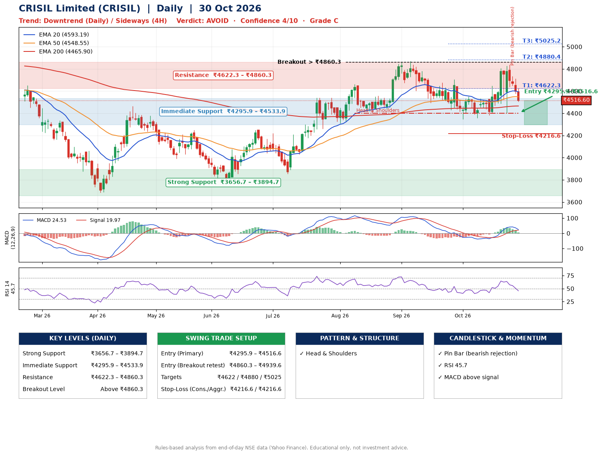

📌 **CRISIL Limited (CRISIL) – Multi-Timeframe Technical Analysis (Daily + 4H Combined)**
_Data up to 30 Oct 2026 · Close ₹4516.60_

**📍 Daily Timeframe Trend**
- Trend: **Downtrend** (lower highs and lower lows)
- Recent swing highs: ₹4662.0, ₹4872.0, ₹4706.2 · swing lows: ₹4401.2, ₹4494.2, ₹4345.0
- EMAs: EMA20 ₹4593.2, EMA50 ₹4548.5, EMA200 ₹4465.9; bullish stack (EMA20 > EMA50 > EMA200); price above EMA200
- MACD 24.53 above signal 19.97 (above zero); histogram falling
- RSI(14) 45.7; no divergence on the last two swings

**📍 4-Hour Timeframe Trend**
- Structure: **Sideways** (mixed swing structure)
- Pullback/support area: recent 4H swing lows ₹4381.9, ₹4402.6; EMA20 ₹4608.1
- EMA20/50: bullish stack (EMA20 > EMA50); price below all EMAs
- MACD 18.64 below signal 38.72 (above zero), fresh bearish crossover; histogram falling
- RSI(14) 45.2; Regular bearish divergence

**📍 Pattern Detection (Both Timeframes)**
- Daily: **Head & Shoulders** – head ₹4872.0, neckline ₹4401.2
- 4H: **Double Bottom** – bottoms near ₹4381.9/₹4402.6, neckline ₹4805.0, forming

**📍 Candlestick Patterns (last 3 daily candles)**
- **Pin Bar (bearish rejection)** – 28 Oct: long upper wick shows selling near ₹4734.4

**📍 Price Action Key Levels (Daily Structure)**

| Zone | Price Level (₹) | Context |
|------|-----------------|---------|
| Strong Support | ₹3656.7 – ₹3894.7 | Cluster of earlier swing lows (demand) |
| Immediate Support | ₹4295.9 – ₹4533.9 | Nearest swing-low / wick area |
| Resistance | ₹4622.3 – ₹4860.3 | Nearest swing-high supply |
| Breakout Level | Above ₹4860.3 | Swing continuation trigger (52-week high ₹5064.9) |

**📍 Swing Trade Setup**

🟢 **Entry Zone**
- Primary: ₹4295.9 – ₹4516.6 (daily support / EMA20 area; enter on a bullish 4H candle)
- Alternate: ₹4860.3 – ₹4939.6 (breakout retest)

🎯 **Profit Targets**
- T1: ₹4622.3
- T2: ₹4880.4
- T3: ₹5025.2

🛑 **Stop-Loss**
- Conservative: below daily swing low (₹4216.6)
- Aggressive: below 4H structure (₹4216.6)
- Risk per share ≈ ₹189.7; reward:risk to T1 ≈ 1.1

**📌 Strategy Notes**
- Higher timeframe: daily trend is downtrend; only take longs while price holds above ₹3656.7.
- Entry timing: wait for a bullish 4H candle (engulfing/hammer) inside ₹4295.9 – ₹4516.6 rather than buying mid-range.
- EMA stacking: bullish stack (EMA20 > EMA50 > EMA200); price above EMA200.
- Breakout rule: a daily close above ₹4860.3 with volume above its 20-day average (≈42,397) opens T2/T3.
- Momentum: RSI 46 – room to run; no divergence on the last two swings.
- Exit discipline: move the stop to entry once T1 is hit; book partial profits at each target.

**STEP 2 — Marked Up Chart**

**✅ Trade Validation Checklist**
- Trend + momentum aligned: No · Price at entry zone: Yes
- Stop defined (₹4216.6) · Reward:risk ≥ 1.5 to T1: No

## 📌 Final Verdict

Recommendation: **🔴 AVOID**

Confidence: **4/10**

Trade Quality: **C**

Reason:
• Daily downtrend (lower highs and lower lows)
• EMAs stacked bullishly

Next Action:
• Avoid until the trend changes (reclaim EMA50 and a higher low)

_Rules-based analysis from end-of-day data. Educational only, not investment advice. Never place orders without your own confirmation._